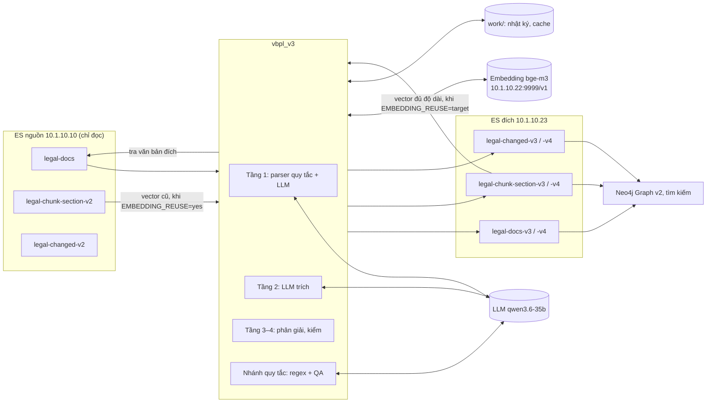

# 1. Kiến trúc

## 1.1. Mục đích

`vbpl_v3` chuyển kho văn bản pháp luật từ v2 sang v3.

- Công cụ đọc 3 index v2 trên ES nguồn.
- Công cụ dựng lại cấu trúc, chunk, quan hệ và metadata pháp lý.
- Công cụ ghi kết quả vào 3 index trên ES đích: `-v4` để thử, `-v3` sau khi duyệt.

Ba phiên bản dữ liệu và khác biệt của chúng ở [05](05-phien-ban-v2-v3-v4.md). Từ 20/10/2026, công cụ dò quan hệ bằng luồng 4 tầng (chế độ `llm`). Tài liệu này mô tả code ở commit `1117e63` (27/10/2026). Code này ghi index `-v4` ngày 27–28/10/2026.

Công cụ chạy độc lập. Công cụ không dùng code, `.env`, PostgreSQL, MinIO hay cache của luồng realtime. Công cụ không sửa luồng realtime.

## 1.2. Sơ đồ ngữ cảnh

- `legal-changed-v2` không là đầu vào. Công cụ dò lại mọi quan hệ từ toàn văn.
- Công cụ đọc `legal-chunk-section-v2` chỉ để dùng lại vector cũ, khi `EMBEDDING_REUSE=yes`.
- Khi ghi lại `-v4` (`EMBEDDING_REUSE=target`), công cụ đọc vector của chính index chunk đích (mục 1.6).

## 1.3. Thành phần

| Module | Vai trò | Dịch vụ ngoài |
| --- | --- | --- |
| `__main__.py` | Dòng lệnh: `check`, `init`, `convert`, `report`, `analyze`. Tham số chung `--env <file>`. | — |
| `config.py` | Đọc `.env`. Kiểm URL, tên index và tổ hợp biến embedding (mục 1.6). | — |
| `es.py` | Client ES. Chặn mọi lệnh ghi lên nguồn. Chỉ cho ghi 3 index đích. | ES |
| `convert.py` | Điều phối một lượt và một văn bản. Gộp nhánh LLM và nhánh quy tắc. Chuẩn hóa vị trí. Bỏ cạnh lặp (`distinct_edges`). Chạy song song. Làm tiếp khi bị ngắt. | ES |
| `structure.py` | Parser quy tắc: phần đầu, căn cứ, lời dẫn, Điều, khoản, điểm, tiểu điểm, Nơi nhận, phụ lục. Dựng chunk. Chia phụ lục và đề mục dài thành đoạn tìm kiếm (`phu_luc_doan` 300 từ, `muc_doan` 150 từ). | — |
| `structure_ai.py` | Hybrid: hỏi model LLM ca mơ hồ. Kiểm câu trả lời trước khi áp dụng. | Server LLM |
| `extract.py` | Tầng 2: chọn đơn vị có từ chỉ hành động, gom ngữ cảnh (câu dẫn, tên Điều, dòng bảng, danh sách kèm theo), hỏi LLM, nhận JSON trung gian. Hỏi đơn vị nêu danh sách dài theo phần (`list_parts`). | Server LLM |
| `resolver.py` | Tầng 3: đổi văn bản đích và vị trí nguyên văn sang định dạng hợp đồng. Không đoán. Quy ước phụ lục (`appendix_scope`, `body_place`). | — |
| `governance.py` | Tầng 4: tìm câu thực hiện hành động theo cấu trúc, bằng chứng nhiều đoạn, vai trò của ngoặc kép, đối tượng của mục danh sách. | — |
| `validate.py` | Tầng 4: kiểm câu trích, động từ, ngoặc kép, tên danh mục, ghi chú lịch sử, dòng bảng, thẩm quyền. Loại hoặc để chờ duyệt. Kiểm vị trí lần nữa sau khi gộp (`check_positions`). Đặt `evidence` là câu nguyên văn của chính đơn vị (`own_quotes`). | — |
| `prompts/*.txt` | Prompt của LLM: trích quan hệ, dàn ý, bố cục, tên Điều, QA. | — |
| `relations.py` | Nhánh quy tắc: dò ứng viên quan hệ và quan hệ hợp nhất. Khớp văn bản đích. | ES |
| `references.py` | Quan hệ hướng dẫn. Dẫn chiếu trong chunk (`dan_chieu`). Tra luật nêu bằng tên. | ES |
| `qa.py` | Nhánh quy tắc: QA ứng viên quan hệ và phạm vi. | Server LLM |
| `temporal.py` | Ngày hiệu lực. Tách vị trí. Ý nghĩa thời gian của quan hệ. | — |
| `legal_status.py` | `la_vbqppl`, `cap_hieu_luc`, ngày hết hiệu lực, hồi tố, ngày hiệu lực riêng của từng Điều, khoản, điểm. | — |
| `text.py` | Khóa số hiệu, khóa cơ quan, nhận diện hành động, kiểm dẫn chứng. Ghép chữ tách âm (`join_split`). | — |
| `llm.py` | Gọi model LLM (API kiểu OpenAI). Kiểm JSON. Lưu cache câu trả lời hợp lệ. Cổng giới hạn số lời gọi cùng lúc theo giờ. Chạy lại chặt (`LLM_REPLAY=strict`). | Server LLM |
| `embedding.py` | Gọi `bge-m3` qua một trong hai loại dịch vụ: API kiểu OpenAI (`POST /v1/embeddings`) hoặc dịch vụ cũ (`POST /embed`). Kiểm vector 1.024 chiều. | Embedding |
| `report.py` | So nguồn với 3 index đích cho một lượt. Chỉ đọc. | ES |
| `analyze.py` | Đo độ phủ metadata trên nguồn. Chỉ đọc. Không gọi model, không gọi embedding. | ES |
| `mappings/*.json` | Settings và mapping của 3 index. Dùng cho `-v3` và `-v4`. | — |

Các phần sau không thuộc image Docker và không thuộc luồng chạy:

| Thư mục | Vai trò | Đọc hay ghi |
| --- | --- | --- |
| `eval/` | Đánh giá theo đợt: lấy mẫu, gói gán nhãn, chấm, chạy lại chặt, kiểm hợp đồng. Cách dùng ở [`eval/README.md`](../eval/README.md). | Đọc `work/<run>/`, ES nguồn, ES đích (`check_contract`). Ghi `eval/sets/`, `eval/packets/`, `work/`. Không ghi ES. |
| `tests/` | Kiểm thử đơn vị. Không gọi dịch vụ ngoài. | — |
| `docs/` | Tài liệu này. | — |
| `frontend/` | Trang đánh giá thủ công: 50 văn bản `-v4` ngẫu nhiên đặt cạnh bản gốc. Chạy `python3 frontend/server.py`. Không đưa vào git. | Đọc ES nguồn, ES đích. Không ghi ES. |
| `statistic/` | Thống kê độ phủ quan hệ toàn kho. Không đưa vào git. | — |

## 1.4. Nguyên tắc thiết kế

1. **Mỗi tầng một loại lỗi.** Quy tắc tách cấu trúc. LLM đọc nghĩa của câu. Code phân giải và kiểm. Mỗi tầng kiểm thử riêng được.
2. **Model không tạo ID và không tạo chữ.** Ở tầng cấu trúc, model chỉ trả số dòng hoặc giá trị đóng. Ở tầng trích, model trả câu trích nguyên văn; code đổi câu đó sang ID và vị trí.
3. **Ca khó thì định nghĩa cho LLM, không ép regex.** Với cách viết mới, công cụ thêm định nghĩa vào prompt. Regex chỉ giữ việc chắc chắn: số hiệu, vị trí, câu trích có trong nguồn.
4. **Code kiểm mọi câu trả lời.** Câu trả lời sai schema thì công cụ hỏi lại tối đa 2–3 lần. Vẫn sai thì công cụ giữ kết quả quy tắc và ghi cảnh báo.
5. **Dẫn chứng phải có thật.** Dẫn chứng của model phải có nguyên văn trong văn bản nguồn. Không có thì công cụ loại đề xuất.
6. **Không đoán.** Không đủ căn cứ thì công cụ để `null` hoặc `unresolved` và ghi lý do. Ví dụ: `can_kiem`, `chua_xac_dinh`, `phan_kem_theo_chua_ro`.
7. **Chỉ tác động trực tiếp.** Công cụ chỉ lưu tác động câu chữ nêu. Công cụ không suy ra tác động lên đơn vị cha, đơn vị con hay văn bản khác.
8. **Văn bản là đơn vị độc lập.** Ghi lại một văn bản chỉ thay chunk và quan hệ của chính văn bản đó.
9. **Làm tiếp được.** Nhật ký và cache nằm ở `work/<run>/`. Chạy lại cùng lượt thì công cụ bỏ qua phần đã xong.

## 1.5. An toàn dữ liệu

| Lớp bảo vệ | Cơ chế | Code |
| --- | --- | --- |
| ES nguồn chỉ đọc | Client nguồn không có index ghi được. Client chỉ cho `GET`, `HEAD`, `POST` tới `_search`, `_count`, `_mget`, scroll. Lệnh khác bị từ chối trước khi gửi. | `es.py` `Cluster.allowed` |
| ES đích chỉ 3 index | Client đích chỉ ghi được 3 index cấu hình. Lệnh bulk có một dòng sang index khác thì bị từ chối cả lệnh. | `es.py` `Cluster.allowed` |
| Không xóa index | `DELETE` chỉ được dùng cho scroll. Công cụ xóa chunk và quan hệ cũ bằng `_delete_by_query` theo `doc_id` hoặc `source_id`. | `es.py` `remove_group` |
| Tên index đích | 3 tên khác nhau, cùng đuôi `-v3`, hoặc cùng đuôi `-v4` (bản thử). Không tên nào trùng `legal-docs`, `legal-chunk-section-v2`, `legal-changed-v2`. | `config.py` `Config.validate` |
| Mapping | `init` chỉ thêm trường mới. `init` không sửa trường đã có. | `__main__.py` `init` |
| Quay lại | Xóa tay 3 index v3 (Kibana hoặc `curl -X DELETE`). Chạy `init`. Dữ liệu nguồn không đổi. | — |

ES nguồn và ES đích có thể là một cụm. Khi đó tên index đích phải khác tên index nguồn.

## 1.6. Cấu hình (`.env`)

Chép `.env.example` thành `.env`. Đặt quyền `600`. Không đặt dấu nháy quanh giá trị: `docker --env-file` không bỏ dấu nháy.

- Công cụ đọc `data_vbpl_v3/.env`, hoặc file nêu ở `--env <file>`.
- Biến của shell thắng giá trị trong `.env`. Vì vậy `export TARGET_*_INDEX=…-v4` đổi index đích mà không sửa `.env` ([02, "Ghi thử vào v4"](02-luong-hoat-dong.md#ghi-thử-vào-v4-trước-khi-ghi-lại-v3)).
- Bảng dưới đối chiếu với `.env.example` và code ngày 28/10/2026.
- Script của một lượt có thể nạp thêm biến. Ví dụ: hai lượt đêm 27/10/2026 nạp `work/.embedding.env` ([02, mục 2.1.2](02-luong-hoat-dong.md#212-quy-trình-một-đợt-chuyển-đổi)).

| Biến | Mặc định | Nghĩa |
| --- | --- | --- |
| `SOURCE_ES_URL` | — (bắt buộc) | URL ES nguồn. Dạng `http(s)://host:port`. |
| `SOURCE_DOCUMENT_INDEX`, `SOURCE_CHUNK_INDEX`, `SOURCE_CHANGE_INDEX` | `legal-docs`, `legal-chunk-section-v2`, `legal-changed-v2` | Tên 3 index nguồn. |
| `TARGET_ES_URL` | — (bắt buộc) | URL ES đích. |
| `TARGET_DOCUMENT_INDEX`, `TARGET_CHUNK_INDEX`, `TARGET_CHANGE_INDEX` | `legal-docs-v3`, `legal-chunk-section-v3`, `legal-changed-v3` | Tên 3 index đích. Cùng đuôi `-v3`, hoặc cùng đuôi `-v4` để ghi thử ([02, "Ghi thử vào v4"](02-luong-hoat-dong.md#ghi-thử-vào-v4-trước-khi-ghi-lại-v3)). |
| `LITELLM_BASE_URL`, `LITELLM_API_KEY`, `LITELLM_MODEL` | `http://100.91.202.88:8012/v1`, `EMPTY`, `qwen3.6-35b` (giá trị trong `.env.example`; code không có mặc định) | Server LLM, API kiểu OpenAI. Ngày 28/10/2026: SGLang trên máy `dell-ai`, 1 GPU, qua mạng Tailscale (mục 1.8). Khóa cache gồm tên model: đổi model thì không dùng lại câu trả lời cũ. **Bí mật:** `LITELLM_API_KEY` khi server cần khóa. |
| `LLM_CONCURRENCY_DAY`, `LLM_CONCURRENCY_NIGHT`, `LLM_NIGHT_HOURS` | `3`, `10`, `22-6` | Số lời gọi LLM cùng lúc **trong mỗi tiến trình**: 3 ban ngày, 10 từ 22h đến 6h. Lời gọi đang chờ đọc lại giờ, nên lượt chạy qua 22h tự tăng lên 10. Chỉ chạy một tiến trình gọi model một lúc. Lượt `v4-next20000` (27/10/2026) đặt `LLM_CONCURRENCY_NIGHT=20` theo cho phép của người dùng. |
| `LLM_MAX_TOKENS`, `LLM_TIMEOUT_CONNECT`, `LLM_TIMEOUT_READ`, `LLM_MIN_TOKENS_PER_SECOND` | `4000`, `5`, `30`, `20` | Trần `max_tokens`. Timeout kết nối 5 s. Timeout đọc 30 s; câu trả lời có thể dài thì `max_tokens / 20` giây (ví dụ 2000 token: 100 s). Không giảm `LLM_MAX_TOKENS`: danh sách dài cần đủ token. |
| `LLM_CONNECT_RETRY_WAITS` | `10,20,40,60,90` | Server từ chối kết nối khi bận: công cụ chờ lần lượt các số giây này rồi thử lại. |
| `LLM_REPLAY` | — (`.env.example` có dòng mẫu đã chú thích) | `strict`: chạy lại chặt. Công cụ không gọi model. Câu trả lời đã lưu bị thiếu thì văn bản lỗi (`ReplayMiss`); `eval.replay` đếm vào `replay_misses`. Chỉ đặt cho một lần chạy, không đặt trong `.env`. |
| `RELATION_EXTRACTOR` | `llm` | Cách dò quan hệ. `llm`: luồng 4 tầng, luồng chốt 20/10/2026. `rules`: regex và QA (cách của v3). Tham số `--extractor` ghi đè biến này. |
| `START_YEAR` | `1980` (1000..2999) | Công cụ chỉ chuyển văn bản có ngày ký, ngày ban hành hoặc ngày hiệu lực từ 1/1 của năm này. Công cụ bỏ qua văn bản sớm hơn, nhật ký ghi `skipped = truoc_nam_bat_dau`. Công cụ kiểm trước mọi lời gọi model. Công cụ cũng bỏ qua văn bản có toàn văn tiếng Anh (`skipped = tieng_anh`): chưa tới 2% chữ có dấu tiếng Việt trong 20.000 ký tự đầu. |
| `EMBEDDING_URL` | — (bắt buộc cho `convert`) | Dịch vụ `bge-m3`, 1.024 chiều. URL kết thúc bằng `/v1`: API kiểu OpenAI. URL khác: dịch vụ cũ (`POST /embed`), cắt ở 256 token. Ngày 28/10/2026, các lượt ghi `-v4` dùng `http://10.1.10.22:9999/v1`. |
| `EMBEDDING_KEY`, `EMBEDDING_MODEL` | trống, `bge-m3` | Khóa và tên model của API kiểu OpenAI. `check` kiểm `GET /v1/models` có `EMBEDDING_MODEL`. **Bí mật:** `EMBEDDING_KEY`. |
| `EMBEDDING_TRUNCATE` | trống (0..8192) | Chỉ cho API kiểu OpenAI. Trống: embed cả chunk, server cắt ở 8.192 token. `256`: cùng không gian với vector của v2 và v3. |
| `EMBEDDING_BATCH` | `64` (1..512) | Số chuỗi trong một lần gọi embedding. `.env.example` khuyên 32–48 cho API kiểu OpenAI. |
| `EMBEDDING_REUSE` | `yes` | Chunk có cùng chuỗi `tieu_de + " " + noi_dung` với một chunk đã có vector thì dùng lại vector đó. `yes`: vector của chunk nguồn v2. `target`: vector của index chunk đích. `no`: không dùng lại. |
| `V3_WORKDIR` | `work` | Thư mục nhật ký và cache. Đường dẫn tương đối tính từ `data_vbpl_v3/`. Image Docker đặt `/app/work`. |
| `QA_MAX_TOKENS`, `QA_SCOPE_MAX_TOKENS` | `512` (128..4096), `1024` (256..4096) | Giới hạn độ dài câu trả lời QA. |

Vector của chunk nguồn v2 là vector của 256 token đầu. Vector của `-v4` là vector của cả chunk: ngày 26/10/2026, bên dữ liệu embed lại toàn bộ `-v4`. `config.py` từ chối tổ hợp trộn hai loại vector:

| `EMBEDDING_REUSE` | Điều kiện `config.py` kiểm | Dùng khi |
| --- | --- | --- |
| `yes` | API kiểu OpenAI thì `EMBEDDING_TRUNCATE=256`. Dịch vụ cũ thì không kiểm. | Ghi vector 256 token, như v2 và v3. Kiểm thêm bằng `check --vectors 50`. |
| `target` | API kiểu OpenAI và `EMBEDDING_TRUNCATE` trống. | Ghi lại văn bản đã có trong `-v4`. Chunk không đổi chữ giữ vector đang có. Chỉ chunk mới hoặc đổi chữ gọi API. |
| `no` | Không kiểm. | Văn bản mới vào `-v4`, vector đủ độ dài. |

- Lượt `v4-next20000` (văn bản mới, 27/10/2026) đặt `EMBEDDING_REUSE=no`. Lượt `v4-2710` (ghi lại, 28/10/2026) đặt `EMBEDDING_REUSE=target`.
- `.env` dùng chung vẫn để dịch vụ cũ (28/10/2026). Script của lượt nạp `work/.embedding.env` để đổi sang API kiểu OpenAI.
- Ngày 09/10/2026, `check --vectors 50` với dịch vụ cũ cho 40/40 chunk cosine 1,0.

## 1.7. Lưu trữ cục bộ (`work/`, `bernmark/`)

| Đường dẫn | Nội dung |
| --- | --- |
| `work/<run>/run.json` | Cấu hình lượt: `run_id`, URL nguồn, URL đích, index đích, cách chọn văn bản. |
| `work/<run>/ids.json` | Danh sách ID đã chọn. Công cụ tạo một lần. Lần chạy sau bỏ qua `--sample`, `--ids`, `--all`. |
| `work/<run>/documents.jsonl` | Một dòng cho mỗi văn bản xong, kể cả văn bản bị bỏ qua (`skipped`). Dòng mới nhất của một ID có hiệu lực. |
| `work/<run>/failures.jsonl` | Văn bản lỗi, kèm thông báo lỗi. Công cụ ghi nối tiếp. |
| `work/<run>/summary.json` | Tổng kết lần chạy gần nhất. |
| `work/<run>/review.jsonl` | Quan hệ `cap_quan_he = chua_xac_dinh`. Cần rà tay. |
| `work/<run>/report.txt` | Kết quả lệnh `report`. |
| `work/<run>/dry-run/<id>.json` | Kết quả `--dry-run`. Không có `embedding`, `full_content`. Bộ chấm đọc thư mục này. |
| `work/<run>/cache/<id>/structure_ai/` | Câu hỏi và câu trả lời hybrid (tên Điều, bố cục). |
| `work/<run>/qa/<id>/` | Câu trả lời QA quan hệ và QA phạm vi (nhánh quy tắc). |
| `work/<run>/extract/<id>/` | Câu hỏi và câu trả lời của tầng 2. `rejected.json`: hàng tầng 4 loại, kèm lý do. `evidence.json`: bằng chứng của hàng còn giữ. |
| `work/<run>/replay.json` | Kết quả của `eval.replay`: số văn bản lỗi, `replay_misses`, `structure_fallbacks`. |
| `work/number-index-<index>.json.gz` | Bảng số hiệu cục bộ của `legal-docs` nguồn ([02, mục 2.5.3](02-luong-hoat-dong.md#253-khớp-văn-bản-đích)). |
| `work/analyze-<name>/` | Kết quả `analyze`: `summary.json`, `documents.jsonl`, `failures.json`. |

- Cache chỉ lưu câu trả lời đã qua kiểm tra. Chạy lại không gọi model cho câu hỏi giống hệt.
- Khóa cache gồm prompt, đầu vào gửi model và tên model. Sửa prompt thì mọi câu trả lời đã lưu hết hiệu lực.
- **Dữ liệu nhạy cảm:** `llm_response.json` chứa toàn văn gửi đi và câu trả lời model. `work/` không đưa vào git và không đưa vào image Docker.
- Dung lượng, chế độ `rules`: khoảng 35 MB cho 1.000 văn bản (09/10/2026).
- Dung lượng, chế độ `llm` (đo 28/10/2026, không có `dry-run/`): lượt `v4-next20000` (20.000 văn bản mới) chiếm 4,5 GB, trong đó `extract/` 3,2 GB, `qa/` 726 MB, `cache/` 547 MB. Lượt `v4-2710` (ghi lại 11.000 văn bản) chiếm 2,9 GB.
- Ước một đợt 10.000 văn bản mới: khoảng 2,3 GB, theo lượt `v4-next20000`.

Các file ở gốc `work/` cho một lượt chạy bằng script:

| Đường dẫn | Nội dung |
| --- | --- |
| `work/run-<lượt>.sh` | Script của lượt: biến môi trường, `init`, `convert`, chạy lại văn bản lỗi. Ví dụ `work/run-v4-next20000.sh`, `work/run-v4-2710.sh`. |
| `work/<lượt>-ids.txt` | Danh sách ID đưa vào `--ids`. |
| `work/<lượt>.time` | Giờ bắt đầu, giờ xong, commit code, kết quả `init`. |
| `work/<lượt>.log`, `work/<lượt>-retry.log` | Nhật ký lượt chính và lần chạy lại văn bản lỗi. |
| `work/.embedding.env` | `EMBEDDING_URL`, `EMBEDDING_KEY` của API kiểu OpenAI. **Bí mật.** |

Ngày 28/10/2026, sau khi dọn, `work/` còn 8,8 GB. Các thư mục lượt cần giữ:

| Thư mục | Lý do giữ |
| --- | --- |
| `work/v4-next20000`, `work/v4-2710` | Câu trả lời model đã lưu. Lượt ghi lại sau dùng lại chúng. |
| `work/v4-next20000-dry` | Kết quả chạy lại chặt của mẫu chấm đợt 20.000. Dùng để chấm lại. |
| `work/v3-32` | Manifest để gỡ 32 văn bản đã ghi v3 ngày 27/10/2026 (`work/v3-32/manifest.json`). |
| `work/toan-kho-1100` | Mẫu 1.100 văn bản cho thống kê toàn kho. |

**Thư mục `bernmark/`** (từ ngày 26/10/2026) giữ kết quả benchmark và cache model cũ, khoảng 4,6 GB (đo 28/10/2026). Thư mục không đưa vào git (`.gitignore`) và không đưa vào image.

| Đường dẫn | Nội dung |
| --- | --- |
| `bernmark/cache/<lượt>` | Cache model của các lượt cần giữ, ví dụ `v4-2210`, `H56-C`, các lượt gốc của `eval.round`. Lượt `v4-2710` chép cache của `v4-2210` từ đây. |
| `work/<lượt>` | Symlink tới `bernmark/cache/<lượt>`. Lệnh cũ (`eval.round`, `eval.replay`, script ghi v4) vẫn chạy như trước. |
| `bernmark/ho300/` | Hold-out 300: danh sách, nhãn agent, kết quả chấm, file duyệt `duyet_ho300.csv`. |
| `bernmark/fix3/` | Script và bảng kết quả của các vòng sửa 26–27/10/2026. |
| `bernmark/ket-qua/` | Kết quả chấm đã nén. Danh sách lượt trong `danh_sach.json`. |
| `bernmark/bm-8docs/` | Benchmark 8 văn bản, so sánh hai model. |
| `bernmark/README-luu-tru.md` | Mô tả từng thư mục và lý do giữ. |

- Ngày 26/10/2026, việc dọn `work/` sang `bernmark/` giải phóng 11 GB.
- Không xóa thư mục trong `bernmark/cache/` khi symlink ở `work/` còn dùng.

## 1.8. Triển khai

Chỉ luồng chính được triển khai. Image Docker chỉ chứa `vbpl_v3/` và thư viện. `eval/`, `tests/`, `docs/`, `work/`, `bernmark/`, `frontend/`, `statistic/` không vào image.

| Cách | Lệnh |
| --- | --- |
| Python 3.10+ | `python3 -m venv .venv`, `.venv/bin/pip install -r requirements.txt`, `.venv/bin/python -m vbpl_v3 <lệnh>` |
| Docker | `docker build -t vbpl-v3 .`, `docker run --rm --env-file .env -v "$PWD/work:/app/work" vbpl-v3 <lệnh>` |

| File | Nội dung |
| --- | --- |
| `Dockerfile` | Image gốc `python:3.12-slim`. Chép `requirements.txt` và `vbpl_v3/`. `ENV V3_WORKDIR=/app/work`. `ENTRYPOINT ["python", "-m", "vbpl_v3"]`. |
| `.dockerignore` | Danh sách cho phép: `*`, `!requirements.txt`, `!vbpl_v3/`. Build context chỉ có 2 mục này. File này bỏ thêm `__pycache__` và file `.pyc`. |
| `.gitignore` (28/10/2026) | Bỏ qua `.env`, `.env.*` (trừ `.env.example`), `work/`, `*.log`, `archive/`, `frontend/`, `/statistic/`, `eval/gold/toan-kho-1100-*/`, `eval/sets/toan-kho-1100-*`, `/loi_du_lieu_v4_*.md`, `/format_survey_local/`, `/bernmark/`, `/*.xlsx`, `/*.csv`, `.~lock.*#`, `eval/packets/`, `eval/tmp/`, `eval/adjudication/`, `.venv/`. |

- Thư viện: `requests`, `python-dotenv`.
- Cấu hình đi qua `--env-file`. Image không chứa `.env`.
- Nhật ký và cache model nằm ở `/app/work`. Gắn thư mục này từ máy chủ.
- Lệnh `eval` chạy bằng Python cục bộ, không chạy trong image.

**Mã nguồn.** Kho git có remote `origin` = https://github.com/Vuminhnhat11224897/data_conversion. Nhánh cục bộ `master` ứng với `origin/main`. Đẩy code bằng `git push origin master:main`. Ngày 28/10/2026, `origin/main` ở commit `df9d8f1`.

**Mạng.** Công cụ cần đường tới ES nguồn (đọc), ES đích (ghi), server LLM và dịch vụ embedding.

| Đích | Đường đi | Đo |
| --- | --- | --- |
| Server LLM `100.91.202.88:8012` (máy `dell-ai`) | Mạng Tailscale. Máy chạy luồng hiện tại nằm sau NAT, không mở cổng được, nên đường đi qua relay DERP (Singapore). | 77–892 ms (25–26/10/2026). 82–86 ms qua DERP (sin), chưa có đường trực tiếp (`tailscale ping`, 27/10/2026). |
| ES nguồn `10.1.10.10`, ES đích `10.1.10.23`, dịch vụ embedding `10.1.10.22:9999` | VPN `tun0`. Ba đích dùng chung một đường. | Khoảng 2,5 MB/s (27/10/2026). |

- Mỗi văn bản gọi model khoảng 8,4 lần (21–22/10/2026). Vì vậy độ trễ mạng cộng vào mọi văn bản.
- Chạy luồng trên máy có đường trực tiếp tới `dell-ai` thì nhanh hơn.
- VPN `tun0` là nút thắt khi ghi ES và gọi embedding. Đêm 27/10/2026, hai lượt chạy cùng lúc gây nhiều lỗi `ConnectionError … timed out`. Chạy một lượt một lúc.

## 1.9. Index v3

Công cụ tạo 3 index v3 trên `10.1.10.23` ngày 09/10/2026 và 3 index `-v4` ngày 14/10/2026. Định nghĩa nằm ở `vbpl_v3/mappings/`. Index `-v4` dùng cùng mapping, chỉ khác tên.

| Index | Shard / bản sao | Lý do |
| --- | --- | --- |
| `legal-docs-v3` | 1 / 0 | Một văn bản là một bản ghi. Kích thước nhỏ. |
| `legal-chunk-section-v3` | 4 / 0 | Nguồn dồn hơn 115 GB vào 1 shard. v3 chia 4 shard. |
| `legal-changed-v3` | 1 / 0 | Kích thước nhỏ. |

- Bản sao bằng 0 vì cụm `10.1.10.23` có 1 node.
- Ngày 09/10/2026, node còn trống khoảng 620 GB. v3 toàn kho dự kiến khoảng 135 GB.
- Mapping có `_meta.contract = v3` và `_meta.copied_mapping_from` là index nguồn tương ứng.
- Ngày 27/10/2026, `init` thêm 3 trường vào `legal-chunk-section-v4`: `loai_phan`, `muc_uid`, `phu_luc_uid`. Ngày 28/10/2026, `legal-chunk-section-v3` chưa có 3 trường này.
- Ngày 28/10/2026, `legal-chunk-section-v4` có 1.534.375 chunk, chiếm 33,9 GB.
