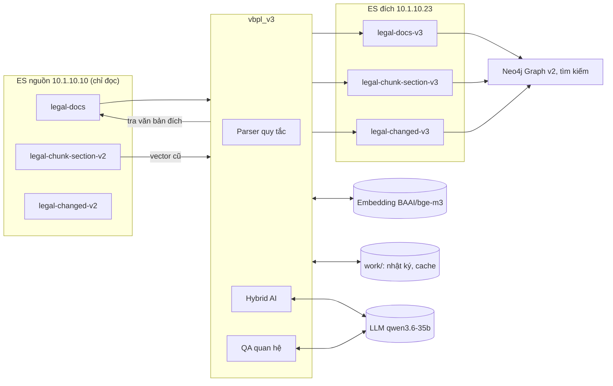

# 1. Kiến trúc

## 1.1. Mục đích

`vbpl_v3` chuyển kho văn bản pháp luật từ v2 sang v3.

- Công cụ đọc 3 index v2 trên ES nguồn.
- Công cụ dựng lại cấu trúc, chunk, quan hệ và metadata pháp lý.
- Công cụ ghi kết quả vào 3 index v3 trên ES đích.

Công cụ chạy độc lập. Công cụ không dùng code, `.env`, PostgreSQL, MinIO hay cache của luồng realtime. Công cụ không sửa luồng realtime.

## 1.2. Sơ đồ ngữ cảnh

- `legal-changed-v2` không là đầu vào. Công cụ dò lại mọi quan hệ từ toàn văn.
- Công cụ đọc `legal-chunk-section-v2` chỉ để dùng lại vector cũ.

## 1.3. Thành phần

| Module | Vai trò | Dịch vụ ngoài |
| --- | --- | --- |
| `__main__.py` | Dòng lệnh: `check`, `init`, `convert`, `report`, `analyze`. | — |
| `config.py` | Đọc `.env`. Kiểm URL và tên index. | — |
| `es.py` | Client ES. Chặn mọi lệnh ghi lên nguồn. Chỉ cho ghi 3 index đích. | ES |
| `convert.py` | Điều phối một lượt và một văn bản. Chạy song song. Làm tiếp khi bị ngắt. | ES |
| `structure.py` | Parser quy tắc: phần đầu, căn cứ, lời dẫn, Điều, khoản, điểm, tiểu điểm, Nơi nhận, phụ lục. Dựng chunk. | — |
| `structure_ai.py` | Hybrid: hỏi model LLM ca mơ hồ. Kiểm câu trả lời trước khi áp dụng. | LiteLLM |
| `relations.py` | Dò ứng viên quan hệ và quan hệ hợp nhất. Khớp văn bản đích. | — |
| `references.py` | Quan hệ hướng dẫn. Dẫn chiếu trong chunk (`dan_chieu`). Tra luật nêu bằng tên. | ES |
| `qa.py` | QA ứng viên quan hệ và phạm vi. | LiteLLM |
| `temporal.py` | Ngày hiệu lực. Tách vị trí. Ý nghĩa thời gian của quan hệ. | — |
| `legal_status.py` | `la_vbqppl`, `cap_hieu_luc`, ngày hết hiệu lực, hồi tố, ngày hiệu lực riêng của từng Điều, khoản, điểm. | — |
| `text.py` | Khóa số hiệu, khóa cơ quan, nhận diện hành động, kiểm dẫn chứng. | — |
| `llm.py` | Gọi model LLM (API kiểu OpenAI). Kiểm JSON. Lưu cache câu trả lời hợp lệ. Giới hạn số lời gọi cùng lúc theo giờ. | LiteLLM |
| `embedding.py` | Gọi `BAAI/bge-m3`. Kiểm vector 1.024 chiều. | Embedding |
| `report.py` | So nguồn với v3 cho một lượt. Chỉ đọc. | ES |
| `analyze.py` | Đo độ phủ metadata trên nguồn. Chỉ đọc. Không gọi model, không gọi embedding. | ES |
| `mappings/*.json` | Settings và mapping của 3 index v3. | — |

## 1.4. Nguyên tắc thiết kế

1. **Quy tắc quyết định.** Parser quy tắc xử lý mọi văn bản. Model LLM chỉ xử lý ca có tín hiệu rõ.
2. **Model không viết dữ liệu.** Model trả số dòng hoặc giá trị đóng (`true`/`false`). Code lấy chữ từ chính văn bản.
3. **Code kiểm mọi câu trả lời.** Câu trả lời sai schema thì công cụ hỏi lại tối đa 2–3 lần. Vẫn sai thì công cụ giữ kết quả quy tắc và ghi cảnh báo.
4. **Dẫn chứng phải có thật.** Dẫn chứng của model phải có nguyên văn trong văn bản nguồn. Không có thì công cụ loại đề xuất.
5. **Không đoán.** Không đủ căn cứ thì công cụ để `null` và ghi lý do. Ví dụ: `can_kiem`, `khong_tim_thay`, `chua_xac_dinh`.
6. **Chỉ tác động trực tiếp.** Công cụ chỉ lưu tác động câu chữ nêu. Công cụ không suy ra tác động lên đơn vị cha, đơn vị con hay văn bản khác.
7. **Văn bản là đơn vị độc lập.** Ghi lại một văn bản chỉ thay chunk và quan hệ của chính văn bản đó.
8. **Làm tiếp được.** Nhật ký và cache nằm ở `work/<run>/`. Chạy lại cùng lượt thì công cụ bỏ qua phần đã xong.

## 1.5. An toàn dữ liệu

| Lớp bảo vệ | Cơ chế | Code |
| --- | --- | --- |
| ES nguồn chỉ đọc | Client nguồn không có index ghi được. Client chỉ cho `GET`, `HEAD`, `POST` tới `_search`, `_count`, `_mget`, scroll. Lệnh khác bị từ chối trước khi gửi. | `es.py` `Cluster.allowed` |
| ES đích chỉ 3 index | Client đích chỉ ghi được 3 index cấu hình. Lệnh bulk có một dòng sang index khác thì bị từ chối cả lệnh. | `es.py` `Cluster.allowed` |
| Không xóa index | `DELETE` chỉ được dùng cho scroll. Công cụ xóa chunk và quan hệ cũ bằng `_delete_by_query` theo `doc_id` hoặc `source_id`. | `es.py` `remove_group` |
| Tên index đích | 3 tên khác nhau, cùng đuôi `-v3`, hoặc cùng đuôi `-v4` (bản thử). Không tên nào trùng `legal-docs`, `legal-chunk-section-v2`, `legal-changed-v2`. | `config.py` `Config.validate` |
| Mapping | `init` chỉ thêm trường mới. `init` không sửa trường đã có. | `__main__.py` `init` |
| Quay lại | Xóa tay 3 index v3 (Kibana hoặc `curl -X DELETE`). Chạy `init`. Dữ liệu nguồn không đổi. | — |

ES nguồn và ES đích có thể là một cụm. Khi đó tên index đích phải khác tên index nguồn.

## 1.6. Cấu hình (`.env`)

Chép `.env.example` thành `.env`. Đặt quyền `600`. Không đặt dấu nháy quanh giá trị: `docker --env-file` không bỏ dấu nháy.

| Biến | Mặc định | Nghĩa |
| --- | --- | --- |
| `SOURCE_ES_URL` | — (bắt buộc) | URL ES nguồn. Dạng `http(s)://host:port`. |
| `SOURCE_DOCUMENT_INDEX`, `SOURCE_CHUNK_INDEX`, `SOURCE_CHANGE_INDEX` | `legal-docs`, `legal-chunk-section-v2`, `legal-changed-v2` | Tên 3 index nguồn. |
| `TARGET_ES_URL` | — (bắt buộc) | URL ES đích. |
| `TARGET_DOCUMENT_INDEX`, `TARGET_CHUNK_INDEX`, `TARGET_CHANGE_INDEX` | `legal-docs-v3`, `legal-chunk-section-v3`, `legal-changed-v3` | Tên 3 index đích. Cùng đuôi `-v3`, hoặc cùng đuôi `-v4` để ghi thử (mục 2.1). |
| `LITELLM_BASE_URL`, `LITELLM_API_KEY`, `LITELLM_MODEL` | `http://100.91.202.88:8012/v1`, `EMPTY`, `qwen3.6-35b` | Server LLM Lào Cai (vLLM), từ 15/10/2026. Cache QA và `structure_ai` tách theo tên model: đổi model thì không dùng lại câu trả lời cũ. **Bí mật:** `LITELLM_API_KEY` khi dùng LiteLLM. |
| `LLM_CONCURRENCY_DAY`, `LLM_CONCURRENCY_NIGHT`, `LLM_NIGHT_HOURS` | `3`, `10`, `22-6` | Số lời gọi LLM cùng lúc trong một tiến trình: 3 ban ngày, 10 từ 22h đến 6h. Lời gọi đang chờ đọc lại giờ, nên lượt chạy qua 22h tự tăng lên 10. Chỉ chạy một tiến trình `convert` một lúc. |
| `LLM_MAX_TOKENS`, `LLM_TIMEOUT_CONNECT`, `LLM_TIMEOUT_READ`, `LLM_MIN_TOKENS_PER_SECOND` | `4000`, `5`, `30`, `20` | Trần `max_tokens`. Timeout kết nối 5 s. Timeout đọc 30 s; câu trả lời có thể dài thì `max_tokens / 20` giây (ví dụ 2000 token: 100 s). |
| `EMBEDDING_URL` | — (bắt buộc cho `convert`) | Dịch vụ `BAAI/bge-m3`, 1.024 chiều. |
| `EMBEDDING_BATCH` | `64` (1..512) | Số chuỗi trong một lần gọi embedding. |
| `EMBEDDING_REUSE` | `yes` | `yes`: chunk có cùng chuỗi `tieu_de + " " + noi_dung` với chunk nguồn thì dùng lại vector nguồn. |
| `V3_WORKDIR` | `work` | Thư mục nhật ký và cache. Đường dẫn tương đối tính từ `data_vbpl_v3/`. |
| `QA_MAX_TOKENS`, `QA_SCOPE_MAX_TOKENS` | `512` (128..4096), `1024` (256..4096) | Giới hạn độ dài câu trả lời QA. |

`EMBEDDING_REUSE=yes` chỉ đúng khi dịch vụ embedding giống cấu hình đã tạo vector nguồn. Kiểm bằng `check --vectors 50`. Ngày 09/10/2026: 40/40 chunk có cosine 1,0 (`max_length` 256). Đổi `max_length` thì đặt `EMBEDDING_REUSE=no`.

## 1.7. Lưu trữ cục bộ (`work/`)

| Đường dẫn | Nội dung |
| --- | --- |
| `work/<run>/run.json` | Cấu hình lượt: `run_id`, URL nguồn, URL đích, cách chọn văn bản. |
| `work/<run>/ids.json` | Danh sách ID đã chọn. Công cụ tạo một lần. |
| `work/<run>/documents.jsonl` | Một dòng cho mỗi văn bản xong. Dòng mới nhất của một ID có hiệu lực. |
| `work/<run>/failures.jsonl` | Văn bản lỗi, kèm thông báo lỗi. |
| `work/<run>/summary.json` | Tổng kết lượt. |
| `work/<run>/review.jsonl` | Quan hệ `cap_quan_he = chua_xac_dinh`. Cần rà tay. |
| `work/<run>/report.txt` | Kết quả lệnh `report`. |
| `work/<run>/dry-run/<id>.json` | Kết quả `--dry-run`. Không có `embedding`, `full_content`. |
| `work/<run>/cache/<id>/structure_ai/` | Câu hỏi và câu trả lời hybrid (tên Điều, bố cục). |
| `work/<run>/qa/<id>/` | Câu trả lời QA quan hệ và QA phạm vi. |
| `work/analyze-<name>/` | Kết quả `analyze`: `summary.json`, `documents.jsonl`, `failures.json`. |

- Cache chỉ lưu câu trả lời đã qua kiểm tra. Chạy lại không gọi model cho câu hỏi giống hệt.
- **Dữ liệu nhạy cảm:** `llm_response.json` chứa toàn văn gửi đi và câu trả lời model. `work/` không đưa vào git và không đưa vào image Docker.
- Dung lượng: khoảng 35 MB cho 1.000 văn bản. Toàn kho cần khoảng 18 GB.

## 1.8. Triển khai

| Cách | Lệnh |
| --- | --- |
| Python 3.10+ | `python3 -m venv .venv`, `.venv/bin/pip install -r requirements.txt`, `.venv/bin/python -m vbpl_v3 <lệnh>` |
| Docker | `docker build -t vbpl-v3 .`, `docker run --rm --env-file .env -v "$PWD/work:/app/work" vbpl-v3 <lệnh>` |

- Thư viện: `requests`, `python-dotenv`.
- Image Docker chỉ chứa `vbpl_v3/` và thư viện. Cấu hình đi qua `--env-file`. `work/` gắn từ máy chủ.
- Mạng: ES nguồn (đọc), ES đích (ghi), LiteLLM, dịch vụ embedding.

## 1.9. Index v3

Công cụ tạo 3 index trên `10.1.10.23` ngày 09/10/2026. Định nghĩa nằm ở `vbpl_v3/mappings/`.

| Index | Shard / bản sao | Lý do |
| --- | --- | --- |
| `legal-docs-v3` | 1 / 0 | Một văn bản là một bản ghi. Kích thước nhỏ. |
| `legal-chunk-section-v3` | 4 / 0 | Nguồn dồn hơn 115 GB vào 1 shard. v3 chia 4 shard. |
| `legal-changed-v3` | 1 / 0 | Kích thước nhỏ. |

- Bản sao bằng 0 vì cụm `10.1.10.23` có 1 node.
- Ngày 09/10/2026, node còn trống khoảng 620 GB. v3 toàn kho dự kiến khoảng 135 GB.
- Mapping có `_meta.contract = v3` và `_meta.copied_mapping_from` là index nguồn tương ứng.
