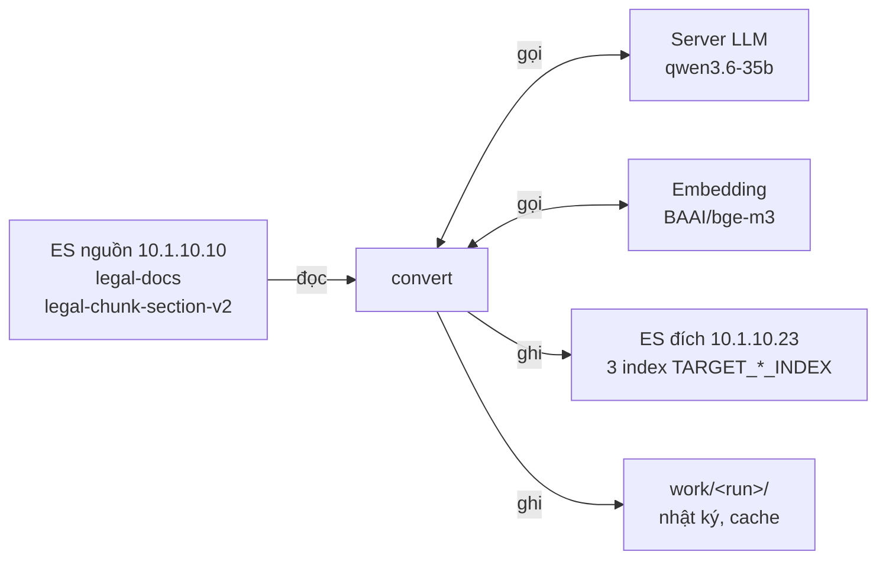
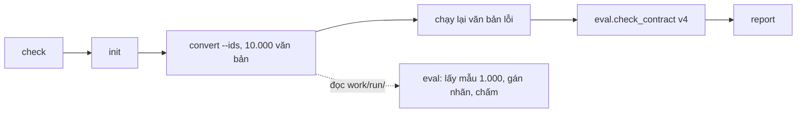
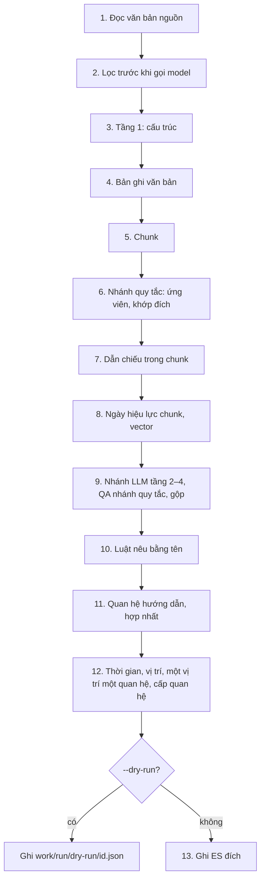

# 2. Luồng hoạt động

Tài liệu này mô tả luồng dữ liệu của công cụ `vbpl_v3`. Dữ liệu đi từ ES nguồn, qua lệnh `convert`, tới 3 index trên ES đích. Hợp đồng của dữ liệu ghi ra ở [09-hop-dong-du-lieu-v4.md](09-hop-dong-du-lieu-v4.md).

- Luồng mô tả ở đây là chế độ `llm` (mặc định), code ở commit `8b023ca` (27/10/2026).
- Dữ liệu `-v4` hiện có do code `2911b77` ghi. Trạng thái ở [09, mục 9.1](09-hop-dong-du-lieu-v4.md#91-trạng-thái-v4).
- Chế độ `rules` chỉ dùng nhánh quy tắc. Chế độ này bỏ tầng 2–4 ở bước 9 (mục 2.4).
- Thư mục `eval/` không thuộc luồng. Cách đánh giá ở [`eval/README.md`](../eval/README.md).
- Mọi số liệu ghi ngày đo.

## 2.1. Tổng quan và quy trình

### 2.1.1. Luồng dữ liệu



| Thành phần | Công cụ dùng để | Đọc hay ghi |
| --- | --- | --- |
| `legal-docs` (ES nguồn) | Lấy văn bản, tra số hiệu văn bản đích, tra luật theo tên | Chỉ đọc |
| `legal-chunk-section-v2` (ES nguồn) | Lấy vector cũ của chunk có chuỗi không đổi | Chỉ đọc |
| `legal-changed-v2` (ES nguồn) | Đếm quan hệ nguồn cho lệnh `report` | Chỉ đọc |
| Server LLM (`LITELLM_BASE_URL`, API kiểu OpenAI) | Tầng 1 (ca mơ hồ của cấu trúc), tầng 2 (trích quan hệ), QA của nhánh quy tắc | Gọi |
| Embedding | Tạo vector cho chunk mới và cho văn bản thiếu vector | Gọi |
| 3 index đích | Ghi văn bản, chunk, quan hệ. Tên index lấy từ `TARGET_DOCUMENT_INDEX`, `TARGET_CHUNK_INDEX`, `TARGET_CHANGE_INDEX`. | Ghi |
| `work/<run>/` | Ghi nhật ký lượt, cache câu trả lời model, bản xem trước của `--dry-run` | Ghi |

### 2.1.2. Quy trình một đợt chuyển đổi

Một **đợt** là một lần thêm 10.000 văn bản mới vào 3 index `-v4`. Một đợt có 2 phần tách riêng:

- Luồng chính (`vbpl_v3`): chạy `convert` cho 10.000 văn bản, chạy lại văn bản lỗi, kiểm hợp đồng.
- Đánh giá (`eval/`): lấy mẫu 1.000 văn bản của đợt, gán nhãn, chấm. Các bước ở [`eval/README.md`](../eval/README.md).

Đánh giá đọc `work/<run>/` và ES nguồn. Đánh giá không ghi ES và không chặn việc ghi đợt.



Chạy các lệnh trong `data_vbpl_v3/` bằng `.venv/bin/python -m vbpl_v3 <lệnh>`. Với Docker, thay bằng `docker run --rm --env-file .env -v "$PWD/work:/app/work" vbpl-v3 <lệnh>`. Lệnh `eval` chỉ chạy bằng `.venv/bin/python -m eval.<lệnh>`: image không có `eval/`.

| Bước của đợt | Lệnh | Ghi ES đích |
| --- | --- | --- |
| 1. Kiểm kết nối | `check` | Không |
| 2. Tạo index hoặc thêm trường mới | `init` | Tạo index chưa có. Thêm trường mới vào index đã có. |
| 3. Chạy luồng | `convert --run <lượt> --ids <file> --limit 10000` | Có |
| 4. Chạy lại văn bản lỗi | `convert --run <lượt> --limit <số văn bản lỗi> --workers 3` (mục 2.6) | Có |
| 5. Kiểm hợp đồng | `python -m eval.check_contract v4` (mục 2.7) | Không |
| 6. So nguồn với đích | `report --run <lượt>` | Không |
| 7. Đánh giá | `python -m eval.sample_batch …`, rồi các bước ở `eval/README.md` | Không |

Lệnh cho việc khác:

| Việc | Lệnh | Ghi ES đích |
| --- | --- | --- |
| Kiểm vector cũ dùng lại được | `check --vectors 50` | Không |
| Chạy thử | `convert --run thu --sample 20 --dry-run` | Không. Kết quả ở `work/thu/dry-run/`. |
| Chạy theo khoảng ngày ban hành | `convert --run nam-2020 --all --from-date 2020-01-01 --to-date 2020-12-31` | Có |
| Chạy toàn kho | `convert --run toan-kho --all` | Có |
| Thêm trường mới cho văn bản đã chuyển | `init`, rồi `convert --run <lượt cũ> --redo --limit 100` | Có |

### Ghi thử vào v4 trước khi ghi lại v3

Khi đổi quy tắc, ghi thử vào 3 index `-v4` trên ES đích. Bên Graph duyệt v4. Sau khi duyệt, xóa v4 và ghi lại v3.

1. Đặt biến môi trường cho lần chạy. Không sửa `.env`. Biến của shell thắng giá trị trong `.env`:
   `export TARGET_DOCUMENT_INDEX=legal-docs-v4 TARGET_CHUNK_INDEX=legal-chunk-section-v4 TARGET_CHANGE_INDEX=legal-changed-v4`
2. Chạy `init`. Lệnh tạo 3 index v4, hoặc thêm trường mới vào index đã có.
3. Chạy `convert --run <lượt> --ids <file> --limit <số văn bản chính>`.
4. Chạy lại văn bản lỗi (mục 2.6).
5. Kiểm v4 bằng `python -m eval.check_contract v4`. Gửi bên Graph duyệt.
6. Sau khi duyệt: xóa tay 3 index v4. Mở shell mới, không có biến ở bước 1. Chạy `init`, rồi `convert --run <lượt v3> --redo`.

**Trạng thái ngày 27/10/2026:**

| Mục | Trạng thái |
| --- | --- |
| Index `-v4` | 11.000 văn bản, ban hành từ 08/10/2025 đến 30/09/2026. Lượt `v4-2210` ghi lại ngày 22/10/2026 bằng code `2911b77`. Danh sách: `work/v4-2210-ids.txt`. Số bản ghi ở [09, mục 9.1](09-hop-dong-du-lieu-v4.md#91-trạng-thái-v4). |
| Code hiện tại | `8b023ca`. Dữ liệu `-v4` chưa có các thay đổi sau `2911b77` ([08, mục 8.16–8.17](08-quan-he-4-tang-va-danh-gia.md)). Chưa quyết ghi lại 11.000 văn bản bằng code mới. |
| Đợt tiếp theo | `work/v4-next10000b-ids.txt`: 10.200 ID (10.000 ID chính, 200 ID dự phòng), ban hành từ 25/06/2025 đến 08/10/2025, chưa có trong `-v4`. **Chưa chạy.** Chờ người dùng quyết. |
| v3 | Không đổi. Ghi lại v3 cần bên Graph duyệt v4. |

Lệnh cho đợt tiếp theo. Tên lượt `v4-next10000b` là ví dụ:

```bash
export TARGET_DOCUMENT_INDEX=legal-docs-v4 TARGET_CHUNK_INDEX=legal-chunk-section-v4 TARGET_CHANGE_INDEX=legal-changed-v4
.venv/bin/python -m vbpl_v3 check
.venv/bin/python -m vbpl_v3 init
.venv/bin/python -m vbpl_v3 convert --run v4-next10000b --ids work/v4-next10000b-ids.txt --limit 10000 --workers 10
# Khi có văn bản lỗi: N = số ID khác nhau trong work/v4-next10000b/failures.jsonl. Không dùng --redo.
mv work/v4-next10000b/failures.jsonl work/v4-next10000b/failures-1.jsonl
.venv/bin/python -m vbpl_v3 convert --run v4-next10000b --limit N --workers 3
.venv/bin/python -m eval.check_contract v4
```

- `--limit 10000` chỉ chạy 10.000 ID chính. 200 ID dự phòng đứng cuối danh sách.
- Văn bản lỗi không có dòng trong `documents.jsonl`. Chúng đứng trước ID dự phòng trong `ids.json`. Vì vậy `--limit N` chỉ chạy lại các văn bản lỗi.
- Văn bản bị bỏ qua (`skipped`) có dòng trong `documents.jsonl` và tính vào `--limit`. Muốn thay chúng bằng ID dự phòng: chạy thêm với `--limit <số văn bản bị bỏ qua>`.
- Đánh giá đợt: lấy mẫu 1.000 văn bản từ lượt này. Các bước ở [`eval/README.md`](../eval/README.md).

### 2.1.3. Giới hạn tải

- Cổng LLM (`llm.GATE`) giới hạn số lời gọi LLM cùng lúc **trong mỗi tiến trình**: 3 ban ngày, 10 trong `LLM_NIGHT_HOURS` (mặc định 22h đến 6h).
- Lời gọi đang chờ cổng đọc lại giờ ít nhất mỗi 30 giây. Vì vậy lượt chạy qua 22h tự tăng lên 10 lời gọi.
- `--workers` không đổi giới hạn này. `--workers 10` an toàn cả ngày lẫn đêm.
- Hai tiến trình chạy cùng lúc thì server nhận gấp đôi. Chỉ chạy một tiến trình gọi model một lúc: `convert`, hoặc `eval.replay --allow-new`.
- Lời gọi bị server từ chối kết nối thì công cụ chờ `LLM_CONNECT_RETRY_WAITS` rồi thử lại. Lời gọi chờ ngoài cổng, không giữ chỗ.
- Chạy lại chặt (`LLM_REPLAY=strict`, mục 2.6) không gọi model, nên không tải server LLM.
- Chạy đợt lớn nên bắt đầu sau 22h. Tốc độ ban đêm gấp gần 3 lần ban ngày (mục 2.8).
- Embedding và ES không có cổng này. Văn bản rất lớn có thể hết thời gian chờ khi chạy 10 luồng. Chạy lại các văn bản đó với `--workers 3`.

**Mạng tới máy LLM.** Công cụ gọi server LLM trên máy `dell-ai` (`100.91.202.88:8012`) qua mạng Tailscale. Máy chạy luồng hiện tại nằm sau NAT và không mở cổng được. Vì vậy đường tới `dell-ai` đi qua relay DERP (Singapore). Mỗi văn bản gọi model khoảng 8,4 lần (21–22/10/2026), nên độ trễ cộng vào mọi văn bản.

| Đo | Kết quả |
| --- | --- |
| 25–26/10/2026, độ trễ qua relay | 77–892 ms |
| 27/10/2026, `tailscale ping`, 3 lần | 82–86 ms, qua DERP (sin), chưa có đường trực tiếp |

Chạy luồng trên máy có đường trực tiếp tới `dell-ai` thì nhanh hơn.

## 2.2. Lệnh

### `check`

Lệnh kiểm 5 mục. Mỗi mục trả `ok` và kết quả hoặc lỗi. Mã thoát là 0 khi mọi mục đạt.

| Mục | Kiểm |
| --- | --- |
| `source_es` | Phiên bản ES. Số bản ghi của 3 index nguồn. |
| `target_es` | Phiên bản ES. Số bản ghi của 3 index đích, hoặc "chưa tạo". |
| `litellm` | `GET /models` có `LITELLM_MODEL`. |
| `embedding` | `GET /health` trả `model = BAAI/bge-m3` và `dims = 1024`. |
| `workdir` | Ghi được vào `V3_WORKDIR`. |
| `legacy_vectors` | Chỉ khi có `--vectors N`. Tạo lại vector của N chunk nguồn ngẫu nhiên. So cosine với vector cũ. `reuse_safe = true` khi cosine nhỏ nhất lớn hơn 0,99. |

### `init`

- Index chưa có: lệnh tạo index từ `mappings/<role>.json`.
- Index đã có: lệnh so mapping. Lệnh chỉ thêm trường và trường con còn thiếu. Lệnh không sửa trường đã có.

### `convert`

| Tham số | Nghĩa |
| --- | --- |
| `--run <tên>` | Bắt buộc. Tên lượt. Nhật ký ở `work/<tên>/`. Chạy lại cùng tên thì làm tiếp. |
| `--sample N` | Chọn ngẫu nhiên N văn bản (1..10.000). Hạt giống `--seed`, mặc định `20261009`. |
| `--ids <file>` | Danh sách ID. Mỗi dòng một ID, hoặc một mảng JSON. |
| `--all` | Mọi văn bản khớp bộ lọc. |
| `--from-date`, `--to-date` | Lọc `issuance_date` (`YYYY-MM-DD`). |
| `--legal-type` | Lọc `legal_type`. |
| `--limit N` | Chỉ chạy N văn bản chưa xong đầu tiên, theo thứ tự của `ids.json`. |
| `--extractor llm\|rules` | Cách dò quan hệ. `llm`: luồng 4 tầng, mặc định (biến `RELATION_EXTRACTOR`). `rules`: chỉ nhánh quy tắc. |
| `--workers N` | Số văn bản chạy song song (1..32). Mặc định 10. Số lời gọi LLM cùng lúc không vượt giới hạn ở mục 2.1.3. |
| `--no-qa` | Bỏ bước dò quan hệ. Công cụ **không ghi** quan hệ và **không xóa** quan hệ cũ. |
| `--dry-run` | Chạy đủ các bước, trừ vector. Không ghi ES. Kết quả ở `work/<run>/dry-run/<id>.json`. |
| `--redo` | Chạy lại cả danh sách `ids.json`, kể cả văn bản đã xong. Công cụ vẫn dùng câu trả lời model đã lưu. |

- Lượt mới cần một trong `--sample`, `--ids`, `--all`. Lượt cũ dùng lại `ids.json` và bỏ qua 3 tham số này.
- Tham số chung `--env <file>` đặt trước tên lệnh: `python -m vbpl_v3 --env <file> convert …`. Mặc định là `data_vbpl_v3/.env`.

### `report`

Lệnh chỉ đọc. Lệnh so nguồn với 3 index đích trên các văn bản đã xong của lượt. Kết quả ở `work/<run>/report.txt`. Xem mục 2.7.

### `analyze`

Lệnh chỉ đọc ES nguồn. Lệnh không ghi ES và không gọi embedding. Lệnh đo độ phủ: ngày hiệu lực, hành động quan hệ, quan hệ hướng dẫn, dẫn chiếu.

- Ví dụ: `analyze --name mau3000 --sample 3000`.
- `--action huongdan`: chỉ đo văn bản có `action = huongdan`.
- Kết quả ở `work/analyze-<name>/`.

## 2.3. Luồng một lượt

1. Công cụ đọc `work/<run>/run.json`. Không có file thì công cụ tạo file với `run_id` là giờ UTC dạng `YYYYMMDDTHHMMSSZ`.
2. Công cụ đọc `ids.json`. Không có file thì công cụ chọn ID theo tham số và ghi file.
3. Công cụ bỏ ID đã có trong `documents.jsonl`. Với `--redo`, công cụ không bỏ ID nào.
4. Công cụ cắt danh sách theo `--limit`.
5. Công cụ nạp bảng số hiệu cục bộ của `legal-docs` nguồn (mục 2.5.3).
6. Công cụ chạy luồng một văn bản (mục 2.4) song song theo `--workers`.
7. Văn bản xong: công cụ ghi một dòng vào `documents.jsonl`. Văn bản lỗi: công cụ ghi một dòng vào `failures.jsonl`.
8. Công cụ ghi `summary.json`. Mã thoát là 1 khi có văn bản lỗi.

`run_id` đi vào trường `ingest_job_id = v3:<run_id>` của mọi bản ghi mà lượt đó ghi.

## 2.4. Luồng một văn bản



| # | Bước | Module | Dịch vụ ngoài | Kết quả |
| --- | --- | --- | --- | --- |
| 1 | Đọc `legal-docs/<id>`. Không có văn bản hoặc `full_content` rỗng thì công cụ báo lỗi. | `convert.py` | ES nguồn | `_source` nguồn |
| 2 | Chuẩn hóa NFC. Công cụ bỏ qua văn bản có toàn văn tiếng Anh (`skipped = tieng_anh`). Công cụ bỏ qua văn bản ban hành trước 01/01 của `START_YEAR` (mặc định 1980) mà ngày hiệu lực cũng trước ngày đó (`skipped = truoc_nam_bat_dau`). Văn bản bị bỏ qua không có bản ghi. | `convert.py`, `text.py`, `temporal.py` | — | Văn bản cần chuyển |
| 3 | Parser quy tắc tách cấu trúc. Model LLM xử lý ca mơ hồ (mục 2.5.1). | `structure.py`, `structure_ai.py` | Server LLM | Cấu trúc văn bản |
| 4 | Chép metadata. Tính `content_sha256`, `la_vbqppl`, `cap_hieu_luc`, ngày hiệu lực, ngày hết hiệu lực, hồi tố, `hieu_luc_rieng`. Nguồn thiếu `embedding` thì tạo vector của `title`. | `convert.py`, `legal_status.py`, `temporal.py` | Embedding, khi thiếu vector | Bản ghi văn bản |
| 5 | Dựng chunk: Điều, khoản, điểm, tiểu điểm, phụ lục, đề mục, đoạn. | `structure.py` | — | Danh sách chunk |
| 6 | Nhánh quy tắc dò ứng viên (mục 2.5.2). Công cụ tra số hiệu đích và khớp đích (mục 2.5.3). | `relations.py` | ES nguồn | Ứng viên |
| 7 | Tìm dẫn chiếu trong từng chunk. Nối văn bản được dẫn. | `references.py` | ES nguồn | `dan_chieu` |
| 8 | Gắn ngày hiệu lực của từng đơn vị và 5 trường truy vết vào chunk (mục 2.5.7). Chunk có chuỗi giống chunk nguồn: dùng lại vector nguồn. Chunk khác: gọi embedding theo lô. `--dry-run` bỏ phần vector. | `convert.py`, `legal_status.py`, `embedding.py` | ES nguồn, Embedding | Chunk hoàn chỉnh |
| 9 | Nhánh LLM: tầng 2 trích, tầng 3 phân giải, tầng 4 kiểm. QA ứng viên của nhánh quy tắc. Gộp hai nhánh (mục 2.5.8). Văn bản hợp nhất không qua nhánh LLM. | `extract.py`, `resolver.py`, `validate.py`, `governance.py`, `qa.py`, `convert.py` | Server LLM, ES nguồn | Quan hệ |
| 10 | Quan hệ có `target_doc` là luật nêu bằng tên và chưa nối: tra luật gốc cùng tên, ban hành gần nhất trước văn bản nguồn. | `references.py` | ES nguồn | `target_matched_id` |
| 11 | Dò quan hệ hướng dẫn `hd_` (mục 2.5.5). Văn bản hợp nhất: dò quan hệ hợp nhất `hn_` từ phần đầu. Bỏ quan hệ hướng dẫn mà nhánh LLM đọc ở lời dẫn khi `hd_` đã có cùng đích. | `references.py`, `relations.py` | ES nguồn | Quan hệ `hd_`, `hn_` |
| 12 | Tính thời gian. Chuẩn hóa vị trí. Tách mỗi vị trí thành một quan hệ. Đánh số lại `_id`. Tính `cap_quan_he` và trạng thái cạnh (mục 2.5.6). | `convert.py`, `temporal.py` | — | Quan hệ hoàn chỉnh |
| 13 | Ghi ES đích theo thứ tự ở dưới. | `es.py` | ES đích | 3 index đích |

Thứ tự ghi ở bước 13:

1. Xóa chunk cũ có `doc_id = <id>`.
2. Ghi chunk mới (bulk).
3. Ghi bản ghi văn bản (`PUT`, ghi đè).
4. Trừ khi có `--no-qa`: xóa quan hệ cũ có `source_id = <id>`.
5. Trừ khi có `--no-qa`: ghi quan hệ mới (bulk).

Lỗi giữa chừng thì văn bản không vào `documents.jsonl`. Chạy lại cùng lượt thì công cụ ghi lại văn bản đó từ đầu.

## 2.5. Luồng con

### 2.5.1. Parser và hybrid AI

Parser quy tắc tách văn bản thành: căn cứ, lời dẫn, Điều, khoản, điểm, tiểu điểm, phần cuối (chữ ký, Nơi nhận), phụ lục. Parser chia văn bản không có Điều theo đề mục hoặc theo đoạn. Các ca quy tắc chi tiết ở [08, mục 8.3](08-quan-he-4-tang-va-danh-gia.md#83-tầng-cấu-trúc-quy-tắc-và-llm).

Công cụ hỏi model LLM trong 3 trường hợp:

| Câu hỏi | Tín hiệu | Model trả | Code kiểm |
| --- | --- | --- | --- |
| Chữ sau "Điều N." là tên Điều hay nội dung? Một lần hỏi cho cả văn bản. | Tên dài hơn 90 ký tự. Tên kết thúc bằng `.`, `;`, `,`, `:`. Tên bắt đầu bằng chủ ngữ ("Quyết định này", "Các Sở …"). Tên nằm ở dòng sau. | `{articles: [{line, has_title}]}` | Chỉ chấp nhận dòng đã hỏi, mỗi dòng một lần. |
| Phụ lục và văn bản kèm theo bắt đầu ở dòng nào? | Có tín hiệu bố cục: `tail_dieu`, `long_noi_nhan`, `segment_in_main`, `unlabeled_without_note`, `empty_labeled_part` ([06, mục 6.5](06-bang-enum.md#65-nhật-ký-lượt-chạy)). | `{parts: [{start_line}]}` | Dòng bắt đầu là dòng tiêu đề, sau Điều đầu tiên. Bố cục mới giữ đủ Điều. Bố cục mới không đưa Điều vào phần cuối và không làm Nơi nhận dài thêm. Phụ lục có nhãn dài từ 1.000 ký tự giữ riêng. Sai thì công cụ giữ bố cục quy tắc. |
| Văn bản không chia Điều có những đề mục nào, cấp nào? | Bố cục nhiều cấp (I/II với 1/2, phần A/B), hoặc một mục chiếm phần lớn văn bản. | Số dòng, nhãn, cấp (`prompts/dan_y_van_ban.txt`) | Nhãn có ở đầu dòng. Không đạt thì công cụ giữ kết quả quy tắc. |

Model lỗi thì công cụ giữ kết quả quy tắc. Nhật ký văn bản ghi `ai_warnings`.

### 2.5.2. Dò ứng viên quan hệ (nhánh quy tắc)

Nhánh quy tắc chạy ở cả hai chế độ. Ở chế độ `llm`, công cụ gộp kết quả của nhánh này với nhánh LLM (mục 2.5.8).

Văn bản hợp nhất chỉ có quan hệ hợp nhất (dòng cuối bảng). Ghi chú sửa đổi trong văn bản hợp nhất không là tác động của văn bản đó. Các văn bản khác đi qua 5 bộ dò đầu.

| Bộ dò | Điều kiện | Đơn vị nguồn | Tiền tố `_id` |
| --- | --- | --- | --- |
| Theo tiêu đề | Tiêu đề văn bản nêu hành động ("… sửa đổi Nghị định …"). Công cụ xét từng Điều, khoản, điểm. | Điều, khoản, điểm | không có |
| Ẩn | Tiêu đề không nêu hành động. Tên hoặc câu dẫn của một Điều nêu hành động và số hiệu đích. | Điều, khoản, điểm | `hidden_` |
| Lời dẫn | Lời dẫn nêu hành động và số hiệu. | `intro` | `intro_` |
| Hết hiệu lực | Câu "… hết hiệu lực kể từ ngày …" đi kèm câu "… này có hiệu lực". Mỗi văn bản câu nêu là một quan hệ `bai-bo`, phạm vi `toàn bộ` hoặc điều khoản câu nêu. Không qua QA hành động. | Điều, khoản | `hhl_` |
| Công văn có đề mục | Văn bản không chia Điều. Tiêu đề nêu `dinh-chinh`, `ngung-hieu-luc` hoặc `gia-han`. | `Mục <n>` hoặc `Nội dung` | không có |
| Hợp nhất | Văn bản hợp nhất. Văn bản đầu tiên nêu ở phần đầu (trước dòng căn cứ) là văn bản gốc được hợp nhất. Văn bản sửa đổi nêu sau "được sửa đổi, bổ sung bởi" chỉ là ghi chú. Hành động `hop-nhat`, phạm vi `toàn bộ`. Không qua QA. | `Phần đầu` | `hn_` |

Quy tắc chung:

- Danh sách gạch đầu dòng: mỗi mục là một ứng viên. Mục nhận hành động của câu dẫn.
- Khoản có câu dẫn "Điều 34 được sửa đổi như sau:": các điểm a), b) là nội dung mới. Các điểm này không thành ứng viên riêng.
- Điểm, khoản thiếu số Điều thì nhận số Điều từ câu dẫn ("… của khoản 3 Điều 2 như sau: a) … tại điểm a").
- Câu chỉ nói thẩm quyền ("kiến nghị đình chỉ", "có quyền …") không là hành động.
- Câu "Bỏ <đơn vị>" ("Bỏ gạch đầu dòng thứ ba điểm b …") là `bai-bo`. "Hủy bỏ" vẫn là `huy-bo`. "Bỏ dấu", "bỏ cụm từ" không tính.
- Lời dẫn và từng Điều có quan hệ riêng, kể cả khi cùng hành động và cùng đích.
- **Đích là văn bản câu nêu trực tiếp.** Ví dụ: câu của đơn vị nêu "Điều 17 Thông tư số 55/2016/TT-BTC". Đích là Thông tư đó, dù tên Điều nêu văn bản khác.
- Công cụ bỏ ghi chú lịch sử khi dò: "(đã) được sửa đổi, bổ sung tại/bởi/theo …", có hoặc không có ngoặc.
- Công cụ bỏ ghi chú phụ lục của chính văn bản nguồn: "… tại Mẫu số 01 Phụ lục I kèm theo Nghị định này", "(Phụ lục 1 kèm theo)".
- **Luật nêu bằng tên** ("… một số điều của Luật Quy hoạch đô thị và nông thôn"): đích là luật đó. Công cụ lấy số hiệu từ dòng căn cứ nếu có. Nếu không có, công cụ tra luật gốc cùng tên, ban hành gần nhất trước văn bản nguồn. Công cụ không chọn luật sửa đổi và văn bản hợp nhất.
- **Câu dẫn liệt kê:** mỗi điểm là một đơn vị và nhận hành động của câu dẫn. Ví dụ: "Bãi bỏ các quy định sau: a) …; b) …", "Các Thông tư sau đây hết hiệu lực: a) …". Điểm chỉ nêu văn bản thì phạm vi là `toàn bộ`. Câu dẫn có "như sau:" thì các điểm là nội dung mới, kể cả khi nguồn cắt chữ ngay sau đó.
- **Câu nhiều vế:** mỗi vế giữ hành động và vị trí của vế đó. Ví dụ: "Sửa đổi khoản 1 Điều 39; bổ sung khoản 1a, 1b vào sau khoản 1 Điều 39". Cặp "sửa đổi, bổ sung" là một vế.
- Điểm của một khoản chỉ là đơn vị tác động khi đa số điểm tự nêu hành động. Điểm nội dung mới tình cờ có chữ "bổ sung" không tính.
- **Danh sách nhiều văn bản** ("thay thế Quyết định số A ngày … và Quyết định số B …"): mỗi văn bản là một quan hệ.
- Điều không có khoản và câu của Điều tự nêu hành động: công cụ dùng hành động và vị trí của câu đó. Công cụ không dùng mọi động từ ở tên Điều.
- Mã mẫu biểu ("mẫu số 01/THKH") không là số hiệu văn bản.
- `thay-cum-tu`: công cụ tách từng cặp cụm từ. Mỗi cặp có vị trí riêng.
- `dinh-chinh`: công cụ lấy mọi vị trí sau "tại". Đính chính căn cứ hoặc Nơi nhận thì công cụ ghi `doi_tuong`.
- `dinh-chi`, `ngung-hieu-luc`: công cụ đọc ngày bắt đầu, ngày kết thúc, điều kiện kết thúc.
- `gia-han`: công cụ đọc ngày hết hiệu lực mới ("đến hết tháng 12 năm 2016" cho `2016-12-31`) hoặc điều kiện.

### 2.5.3. Khớp văn bản đích

Công cụ tra số hiệu trong `legal-docs` nguồn, gồm cả dạng bỏ năm.

Công cụ tra số hiệu trong một bảng cục bộ (`es.Cluster.use_number_index`). Công cụ không gửi truy vấn ES cho từng số hiệu.

- Bảng ánh xạ khóa số hiệu (`number_key`) sang ID văn bản. Khóa số hiệu bỏ khoảng trắng, không phân biệt hoa thường, bỏ số 0 đầu.
- Bảng nằm ở `work/number-index-<index>.json.gz` (khoảng 3 MB). Lập bảng một lần mất khoảng 4 phút: quét 518.261 văn bản, được 239.342 khóa (đo ngày 21/10/2026).
- Công cụ lập lại bảng khi số văn bản của index nguồn thay đổi, hoặc khi bảng cũ hơn 7 ngày.
- Mỗi văn bản nguồn chỉ cần một truy vấn theo ID để lấy các đích. Cách cũ cần một truy vấn `regexp` cho mỗi số hiệu, mỗi truy vấn mất 1–2 giây.
- Kết quả trùng khớp với cách cũ trên 6 bộ có nhãn (882 văn bản).
- Ở chế độ `--dry-run`, công cụ không đọc vector cũ và không tính vector mới, vì bản xem trước không chứa vector.

Công cụ áp các bộ lọc theo thứ tự:

1. Số hiệu khớp chính xác (bỏ khoảng trắng, không phân biệt hoa thường, bỏ số 0 đầu). Không có thì công cụ thử dạng bỏ năm: `1941/2008/QĐ-UBND` thành `1941/QĐ-UBND` ban hành năm 2008.
2. Đích có `_id` là số, khác văn bản nguồn, ngày ban hành không sau ngày ban hành nguồn.
3. Câu trích dẫn có ngày: chỉ giữ đích cùng ngày. Không có đích cùng ngày và số hiệu có năm: chấp nhận một đích duy nhất cùng năm. Công cụ ghi `target_match_note = lech_ngay_trich_dan`.
4. Câu trích dẫn nêu cơ quan: chỉ giữ đích cùng cơ quan.
5. Số hiệu địa phương (`UBND`, `HĐND`, `UB`) không nêu cơ quan: chỉ giữ đích cùng cơ quan với văn bản nguồn. Công cụ không nối sang tỉnh khác.
6. Còn nhiều đích: giữ đích cùng cơ quan với nguồn. Không có thì bỏ hết.
7. Còn nhiều đích: giữ đích có ngày ban hành gần nhất.

Còn đúng một đích thì `target_matched_id` là `_id` của đích đó. Còn lại thì `target_matched_id = null`.

### 2.5.4. QA quan hệ (nhánh quy tắc)

Công cụ gom ứng viên theo (`source_path`, `target_doc`, `action`).

1. **QA hành động.** Model LLM trả `{valid, reason}`. `valid = true` khi đơn vị nguồn tự thực hiện hành động lên đích. Kể lịch sử hoặc trích dẫn thì `valid = false`. Công cụ loại nhóm có `valid = false`.
   - Đơn vị mở đầu bằng chính hành động và nêu rõ vị trí không qua model. Câu đó đã là tác động trực tiếp. Ví dụ: "Bỏ gạch đầu dòng thứ ba điểm b …", "Sửa đổi, bổ sung khoản 5 Điều 4 như sau".
   - Ứng viên `hhl_` không qua model. Câu "… hết hiệu lực kể từ ngày …" đã là tác động trực tiếp.
   - Hai nhóm `sua-doi` và `bo-sung` của cùng câu "sửa đổi, bổ sung" dùng chung một kết luận. Một nhóm đạt thì cả hai đạt.
2. **Phạm vi do câu nêu rõ.** Câu nguồn nêu rõ vị trí thì công cụ dùng vị trí đó: `scope_resolution_method = explicit_declaration`.
3. **Phạm vi liệt kê.** `thay-cum-tu`, `dinh-chinh` có danh sách vị trí thì công cụ giữ danh sách: `scope_resolution_method = liet_ke_vi_tri`.
4. **QA phạm vi.** Phạm vi còn lại có số hoặc chưa xác định thì model LLM trả `{scope, correct, evidence}`. Công cụ kiểm `evidence` có nguyên văn trong nguồn và chứa mọi số của `scope`.

| Kết quả QA phạm vi | Công cụ ghi |
| --- | --- |
| Đạt. Đề xuất là vị trí khác phạm vi cũ. | `scope` = đề xuất, `llm_refined = true`, `unresolved = false` |
| Đạt. Đề xuất là câu mô tả, không là vị trí. | Giữ `scope`. Ghi `scope_grounding_suggestion`. |
| Không đạt | `unresolved = true`, ghi `scope_grounding_suggestion`. Dẫn chứng không có trong nguồn thì `llm_hallucination_rejected = true`. |

Lỗi gọi model thì nhóm đó không có quan hệ. Nhật ký ghi `qa = incomplete`. Xem mục 2.6 để chạy lại.

### 2.5.5. Quan hệ hướng dẫn

Tiêu đề có "hướng dẫn" hoặc "quy định chi tiết" thì công cụ tìm văn bản được hướng dẫn. Công cụ không xét công văn và văn bản hợp nhất. Công cụ không xét tiêu đề sửa đổi văn bản hướng dẫn ("sửa đổi Thông tư X hướng dẫn Nghị định Y").

| Thứ tự | Nơi tìm | `source_path` |
| --- | --- | --- |
| 1 | Tiêu đề nêu số hiệu hoặc tên luật | `Tiêu đề` |
| 2 | Lời dẫn "… ban hành Thông tư hướng dẫn …", trong cùng câu với động từ. Câu "xét đề nghị tại Công văn …" không tính. | `Lời dẫn` |

- Dòng căn cứ không tạo quan hệ hướng dẫn. Dòng căn cứ chỉ trích dẫn cơ sở pháp lý.
- Văn bản bị thay thế hoặc bãi bỏ nêu cùng câu không là văn bản được hướng dẫn.
- Câu có thể nêu điều khoản trước văn bản được hướng dẫn: "quy định chi tiết khoản 3 Điều 25 và Điều 30 của Luật …". Khi đó mỗi điều khoản là một vị trí.
- Câu không nêu điều khoản thì phạm vi là `toàn bộ` hoặc `một số điều`.
- Luật nêu bằng tên: công cụ nối qua dòng căn cứ có số hiệu hoặc ngày, hoặc qua năm ghi kèm tên.

### 2.5.6. Thời gian, vị trí và cấp quan hệ

Bước 12 của mục 2.4 có 4 phần. Công cụ làm theo thứ tự.

**Thời gian.** Với mỗi quan hệ, công cụ tính:

1. `scope`: đổi `toan-bo`, `toàn văn` thành `toàn bộ`.
2. `vi_tri`: tách `scope` thành vị trí đủ cấp, nếu bước trước chưa có vị trí.
3. Phần không có node bên trong vị trí (mẫu biểu, đoạn, câu, tiết, dòng số thứ tự): công cụ giữ lại để ghi `chi_tiet_vi_tri`.
4. `source_ngay_hieu_luc`: ngày hiệu lực của đơn vị nguồn (mục 2.5.7).
5. `hieu_luc_tac_dong` theo `action` ([09, mục 9.10.6](09-hop-dong-du-lieu-v4.md#9106-tác-động)).
6. Văn bản nguồn hồi tố và đơn vị nguồn nằm trong `hoi_to_vi_tri`: `ve_sau` đổi thành `ve_truoc`, thêm `source_ngay_hoi_to`.
7. `dinh-chi`, `ngung-hieu-luc` không có ngày bắt đầu: `dinh_chi_tu_ngay` = `source_ngay_hieu_luc`.

**Chuẩn hóa vị trí.** Công cụ xét mọi quan hệ của văn bản:

1. Đổi `Tên` thành `tên`, `Phụ lục số 07` thành `Phụ lục 07`.
2. Vị trí ngoài định dạng ([09, mục 9.5](09-hop-dong-du-lieu-v4.md#95-vị-trí)) chuyển sang `doi_tuong`. `kem_theo = true` khi câu có "kèm theo" hoặc `target_section = kem_theo`.
3. Phạm vi nêu "số thứ tự" mà chưa có vị trí: vị trí là phụ lục chứa danh sách, dòng ghi vào `chi_tiet_vi_tri`. Không tìm được phụ lục thì `doi_tuong` là tên danh mục.
4. Chế độ `llm`: công cụ áp lại quy ước phụ lục cho mọi quan hệ (lần 2, mục 2.5.8).
5. Cùng đơn vị nguồn, hành động, văn bản đích: công cụ bỏ vị trí cha khi có vị trí con. Quan hệ chỉ còn vị trí cha thì công cụ bỏ quan hệ đó.

**Một vị trí một quan hệ.**

1. `thay-cum-tu`: mọi cặp cụm từ có vị trí đúng định dạng thì vị trí của quan hệ là vị trí của các cặp.
2. Quan hệ có N vị trí thành N quan hệ. Mỗi quan hệ chỉ giữ cặp cụm từ áp dụng tại vị trí của nó. Công cụ không gộp quan hệ trùng.
3. Công cụ ghi `chi_tiet_vi_tri` cho vị trí có phần không có node, và cho vị trí mà quy ước phụ lục đã đổi.
4. Công cụ đánh số lại `_id` theo từng tiền tố, từ 0.

**Cấp quan hệ và trạng thái cạnh.**

1. Quan hệ không có `doi_tuong` thì công cụ bỏ `kem_theo`.
2. `cap_quan_he` theo bảng ở [09, mục 9.10.8](09-hop-dong-du-lieu-v4.md#9108-cấp-quan-hệ). Cạnh có `vi_tri` khác `toàn bộ` nhận `vi_tri`, kể cả khi còn `doi_tuong`. Ví dụ: cạnh mà quy ước phụ lục (mục 2.5.8) đổi thành `["Phụ lục"]`.
3. Quan hệ thiếu `extraction` nhận `rules`. Quan hệ thiếu `doi_tuong_loai` nhận loại theo tên phần bị tác động.
4. `cap_quan_he = chua_xac_dinh`: `resolution_status = unresolved`, `resolution_reason = vi_tri_chua_xac_dinh`. Công cụ ghi thêm quan hệ vào `work/<run>/review.jsonl`.
5. Quan hệ còn thiếu `resolution_status` nhận `validated`.

### 2.5.7. Ngày hiệu lực theo đơn vị

1. Công cụ tìm câu "<điều khoản> (… này) có hiệu lực …" của chính văn bản, ngoài ngoặc kép. Câu có thể nằm sau "trừ", "riêng", "đối với". Kết quả ghi vào `hieu_luc_rieng`.
2. Câu nêu điều khoản của văn bản khác (có số hiệu) thì công cụ bỏ.
3. Mỗi chunk Điều, khoản, điểm, tiểu điểm của văn bản chính lấy ngày của dòng `hieu_luc_rieng` gần nhất chứa nó. Thứ tự gần: tiểu điểm, điểm, khoản, Điều, Chương.
4. Không có dòng nào chứa chunk thì chunk lấy ngày của văn bản. Chunk phụ lục và văn bản kèm theo lấy ngày của văn bản.
5. Văn bản hồi tố: chunk nằm trong `hoi_to_vi_tri` có thêm `ngay_hoi_to`. `hoi_to_vi_tri` rỗng thì mọi chunk có `ngay_hoi_to`.

### 2.5.8. Nhánh LLM 4 tầng và gộp

Thiết kế và đánh giá của luồng 4 tầng ở [08, mục 8.2](08-quan-he-4-tang-va-danh-gia.md#82-bốn-tầng). Quy tắc kiểm sự thật (quy tắc 1–19) ở [08, mục 8.11.3](08-quan-he-4-tang-va-danh-gia.md). Thay đổi ngày 26–27/10/2026 ở [08, mục 8.16–8.17](08-quan-he-4-tang-va-danh-gia.md). Mục này mô tả dữ liệu đi qua các tầng, theo code `8b023ca`.

**Tầng 2: trích (`extract.py`).**

1. **Chọn đơn vị.** Công cụ chọn các đơn vị sau:
   - Điều, khoản, điểm của văn bản chính và của phụ lục chia Điều.
   - Đề mục (`Mục <n>`) hoặc `Nội dung` của văn bản không chia Điều.
   - `Phần đầu`: tên in trong văn bản và lời dẫn. Tên lưu ở nguồn (`title`) không dùng (quy ước Q11).
   - Dòng bảng của phụ lục không chia Điều (`Phụ lục <n> [Mục <m>] STT <k>`).
   - Đề mục của phụ lục viết thành đoạn văn (`Phụ lục <n> Mục <m>`).
2. **Lọc đơn vị.** Công cụ chỉ gửi 3 loại đơn vị:
   - đơn vị có từ chỉ hành động;
   - mục của một danh sách do câu dẫn mở;
   - đơn vị hành động lên danh sách văn bản ở phụ lục.
3. **Gom ngữ cảnh.** Mỗi đơn vị có câu dẫn, tên Điều, câu dẫn của Điều, tên Chương, số hiệu và loại văn bản. Dòng bảng có tên phụ lục và tên cột.
   - Điều tác động lên các văn bản của một phụ lục nhận danh sách văn bản của phụ lục đó (`danh_sach_kem_theo`, `extract.acting_lists`). Phụ lục có thể là bảng hoặc danh sách đánh số. "Phụ lục 2" khớp nhãn "PHỤ LỤC 02".
   - Điều nêu một mục của phụ lục ("chi tiết tại mục II theo phụ lục đính kèm") chỉ nhận văn bản của mục đó.
   - Câu ngoài bảng của phụ lục dạng bảng nêu hành động và số hiệu là một đơn vị `Phụ lục <n> [Mục <m>]` (`extract.table_notes`). Đề mục là câu dẫn của đơn vị này.
4. **Gọi model.** Một lời gọi chứa tối đa 5 đơn vị (`UNITS_PER_CALL`) của cùng một Điều. Công cụ rút ngắn nội dung mới trong ngoặc kép còn 160 ký tự. Một văn bản có tối đa 10 lời gọi chạy song song; cổng LLM giữ giới hạn chung (mục 2.1.3).
5. **Hỏi theo phần** (`extract.list_parts`). Một câu trả lời cho danh sách dài có thể vượt `LLM_MAX_TOKENS`. Câu trả lời bị cắt thì mất hết. Vì vậy công cụ chia đơn vị dài thành phần:

   | Đơn vị | Công cụ chia | Mỗi phần có |
   | --- | --- | --- |
   | Nội dung nêu từ 8 số hiệu văn bản (`LIST_MIN`) | Cắt ngay trước số hiệu thứ 1, 6, 11, … | Lời dẫn (chữ trước số hiệu đầu tiên), 5 số hiệu (`LIST_PART`), toàn văn đơn vị ở khóa `_noi_dung_goc` |
   | `danh_sach_kem_theo` từ 8 dòng | Chia danh sách | Nội dung đơn vị, 5 dòng của danh sách |

   - Mỗi phần là một lời gọi riêng.
   - Công cụ không gửi khóa bắt đầu bằng `_` cho model. Vì vậy `_noi_dung_goc` không đổi khóa cache.
   - Tầng 4 dùng `_noi_dung_goc` để kiểm ghi chú lịch sử trên toàn văn đơn vị (dưới đây).
6. **Xử lý lỗi.** Câu trả lời quá dài thì công cụ chia đôi lời gọi. Một lời gọi lỗi chỉ mất quan hệ của đơn vị trong lời gọi đó.
7. **Kết quả.** Với mỗi hành động, model trả: `chu_the`, `performed`, `action`, `target_document`, `target_section`, `target_text`, `target_part`, `van_ban_chua_noi_dung`, `evidence`. Cache nằm ở `work/<run>/extract/<id>/`. Khóa cache gồm prompt, đầu vào gửi model và tên model.

**Tầng 3: phân giải (`resolver.py`) và tầng 4: kiểm (`validate.py`, `governance.py`).**

1. Công cụ loại hành động có `performed = false`.
2. Công cụ loại hành động mà văn bản không tự thực hiện: `chu_the` là `de_nghi`, `giao_nhiem_vu`, `ke_lai`, `trich_dan`.
3. `governance.py` tìm câu thực hiện hành động: câu của đơn vị, hoặc câu dẫn mở danh sách chứa đơn vị. Chữ trong nội dung mới trích dẫn không tính.
   - Ngoặc kép lồng nhau là một đoạn nội dung mới (`governance.quote_spans`). Ví dụ: “i) Thay thế cụm từ “A” bằng cụm từ “B” tại …”.
   - Ngoặc kép đứng ngay sau dấu hai chấm là nội dung mới.
4. Tầng 3 đổi kết quả của model sang trường hợp đồng: `target_doc`, `vi_tri`, `doi_tuong`, `doi_tuong_loai`, `ma_thu_tuc`, `cum_tu`, `dinh_chi_*`, `gia_han_*`. Tầng 3 không đoán. Ca câu không quyết định được thì quan hệ là `unresolved` kèm lý do.
5. Tầng 4 kiểm sự thật. Kết quả là loại, `unresolved` hoặc đạt (bảng dưới).
6. Hai cách đọc trùng đơn vị nguồn, hành động, đích, vị trí, `doi_tuong` thì công cụ giữ một. Cách đọc `validated` thắng cách đọc `unresolved`.
7. Câu có "sửa đổi, bổ sung" mà model chỉ nêu một hành động thì công cụ thêm hành động còn lại.
8. Dòng bảng chỉ là chi tiết của một Điều đã nêu cùng hành động, cùng đích: quan hệ thuộc Điều đó ([09, mục 9.6](09-hop-dong-du-lieu-v4.md#96-đơn-vị-nguồn)).

**Ghi chú lịch sử.** Ghi chú lịch sử kể lại tác động đã có. Ví dụ: "… đã được sửa đổi, bổ sung bởi/theo/tại …", "… bị thay thế bởi …". Văn bản chỉ có tên trong ghi chú lịch sử không là đích.

| Quy tắc | Code |
| --- | --- |
| Ghi chú phủ hết danh sách văn bản đi sau nó. Văn bản đầu tiên đứng trong 80 ký tự sau ghi chú, cùng vế câu. Mỗi văn bản tiếp theo chỉ cách văn bản trước bằng dấu phẩy, dấu chấm phẩy, "và", ngày, cơ quan ban hành hoặc vị trí. | `validate.history_spans`, `relations.LIST_GAP` |
| Nhánh LLM: tầng 4 kiểm trên toàn văn đơn vị (`_noi_dung_goc`), không chỉ trên phần model đọc. Câu thực hiện lấy từ phần bị cắt được coi là câu của chính đơn vị. Câu thực hiện ở nơi khác (câu dẫn, đề mục) được kiểm thêm. Lý do loại: `ghi_chu_lich_su`. | `validate.only_noted`, `validate.check` |
| Nhánh quy tắc: công cụ bỏ quan hệ có đích chỉ nằm trong ghi chú lịch sử của đơn vị. Công cụ bỏ sau QA, nên đầu vào của model không đổi. | `convert.model_relations` (biến `noted`) |
| "Được sửa đổi, bổ sung tại số thứ tự 136 … Quyết định số X" không là ghi chú lịch sử. "Số thứ tự" là dòng của X chứa thủ tục. | `validate.HISTORY` |

| Kết quả của tầng 3, 4 | Lý do | Nghĩa |
| --- | --- | --- |
| Loại | `chu_the_<giá trị>` | Văn bản không tự thực hiện hành động. |
| Loại | `khong_co_van_ban_dich` | Không có văn bản đích ("các quy định trái với …"). |
| Loại | `trong_noi_dung_moi` | Động từ chỉ nằm trong nội dung mới trích dẫn. |
| Loại | `dich_trong_noi_dung_moi` | Đích chỉ nằm trong nội dung mới (`governance.only_in_new_wording`). Ví dụ: "Sửa đổi, bổ sung khoản 10 Điều 18 như sau: “a) Sửa đổi … Thông tư số 31/2023/TT-BGDĐT …”". |
| Loại | `chua_co_cau_thuc_hien` | Không có câu nào của đơn vị thực hiện hành động. |
| Loại | `dich_khong_phai_doi_tuong` | Văn bản chỉ nằm trong tên của văn bản mà mục danh sách nêu. |
| Loại | `ghi_chu_lich_su` | Văn bản chỉ nằm trong ghi chú lịch sử (xem bảng trên). |
| Loại | `ten_danh_muc` | Câu là tên một danh mục nêu từ 3 hành động. |
| Loại | `cong_bo_danh_muc` | Câu chỉ công bố danh mục, không nêu đích. Câu mở danh sách mà mục của danh sách nêu đích thì không loại. |
| Loại | `dong_bang_khong_neu_van_ban`, `dong_bang_ke_hoach`, `dong_bang_khac_co_quan` | Dòng bảng không nêu đích, là việc cần làm, hoặc là thủ tục của cơ quan khác. |
| Loại | `chinh_van_ban_nguon` | Đích là chính văn bản nguồn. |
| Loại | `vuot_tham_quyen` | Văn bản không phải Luật, Pháp lệnh, Nghị quyết của Quốc hội hoặc Ủy ban Thường vụ Quốc hội tác động lên Luật, Pháp lệnh. |
| Loại | `dan_chieu_khong_phai_huong_dan` | Câu chỉ dẫn chiếu, không tuyên bố hướng dẫn. |
| `unresolved` | `vi_tri_chua_xac_dinh`, `phan_kem_theo_chua_ro` | Tầng 3 không đọc được vị trí, hoặc không biết vị trí thuộc phần nào. |
| `unresolved` | `dich_chua_gan_cau_thuc_hien`, `van_ban_dich_khong_co_trong_nguon`, `vi_tri_khong_co_trong_nguon` | Tầng 4 không xác nhận được đích hoặc vị trí trong nguồn. |
| Đạt | — | `resolution_status = validated`. |

Công cụ ghi hành động bị loại vào `work/<run>/extract/<id>/rejected.json`. Công cụ ghi dẫn chứng của hành động còn giữ vào `work/<run>/extract/<id>/evidence.json`. Hai file này không đi vào index.

**Gộp hai nhánh (`convert.model_relations`).** Công cụ làm theo thứ tự:

1. Ứng viên của nhánh quy tắc đi qua QA (mục 2.5.4).
2. Công cụ bỏ quan hệ của nhánh quy tắc có đích chỉ nằm trong ghi chú lịch sử (bảng "Ghi chú lịch sử" ở trên).
3. **Bỏ phiếu trong một câu.** Câu là (đơn vị nguồn, hành động, 80 ký tự đầu của `evidence`). Các hành động của nhánh LLM trích từ cùng một câu có cùng phạm vi.
   - Hành động có vị trí cụ thể (khác `toàn bộ`) không bỏ phiếu và không đổi.
   - Mỗi hành động còn lại bỏ một phiếu: "một phần" (có `doi_tuong`) hoặc "cả văn bản".
   - Phiếu "một phần" bằng hoặc nhiều hơn: hành động "cả văn bản" nhận phần đó.
   - Phần mà model đọc được không bao giờ đổi thành "cả văn bản".
4. **Gộp** theo (đơn vị nguồn, hành động, văn bản đích). Model có thể đọc một hành động nhiều lần, ví dụ khi hỏi theo phần. Khi cả hai nhánh đọc được, công cụ so nhánh quy tắc với cách đọc `validated` cụ thể nhất của model: vị trí, rồi phần nêu tên, rồi cả văn bản.

| Nhánh đọc được | `extraction` | Công cụ lấy |
| --- | --- | --- |
| Cả hai | `llm+rules` | Vị trí của nhánh quy tắc. `evidence`, `target_section` của nhánh LLM. `doi_tuong_loai`, `ma_thu_tuc` của nhánh LLM khi model đọc được thủ tục hành chính. Ngoại lệ ở bảng dưới. |
| Chỉ nhánh LLM | `llm` | Mọi trường của nhánh LLM. `detection_mode = llm`. `_id` là `<doc>_<n>`, hoặc `intro_<doc>_<n>` khi đơn vị là `Phần đầu`. |
| Chỉ nhánh quy tắc | `rules` | Mọi trường của nhánh quy tắc. `resolution_status = validated`. |

Ngoại lệ khi cả hai nhánh đọc được. Một cạnh "cả văn bản" sai là lỗi tốn kém nhất, nên cách đọc hẹp hơn thắng:

| Nhánh quy tắc có | Nhánh LLM có | Công cụ lấy |
| --- | --- | --- |
| Chỉ `toàn bộ`, hoặc không có vị trí | Vị trí cụ thể | Vị trí của nhánh LLM. Công cụ bỏ trường QA phạm vi. |
| Chỉ `toàn bộ`, không có phần nêu tên | Phần nêu tên (`doi_tuong`) | Phần nêu tên của nhánh LLM. Công cụ bỏ trường QA phạm vi. |
| Không có vị trí, không có phần nêu tên | Phần nêu tên hoặc `toàn bộ` | Cách đọc của nhánh LLM, thay cho quan hệ chờ duyệt. Công cụ bỏ trường QA phạm vi. |

5. **Quy ước phụ lục** (`resolver.appendix_scope`). Ở chế độ `llm`, công cụ áp quy ước cho mọi cạnh của cả hai nhánh, hai lần:
   - Lần 1: ở cuối bước 9, sau khi gộp.
   - Lần 2: ở bước 12, trong `tidy_positions` (mục 2.5.6). Lần này phủ vị trí tính sau bước 9: vị trí nhánh quy tắc đọc từ `scope`, vị trí của dòng danh mục, `doi_tuong` mà `tidy_positions` ghi, và `cum_tu[].vi_tri`.
   - Chạy lại hàm không đổi kết quả. `settle()` chạy sau cả hai lần, nên `cap_quan_he` dùng vị trí đã đổi.

**Vị trí của phần thân** (`resolver.body_place`) giữ nguyên. Vị trí của phần thân là vị trí có một trong các chữ sau:

- "điểm", "khoản", "Điều", "Chương". Ví dụ: "khoản 1 Điều 2", "tên Điều 5", "Mục 1 Chương II".
- "tên văn bản", "tên Mục <số>".

| Cạnh có | Điều kiện | Công cụ ghi |
| --- | --- | --- |
| `vi_tri` | Vị trí không là vị trí của phần thân. "Mục <n>" đứng một mình cũng vậy, số La Mã hay số Ả Rập. | "Phụ lục <n>" khi chữ nêu đúng một số phụ lục (`APPENDIX_LABEL`). "Phụ lục" khi không nêu số hoặc nêu nhiều số. Chữ gốc ghi ở `chi_tiet_vi_tri` của cạnh tới phụ lục. |
| `doi_tuong`, không có `vi_tri` | `resolver.appendix_like(doi_tuong)` đúng, hoặc `doi_tuong_loai = thu_tuc_hanh_chinh`, hoặc `source_path` có " STT " hay bắt đầu bằng "Phụ lục" | `vi_tri = ["Phụ lục <n>"]` hoặc `["Phụ lục"]`. `doi_tuong`, `kem_theo` giữ chữ gốc. Không có `chi_tiet_vi_tri` mới. |
| `doi_tuong`, không có `vi_tri` | Không điều kiện nào ở trên đúng | Giữ phần nêu tên, không có `vi_tri`. |

- **`chi_tiet_vi_tri` của cạnh tới phụ lục:** các đoạn nối bằng "; ". Đoạn đầu là vị trí gốc. Đoạn sau là chi tiết đã có, ví dụ dòng danh mục.
- Nhiều vị trí gốc đổi về cùng một phụ lục thì thành một cạnh. Chữ gốc của chúng nối bằng "; ".
- `appendix_like` đúng khi chữ có: "phụ lục", "danh mục", "thủ tục", "TTHC", "biểu mẫu", "mẫu (số) …", "phương án", "quy trình nội bộ", "Mục <số>", "Phần <số hoặc chữ>", "số thứ tự", "STT".
- Phần nêu tên khác giữ tên: "một số điều của các Thông tư …", "phần căn cứ", "đơn giá ban hành kèm theo Quyết định X".
- Vị trí của phần thân và `toàn bộ` giữ nguyên.

Ví dụ, lượt `fix9-H56` (27/10/2026, chạy lại chặt, chưa ghi ES):

| Bản ghi | `vi_tri` | `chi_tiet_vi_tri` | `doi_tuong` | `cap_quan_he` |
| --- | --- | --- | --- | --- |
| `682085_0` | `["Phụ lục II"]` | "Mục 3 Phụ lục II" | — | `vi_tri` |
| `678019_0` | `["Phụ lục II"]` | "Phụ lục II Mục X Phần A; số thứ tự 136" | — | `vi_tri` |
| `683435_14` | `["Phụ lục"]` | "Mục 14; Mục 89; Mục 90" | — | `vi_tri` |
| `685249_0` | `["Phụ lục"]` | — | "03 thủ tục hành chính cấp tỉnh thuộc lĩnh vực hoạt động khoa học và công nghệ" | `vi_tri` |

Đo ngày 27/10/2026 trên lượt `fix9-H56` và `fix9-ho` (876 văn bản, 9.760 quan hệ `validated`):

- 0 quan hệ còn vị trí ngoài phần thân mà chưa đổi thành phụ lục.
- 557 quan hệ có vị trí chỉ gồm phụ lục: 265 "Phụ lục <n>", 292 "Phụ lục" không số. 196/557 có `chi_tiet_vi_tri`.
- "Phụ lục" không số chưa chỉ tới một node phụ lục cụ thể. Bên Graph cần chốt cách nối ([11](11-cau-hoi-graph.md), việc 3).

## 2.6. Làm tiếp và chạy lại

Một lượt giữ danh sách văn bản ở `work/<run>/ids.json`. Công cụ tạo file này ở lần chạy đầu. Từ lần chạy thứ hai, công cụ bỏ qua `--sample`, `--ids`, `--all`.

| Tình huống | Việc cần làm |
| --- | --- |
| Lượt bị ngắt | Chạy lại cùng `--run`, không có `--redo`. Công cụ bỏ văn bản đã xong. Lượt có ID dự phòng: đặt `--limit` bằng số văn bản chính chưa xong. |
| Có văn bản lỗi | Xem `failures.jsonl`. Sửa nguyên nhân. Đổi tên `failures.jsonl` để tách lỗi của lần sau. Chạy lại cùng `--run`, không có `--redo`, với `--limit <số văn bản lỗi>` và `--workers 3`. Cách khác: tạo lượt mới với `--ids` chỉ gồm văn bản lỗi. |
| `qa = incomplete` | Văn bản này đã có trong `documents.jsonl`. Chạy lại không có `--redo` thì công cụ bỏ qua văn bản này. Lượt nhỏ: chạy cùng `--run` với `--redo`. Lượt lớn: tạo lượt mới với `--ids` chứa các văn bản đó. |
| Code thêm trường mới | Chạy `init`. Chạy `convert --run <lượt cũ> --redo --limit 100` để thử. Kiểm kết quả. Chạy lại không có `--limit`. |
| Code đổi, cần ghi lại cả lượt | Chạy `convert --run <lượt cũ> --redo`. Công cụ dùng câu trả lời model đã lưu. Chỉ đơn vị có đầu vào mới gọi model. |
| Đo thay đổi code, không gọi model | Chạy lại chặt (dưới đây). |
| Cần quay lại hoàn toàn | Xóa tay 3 index đích. Chạy `init`. |

- `--redo` chạy lại cả danh sách `ids.json`. Không dùng `--redo` để chạy lại văn bản lỗi.
- `--limit N` tính trên văn bản chưa xong, theo thứ tự của `ids.json`. Văn bản lỗi đứng trước ID dự phòng, nên `--limit <số văn bản lỗi>` chỉ chạy lại chúng.
- `--redo --limit N` luôn chạy lại N văn bản đầu của `ids.json`.
- Cache nằm trong thư mục lượt. Lượt mới không tự dùng cache của lượt cũ. Muốn dùng lại: chép `cache/<id>`, `extract/<id>`, `qa/<id>` của lượt cũ sang lượt mới trước khi chạy.

**Chạy lại chặt** (`LLM_REPLAY=strict`). Công cụ chỉ dùng câu trả lời model đã lưu và không gọi model. Mức thay đổi đo được khi đó chỉ do code.

| Câu trả lời thiếu ở | Công cụ làm |
| --- | --- |
| Tầng 2 hoặc QA | Văn bản lỗi: `ReplayMiss`, "chạy lại chặt: thiếu câu trả lời đã lưu". `eval.replay` đếm vào `replay_misses`. |
| Tầng 1 (cấu trúc) | Công cụ giữ cấu trúc quy tắc và ghi `ai_warnings`. `eval.replay` đếm vào `structure_fallbacks`. |
| Lời gọi đã lỗi ở lượt gốc | Lời gọi lỗi như ở lượt gốc. |

- Lệnh thường dùng: `python -m eval.replay <lượt gốc> <lượt mới> <file ID>`. Lệnh chép câu trả lời đã lưu, rồi chạy `convert --dry-run --redo` với `LLM_REPLAY=strict`.
- Lượt chạy lại hợp lệ khi có 0 văn bản lỗi. Kết quả ở `work/<lượt mới>/replay.json`.
- Sửa prompt hoặc mô tả trường JSON làm mọi câu trả lời đã lưu hết hiệu lực: khóa cache gồm mã băm của prompt. Khi đó phải hỏi lại model.

## 2.7. Kiểm tra sau mỗi đợt

### `report`

`report` đếm cùng chỉ số trên nguồn và trên 3 index đích cho các văn bản đã xong:

| Chỉ số | Yêu cầu trên index đích |
| --- | --- |
| `documents` | Bằng số văn bản đã xong (trừ dry-run). |
| `full_content_nfd` | 0 |
| `chunks` | — |
| `documents_without_chunks` | 0 |
| `dieu_chunks_empty_noi_dung`, `documents_with_empty_dieu` | 0 |
| `relations`, `relations_with_target` | Kiểm mẫu: đúng số hiệu được dẫn, không nối sang tỉnh khác. |
| Văn bản đổi `n_dieu`, ít Điều hơn nguồn | Xem từng ca. Parser có thể nhận nhầm câu dẫn chiếu thành Điều. |
| `qa_incomplete` | 0. Khác 0 thì chạy lại (mục 2.6). |

Dòng "AI/vector/quan hệ" cho biết số lần gọi AI, số vector dùng lại và số quan hệ.

### `eval.check_contract`

`python -m eval.check_contract v4 [fails.json]` kiểm mọi bản ghi của 3 index `-v4` theo hợp đồng. Lệnh chỉ đọc ES. Danh sách bất biến và kết quả ở [09, mục 9.12](09-hop-dong-du-lieu-v4.md#912-bất-biến-để-kiểm).

- Lệnh kiểm 237 luật. Với 11.000 văn bản, lệnh mất 27 phút (22/10/2026).
- Lệnh chấp nhận "Phụ lục" và "Phụ lục <ký hiệu>" là vị trí đúng định dạng.

### Đánh giá đợt

Sau mỗi đợt 10.000 văn bản, lấy mẫu 1.000 văn bản để gán nhãn và chấm. Lệnh và quy ước chấm ở [`eval/README.md`](../eval/README.md). Đánh giá không ghi ES.

## 2.8. Thời gian và tải

| Đo | Chế độ | Kết quả |
| --- | --- | --- |
| 09/10/2026 | Parser quy tắc | Khoảng 1,8 giờ cho toàn kho trên 1 lõi. Parser không là điểm nghẽn. |
| 21/10/2026, lượt `v4-1000`, 1.000 văn bản | `llm`, `--workers 10`, ban ngày, gọi model | 4.243 giây, khoảng 4,2 giây mỗi văn bản |
| 21–22/10/2026, lượt `v4-10000`, 10.000 văn bản | `llm`, `--workers 10`, gọi model | 6 giờ 43 phút (17:15 → 23:58). 16,3 văn bản/phút ban ngày (3 lời gọi cùng lúc). 45,4 văn bản/phút sau 22:00 (10 lời gọi). 83.593 lời gọi LLM, khoảng 8,4 lời gọi mỗi văn bản. |
| 22/10/2026, lượt `v4-2210`, 11.000 văn bản | `llm`, `--workers 10`, dùng lại câu trả lời đã lưu; chỉ đơn vị có đầu vào mới gọi model | 3 giờ 3 phút, khoảng 60 văn bản/phút. 24 văn bản hết thời gian kết nối, chạy lại với 3 luồng thì đạt. |

- Điểm nghẽn là số lời gọi LLM cùng lúc và độ trễ mạng tới máy LLM (mục 2.1.3).
- Văn bản không có từ chỉ hành động không gọi tầng 2.
- Ước một đợt 10.000 văn bản có gọi model, theo tốc độ 21–22/10/2026: khoảng 3,7 giờ nếu cả đợt chạy sau 22h; khoảng 10 giờ nếu chạy ban ngày.
- Ước thô toàn kho (518.261 văn bản, đo 16/10/2026) theo tốc độ ban đêm: khoảng 190 giờ, tức khoảng 24 đêm 8 giờ. Văn bản cũ có thể khác văn bản mới về độ dài; chưa đo.
- Dung lượng `work/`: lượt `v4-2210` (11.000 văn bản, không có `dry-run/`) chiếm 2,8 GB, trong đó `extract/` 2,1 GB (đo 27/10/2026).
