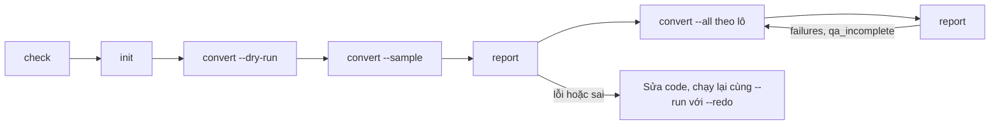
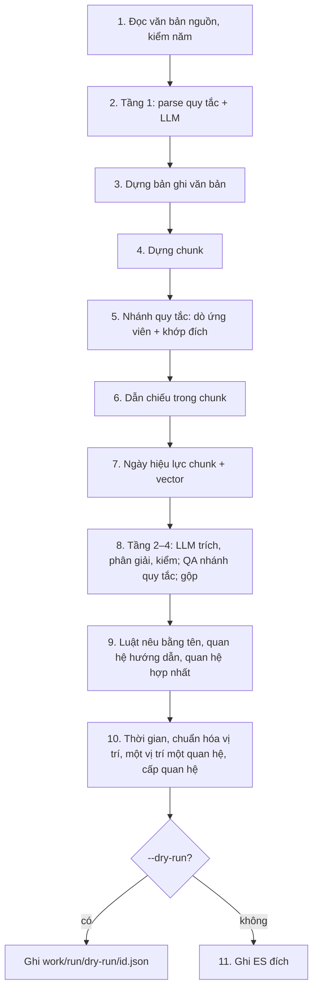

# 2. Luồng hoạt động

## 2.1. Quy trình một đợt chuyển đổi

Chạy các lệnh trong `data_vbpl_v3/` bằng `.venv/bin/python -m vbpl_v3 <lệnh>`. Với Docker, thay bằng `docker run --rm --env-file .env -v "$PWD/work:/app/work" vbpl-v3 <lệnh>`.

| Bước | Lệnh | Ghi ES đích |
| --- | --- | --- |
| 1. Kiểm kết nối | `check` | Không |
| 2. Kiểm vector cũ dùng lại được | `check --vectors 50` | Không |
| 3. Tạo index | `init` | Tạo index chưa có. Thêm trường mới vào index đã có. |
| 4. Chạy thử | `convert --run thu --sample 20 --dry-run` | Không. Kết quả ở `work/thu/dry-run/`. |
| 5. Chạy mẫu | `convert --run mau1000 --sample 1000` | Có |
| 6. So sánh | `report --run mau1000` | Không |
| 7. Chạy theo lô | `convert --run nam-2020 --all --from-date 2020-01-01 --to-date 2020-12-31` | Có |
| 8. Chạy toàn kho | `convert --run toan-kho --all` | Có |
| 9. Thêm trường mới cho văn bản đã chuyển | `init`, rồi `convert --run toan-kho --redo --limit 100` | Có |

### Ghi thử vào v4 trước khi ghi lại v3

Khi đổi quy tắc, ghi thử vào 3 index `-v4` trên ES đích. Bên Graph duyệt v4. Sau khi duyệt, xóa v4 và ghi lại v3.

1. Đặt biến môi trường cho lần chạy (không sửa `.env`):
   `export TARGET_DOCUMENT_INDEX=legal-docs-v4 TARGET_CHUNK_INDEX=legal-chunk-section-v4 TARGET_CHANGE_INDEX=legal-changed-v4`
2. Chạy `init`. Lệnh tạo 3 index v4.
3. Chạy `convert --run v4-pilot --ids work/v4-ids.txt`. File ID là danh sách văn bản đang có trong v3.
4. So v3 với v4. Gửi bên Graph duyệt.
5. Sau khi duyệt: xóa tay 3 index v4. Mở shell mới (không có biến ở bước 1). Chạy `init`, rồi `convert --run <lượt v3> --redo`.

Server LLM Lào Cai nhận 3 lời gọi cùng lúc ban ngày và 10 lời gọi từ 22h đến 6h. Công cụ tự giữ giới hạn này (`LLM_CONCURRENCY_*`), nên `--workers 10` an toàn cả ngày lẫn đêm. Chạy toàn kho nên bắt đầu sau 22h. Chỉ chạy một tiến trình `convert` một lúc: mỗi tiến trình có giới hạn riêng. Embedding không có giới hạn này: nếu embedding báo lỗi tải, giảm `--workers`.

## 2.2. Lệnh

### `check`

Kiểm 5 mục. Mỗi mục trả `ok` và kết quả hoặc lỗi. Mã thoát 0 khi mọi mục đạt.

| Mục | Kiểm |
| --- | --- |
| `source_es` | Phiên bản ES. Số bản ghi của 3 index nguồn. |
| `target_es` | Phiên bản ES. Số bản ghi của 3 index đích, hoặc "chưa tạo". |
| `litellm` | `GET /models` có `LITELLM_MODEL`. |
| `embedding` | `GET /health` trả `model = BAAI/bge-m3` và `dims = 1024`. |
| `workdir` | Ghi được vào `V3_WORKDIR`. |
| `legacy_vectors` | Chỉ khi có `--vectors N`. Tạo lại vector N chunk nguồn ngẫu nhiên. So cosine với vector cũ. `reuse_safe = true` khi cosine nhỏ nhất > 0,99. |

### `init`

- Index chưa có: công cụ tạo index từ `mappings/<role>.json`.
- Index đã có: công cụ so mapping. Công cụ chỉ thêm trường (và trường con) còn thiếu. Công cụ không sửa trường đã có.

### `convert`

| Tham số | Nghĩa |
| --- | --- |
| `--run <tên>` | Bắt buộc. Tên lượt. Nhật ký ở `work/<tên>/`. Chạy lại cùng tên thì làm tiếp. |
| `--sample N` | Chọn ngẫu nhiên N văn bản (1..10.000). Hạt giống `--seed` (mặc định `20261009`). |
| `--ids <file>` | Danh sách ID. Mỗi dòng một ID, hoặc một mảng JSON. |
| `--all` | Mọi văn bản khớp bộ lọc. |
| `--from-date`, `--to-date` | Lọc `issuance_date` (`YYYY-MM-DD`). |
| `--legal-type` | Lọc `legal_type`. |
| `--limit N` | Chỉ chạy N văn bản chưa xong. |
| `--extractor llm\|rules` | Cách dò quan hệ. `llm`: luồng 4 tầng, luồng chốt 20/10/2026 (mặc định, `RELATION_EXTRACTOR`). `rules`: regex và QA, cách của v3. |
| `--workers N` | Số văn bản chạy song song (1..32). Mặc định 10. Số lời gọi LLM cùng lúc không vượt `LLM_CONCURRENCY_DAY` (3) hoặc `LLM_CONCURRENCY_NIGHT` (10, từ 22h đến 6h). |
| `--no-qa` | Bỏ QA. Công cụ **không ghi** quan hệ và **không xóa** quan hệ cũ. |
| `--dry-run` | Chạy đủ các bước. Không ghi ES. Kết quả ở `work/<run>/dry-run/<id>.json`. |
| `--redo` | Chạy lại cả văn bản đã xong. Cache model vẫn được dùng. |

Lượt mới cần một trong `--sample`, `--ids`, `--all`. Lượt cũ dùng lại `ids.json`.

### `report`

Chỉ đọc. Lệnh so nguồn với v3 trên các văn bản đã xong của lượt. Kết quả ở `work/<run>/report.txt`. Xem mục 2.7.

### `analyze`

Chỉ đọc ES nguồn. Lệnh không ghi ES và không gọi embedding. Lệnh đo độ phủ: ngày hiệu lực, hành động quan hệ, quan hệ hướng dẫn, dẫn chiếu.

- Ví dụ: `analyze --name mau3000 --sample 3000`.
- `--action huongdan`: chỉ đo văn bản có `action = huongdan`.
- Kết quả ở `work/analyze-<name>/`.

## 2.3. Luồng một lượt

1. Công cụ đọc `work/<run>/run.json`. Không có thì công cụ tạo file với `run_id` = giờ UTC dạng `YYYYMMDDTHHMMSSZ`.
2. Công cụ đọc `ids.json`. Không có thì công cụ chọn ID theo tham số và ghi file.
3. Công cụ bỏ ID đã có trong `documents.jsonl`. Với `--redo`, công cụ không bỏ ID nào.
4. Công cụ cắt danh sách theo `--limit`.
5. Công cụ chạy luồng một văn bản (mục 2.4) song song theo `--workers`.
6. Văn bản xong: công cụ ghi một dòng vào `documents.jsonl`. Văn bản lỗi: công cụ ghi một dòng vào `failures.jsonl`.
7. Công cụ ghi `summary.json`. Mã thoát 1 khi có văn bản lỗi.

`run_id` đi vào trường `ingest_job_id = v3:<run_id>` của mọi bản ghi lượt đó ghi.

## 2.4. Luồng một văn bản

Luồng dưới đây là chế độ `llm` (mặc định). Chế độ `rules` khác ở bước 8: chỉ có QA ứng viên của nhánh quy tắc.

| # | Bước | Module | Dịch vụ ngoài | Kết quả |
| --- | --- | --- | --- | --- |
| 1 | Đọc `legal-docs/<id>`. Không có văn bản hoặc `full_content` rỗng thì báo lỗi. Công cụ bỏ qua văn bản trước `START_YEAR` (`skipped = truoc_nam_bat_dau`) và văn bản có toàn văn tiếng Anh (`skipped = tieng_anh`), trước mọi lời gọi model. | `convert.py` | ES nguồn | `_source` nguồn |
| 2 | Chuẩn hóa NFC. Parse bằng quy tắc. Hỏi model LLM ca mơ hồ (mục 2.5.1). | `structure.py`, `structure_ai.py` | LiteLLM | Cấu trúc văn bản |
| 3 | Chép metadata. Tính `content_sha256`, `la_vbqppl`, `cap_hieu_luc`, ngày hiệu lực, ngày hết hiệu lực, hồi tố, ngày hiệu lực riêng của từng đơn vị (`hieu_luc_rieng`). Nguồn không có `embedding` thì tạo vector của `title`. | `convert.py`, `legal_status.py`, `temporal.py` | Embedding (khi thiếu) | Bản ghi văn bản |
| 4 | Dựng chunk Điều, khoản, điểm, tiểu điểm, phụ lục, đề mục, nội dung. | `structure.py` `build_chunks` | — | Danh sách chunk |
| 5 | Nhánh quy tắc dò ứng viên (mục 2.5.2). Tra số hiệu đích trong `legal-docs` nguồn. Khớp đích (mục 2.5.3). | `relations.py` | ES nguồn | Ứng viên |
| 6 | Tìm dẫn chiếu trong từng chunk. Nối văn bản được dẫn. | `references.py` `link_references` | ES nguồn | `dan_chieu` |
| 7 | Gắn ngày hiệu lực của từng đơn vị vào chunk (mục 2.5.7). Chunk có chuỗi giống chunk nguồn: dùng lại vector nguồn. Chunk khác: gọi embedding theo lô. | `convert.py`, `legal_status.py`, `embedding.py` | ES nguồn, Embedding | `ngay_hieu_luc`, `embedding` |
| 8 | Chế độ `llm`: tầng 2 trích, tầng 3 phân giải, tầng 4 kiểm (mục 2.5.8). QA ứng viên của nhánh quy tắc (mục 2.5.4). Gộp hai nhánh. Chế độ `rules`: chỉ QA ứng viên. | `extract.py`, `resolver.py`, `validate.py`, `qa.py`, `convert.py` | LiteLLM, ES nguồn | Quan hệ |
| 9 | Luật nêu bằng tên: tra luật gốc cùng tên. Dò quan hệ hướng dẫn từ tiêu đề hoặc lời dẫn (mục 2.5.5). Văn bản hợp nhất: dò quan hệ hợp nhất từ phần đầu. | `references.py` `guidance`, `relations.py` `consolidation` | ES nguồn | Quan hệ `hd_`, `hn_` |
| 10 | Tính `source_ngay_hieu_luc`, `hieu_luc_tac_dong`. Chuẩn hóa vị trí: vị trí ngoài định dạng thành `doi_tuong`, bỏ vị trí cha khi có vị trí con. Tách mỗi vị trí thành một quan hệ. Đánh số lại `_id`. Tính `cap_quan_he` (mục 2.5.6). Quan hệ `chua_xac_dinh` ghi thêm vào `review.jsonl`. | `convert.py`, `temporal.py` | — | Quan hệ hoàn chỉnh |
| 11 | Ghi ES đích theo thứ tự ở bảng dưới. | `es.py` | ES đích | 3 index đích |

Thứ tự ghi ở bước 11:

1. Xóa chunk cũ có `doc_id = <id>`.
2. Ghi chunk mới (bulk).
3. Ghi bản ghi văn bản (`PUT`, ghi đè).
4. Chỉ khi có QA: xóa quan hệ cũ có `source_id = <id>`.
5. Chỉ khi có QA: ghi quan hệ mới (bulk).

Lỗi giữa chừng thì văn bản không vào `documents.jsonl`. Chạy lại cùng lượt thì công cụ ghi lại văn bản đó từ đầu.

## 2.5. Luồng con

### 2.5.1. Parser và hybrid AI

Parser quy tắc tách văn bản thành: căn cứ, lời dẫn, Điều, khoản, điểm, phần cuối (chữ ký, Nơi nhận), phụ lục. Văn bản không có Điều được chia theo đề mục hoặc theo đoạn.

Công cụ hỏi model LLM trong 3 trường hợp:

| Câu hỏi | Tín hiệu | Model trả | Code kiểm |
| --- | --- | --- | --- |
| Chữ sau "Điều N." là tên Điều hay nội dung? Một lần hỏi cho cả văn bản. | Tên dài hơn 90 ký tự; tên kết thúc bằng `.`, `;`, `,`, `:`; tên bắt đầu bằng chủ ngữ ("Quyết định này", "Các Sở …"); tên nằm ở dòng sau. | `{articles: [{line, has_title}]}` | Chỉ chấp nhận dòng đã hỏi, mỗi dòng một lần. |
| Phụ lục và văn bản kèm theo bắt đầu ở dòng nào? | Có tín hiệu bố cục: `tail_dieu`, `long_noi_nhan`, `segment_in_main`, `unlabeled_without_note`, `empty_labeled_part` ([06, mục 6.5](06-bang-enum.md#65-nhật-ký-lượt-chạy)). | `{parts: [{start_line}]}` | Dòng bắt đầu là dòng tiêu đề, sau Điều đầu tiên. Bố cục mới phải giữ đủ Điều. Bố cục mới không đưa Điều vào phần cuối và không làm Nơi nhận dài thêm. Phụ lục có nhãn dài từ 1.000 ký tự phải giữ riêng. Sai thì giữ bố cục quy tắc. |
| Văn bản không chia Điều có những đề mục nào, cấp nào? (từ 15/10/2026) | Bố cục nhiều cấp (I/II với 1/2, phần A/B), hoặc một mục chiếm phần lớn văn bản. | Số dòng, nhãn, cấp (`prompts/dan_y_van_ban.txt`) | Nhãn phải có ở đầu dòng. Không đạt thì giữ quy tắc. |

Các ca quy tắc mới từ 15/10/2026 ở [08, mục 8.3](08-quan-he-4-tang-va-danh-gia.md#83-tầng-cấu-trúc-quy-tắc-và-llm).

Model lỗi thì công cụ giữ kết quả quy tắc. Nhật ký văn bản ghi `ai_warnings`.

### 2.5.2. Dò ứng viên quan hệ (nhánh quy tắc)

Nhánh quy tắc chạy ở cả hai chế độ. Ở chế độ `llm`, công cụ gộp kết quả của nhánh này với nhánh LLM (mục 2.5.8).

Văn bản hợp nhất chỉ sinh quan hệ hợp nhất (dòng cuối bảng). Ghi chú sửa đổi trong văn bản hợp nhất không là tác động của nó. Các văn bản khác đi qua 5 bộ dò đầu:

| Bộ dò | Điều kiện | Đơn vị nguồn | Tiền tố `_id` |
| --- | --- | --- | --- |
| Theo tiêu đề | Tiêu đề văn bản nêu hành động ("… sửa đổi Nghị định …"). Công cụ xét từng Điều, khoản, điểm. | Điều, khoản, điểm | không có |
| Ẩn | Tiêu đề không nêu hành động. Tên hoặc câu dẫn của một Điều nêu hành động và số hiệu đích. | Điều, khoản, điểm | `hidden_` |
| Lời dẫn | Lời dẫn nêu hành động và số hiệu. | `intro` | `intro_` |
| Hết hiệu lực | Câu "… hết hiệu lực kể từ ngày …" đi kèm câu "… này có hiệu lực". Mỗi văn bản nêu trong câu là một quan hệ `bai-bo`, phạm vi `toàn bộ` (hoặc điều khoản câu nêu). Không qua QA. | Điều, khoản | `hhl_` |
| Công văn có đề mục | Văn bản không chia Điều. Tiêu đề nêu `dinh-chinh`, `ngung-hieu-luc` hoặc `gia-han`. | `Mục <n>` hoặc `Nội dung` | không có |
| Hợp nhất | Văn bản hợp nhất. Văn bản đầu tiên nêu ở phần đầu (trước dòng căn cứ) là văn bản gốc được hợp nhất. Văn bản sửa đổi liệt kê sau "được sửa đổi, bổ sung bởi" chỉ là ghi chú. Hành động `hop-nhat`, phạm vi `toàn bộ`. Không qua QA. | `Phần đầu` | `hn_` |

Quy tắc chung:

- Danh sách gạch đầu dòng: mỗi mục là một ứng viên. Mục nhận hành động của câu dẫn.
- Khoản có câu dẫn "Điều 34 được sửa đổi như sau:": các điểm a), b) là nội dung mới. Các điểm này không thành ứng viên riêng.
- Điểm, khoản thiếu số Điều thì nhận số Điều từ câu dẫn ("… của khoản 3 Điều 2 như sau: a) … tại điểm a").
- Câu chỉ nói thẩm quyền ("kiến nghị đình chỉ", "có quyền …") không là hành động.
- Câu "Bỏ <đơn vị>" ("Bỏ gạch đầu dòng thứ ba điểm b …") là `bai-bo`. "Hủy bỏ" vẫn là `huy-bo`. "Bỏ dấu", "bỏ cụm từ" không tính.
- Lời dẫn và từng Điều có quan hệ riêng, kể cả khi cùng hành động và cùng đích.
- **Đích là văn bản câu nêu trực tiếp.** Ví dụ: câu của đơn vị nêu "Điều 17 Thông tư số 55/2016/TT-BTC". Đích là Thông tư đó, dù tên Điều nêu văn bản khác.
- Công cụ bỏ ghi chú lịch sử khi dò: "(đã) được sửa đổi, bổ sung tại/bởi/theo …", có hoặc không có ngoặc.
- Công cụ bỏ ghi chú phụ lục của chính văn bản nguồn: "… tại Mẫu số 01 Phụ lục I kèm theo Nghị định này", "(Phụ lục 1 kèm theo)".
- **Luật nêu bằng tên** ("… một số điều của Luật Quy hoạch đô thị và nông thôn"): đích là luật đó. Số hiệu lấy từ dòng căn cứ nếu có. Nếu không, công cụ tra luật gốc cùng tên, ban hành gần nhất trước văn bản nguồn; luật sửa đổi và văn bản hợp nhất không được chọn.
- **Câu dẫn liệt kê** ("Bãi bỏ các quy định sau: a) …; b) …", "Các Thông tư sau đây hết hiệu lực: a) …"): mỗi điểm là một đơn vị, nhận hành động của câu dẫn. Điểm chỉ nêu văn bản thì phạm vi là `toàn bộ`. Câu dẫn có "như sau:" thì các điểm là nội dung mới, kể cả khi nguồn cắt chữ ngay sau đó.
- **Câu nhiều vế** ("Sửa đổi khoản 1 Điều 39; bổ sung khoản 1a, 1b vào sau khoản 1 Điều 39"): mỗi vế giữ hành động và vị trí của nó. Cặp "sửa đổi, bổ sung" là một vế.
- Điểm của một khoản chỉ là đơn vị tác động khi đa số điểm tự nêu hành động. Điểm nội dung mới tình cờ có chữ "bổ sung" không tính.
- **Danh sách nhiều văn bản** ("thay thế Quyết định số A ngày … và Quyết định số B …"): mỗi văn bản là một quan hệ.
- Điều không có khoản mà câu của Điều tự nêu hành động: dùng hành động và vị trí của câu đó, không dùng mọi động từ ở tên Điều.
- Mã mẫu biểu ("mẫu số 01/THKH") không là số hiệu văn bản.
- `thay-cum-tu`: công cụ tách từng cặp cụm từ, mỗi cặp có vị trí riêng.
- `dinh-chinh`: công cụ lấy mọi vị trí sau "tại". Đính chính căn cứ hoặc Nơi nhận thì ghi `doi_tuong`.
- `dinh-chi`, `ngung-hieu-luc`: công cụ đọc ngày bắt đầu, ngày kết thúc, điều kiện kết thúc.
- `gia-han`: công cụ đọc ngày hết hiệu lực mới ("đến hết tháng 12 năm 2016" → `2016-12-31`) hoặc điều kiện.

### 2.5.3. Khớp văn bản đích

Công cụ tra số hiệu trong `legal-docs` nguồn, gồm cả dạng bỏ năm. Công cụ áp các bộ lọc theo thứ tự:

1. Số hiệu khớp chính xác (bỏ khoảng trắng, không phân biệt hoa thường, bỏ số 0 đầu). Không có thì thử dạng bỏ năm: `1941/2008/QĐ-UBND` → `1941/QĐ-UBND` ban hành năm 2008.
2. Đích có `_id` là số, khác văn bản nguồn, ngày ban hành không sau ngày ban hành nguồn.
3. Câu trích dẫn có ngày: chỉ giữ đích cùng ngày. Không có đích cùng ngày và số hiệu có năm: chấp nhận một đích duy nhất cùng năm. Công cụ ghi `target_match_note = lech_ngay_trich_dan`.
4. Câu trích dẫn nêu cơ quan: chỉ giữ đích cùng cơ quan.
5. Số hiệu địa phương (`UBND`, `HĐND`, `UB`) không nêu cơ quan: chỉ giữ đích cùng cơ quan với văn bản nguồn. Công cụ không nối sang tỉnh khác.
6. Còn nhiều đích: giữ đích cùng cơ quan với nguồn. Không có thì bỏ hết.
7. Còn nhiều đích: giữ đích có ngày ban hành gần nhất.

Còn đúng một đích thì `target_matched_id` là `_id` của đích đó. Còn lại thì `target_matched_id = null`.

### 2.5.4. QA quan hệ (nhánh quy tắc)

Công cụ gom ứng viên theo (`source_path`, `target_doc`, `action`).

1. **QA hành động.** Model LLM trả `{valid, reason}`. `valid = true` khi đơn vị nguồn tự thực hiện hành động lên đích. Kể lịch sử hoặc trích dẫn thì `valid = false`. Nhóm `valid = false` bị loại.
   - Đơn vị mở đầu bằng chính hành động và nêu rõ vị trí ("Bỏ gạch đầu dòng thứ ba điểm b …", "Sửa đổi, bổ sung khoản 5 Điều 4 như sau") không qua model: câu đã là tác động trực tiếp.
   - Hai nhóm `sua-doi` và `bo-sung` của cùng câu "sửa đổi, bổ sung" dùng chung một kết luận: một nhóm đạt thì cả hai đạt.
2. **Phạm vi do câu nêu rõ.** Câu nguồn nêu rõ vị trí thì công cụ dùng vị trí đó: `scope_resolution_method = explicit_declaration`.
3. **Phạm vi liệt kê.** `thay-cum-tu`, `dinh-chinh` có danh sách vị trí thì công cụ giữ danh sách: `scope_resolution_method = liet_ke_vi_tri`.
4. **QA phạm vi.** Phạm vi còn lại có số hoặc chưa xác định thì model LLM trả `{scope, correct, evidence}`. Công cụ kiểm `evidence` có nguyên văn trong nguồn và chứa mọi số của `scope`.

| Kết quả QA phạm vi | Công cụ ghi |
| --- | --- |
| Đạt, đề xuất là vị trí khác phạm vi cũ | `scope` = đề xuất, `llm_refined = true`, `unresolved = false` |
| Đạt, đề xuất là câu mô tả, không là vị trí | Giữ `scope`. Ghi `scope_grounding_suggestion`. |
| Không đạt | `unresolved = true`, ghi `scope_grounding_suggestion`. Dẫn chứng không có trong nguồn thì `llm_hallucination_rejected = true`. |

Lỗi gọi model thì nhóm đó không có quan hệ. Nhật ký ghi `qa = incomplete`. Xem mục 2.6 để chạy lại.

### 2.5.5. Quan hệ hướng dẫn

Tiêu đề có "hướng dẫn" hoặc "quy định chi tiết" thì công cụ tìm văn bản được hướng dẫn. Công văn và văn bản hợp nhất không xét. Tiêu đề sửa đổi văn bản hướng dẫn ("sửa đổi Thông tư X hướng dẫn Nghị định Y") không xét.

| Thứ tự | Nơi tìm | `source_path` |
| --- | --- | --- |
| 1 | Tiêu đề nêu số hiệu hoặc tên luật | `Tiêu đề` |
| 2 | Lời dẫn "… ban hành Thông tư hướng dẫn …", trong cùng câu với động từ. Câu "xét đề nghị tại Công văn …" không tính. | `Lời dẫn` |

Dòng căn cứ không tạo quan hệ hướng dẫn. Dòng căn cứ chỉ trích dẫn cơ sở pháp lý, không là câu tuyên bố hướng dẫn. Văn bản bị thay thế hoặc bãi bỏ nêu cùng câu không là văn bản được hướng dẫn.

- Câu có thể nêu điều khoản trước văn bản được hướng dẫn: "quy định chi tiết khoản 3 Điều 25 và Điều 30 của Luật …". Khi đó mỗi điều khoản là một vị trí.
- Câu không nêu điều khoản thì phạm vi là `toàn bộ` hoặc `một số điều`.
- Luật nêu bằng tên: công cụ nối qua dòng căn cứ có số hiệu hoặc ngày, hoặc qua năm ghi kèm tên.

### 2.5.6. Thời gian và cấp quan hệ

Với mỗi quan hệ, công cụ tính:

1. `scope`: chuẩn hóa `toan-bo`, `toàn văn` thành `toàn bộ`.
2. `vi_tri`: tách `scope` thành vị trí đủ cấp, nếu bước trước chưa có. Mẫu biểu cho phụ lục chứa nó. Gạch đầu dòng của điểm cho tiểu điểm.
3. `source_ngay_hieu_luc` = ngày hiệu lực của đơn vị nguồn (mục 2.5.7).
4. `hieu_luc_tac_dong` theo `action` ([06, mục 6.4](06-bang-enum.md#64-quan-hệ)).
5. Văn bản nguồn hồi tố và đơn vị nguồn nằm trong `hoi_to_vi_tri`: `ve_sau` đổi thành `ve_truoc`, thêm `source_ngay_hoi_to`.
6. `dinh-chi`, `ngung-hieu-luc` không có ngày bắt đầu: `dinh_chi_tu_ngay` = `source_ngay_hieu_luc`.
7. Quan hệ có N vị trí thành N quan hệ, mỗi quan hệ một vị trí. Cặp `cum_tu` đi theo vị trí của nó. Công cụ không gộp quan hệ trùng.
8. Công cụ đánh số lại `_id` theo từng tiền tố, từ 0.
9. `cap_quan_he` theo bảng ở [09, mục 9.10.8](09-hop-dong-du-lieu-v4.md#9108-cấp-quan-hệ).

### 2.5.7. Ngày hiệu lực theo đơn vị

1. Công cụ tìm câu "<điều khoản> (… này) có hiệu lực …" của chính văn bản, ngoài ngoặc kép. Câu có thể nằm sau "trừ", "riêng", "đối với". Kết quả ghi vào `hieu_luc_rieng`.
2. Câu nêu điều khoản của văn bản khác (có số hiệu) thì công cụ bỏ.
3. Mỗi chunk Điều, khoản, điểm, tiểu điểm của văn bản chính lấy ngày của dòng `hieu_luc_rieng` gần nhất chứa nó. Thứ tự gần: tiểu điểm, điểm, khoản, Điều, Chương.
4. Không có dòng nào chứa chunk thì chunk lấy ngày của văn bản. Chunk phụ lục và văn bản kèm theo lấy ngày của văn bản.
5. Văn bản hồi tố: chunk nằm trong `hoi_to_vi_tri` (rỗng là mọi chunk) có thêm `ngay_hoi_to`.

### 2.5.8. Nhánh LLM 4 tầng và gộp

Chi tiết ở [08, mục 8.2](08-quan-he-4-tang-va-danh-gia.md#82-bốn-tầng). Tóm tắt:

1. **Chọn đơn vị.** `extract.py` chọn mọi đơn vị có từ chỉ hành động: Điều, khoản, điểm, đề mục, tên in và lời dẫn (`Phần đầu`; tên lưu ở nguồn không dùng, quy ước Q11), dòng bảng phụ lục (`Phụ lục <n> [Mục <m>] STT <k>`), đề mục của phụ lục viết thành đoạn văn (`Phụ lục <n> Mục <m>`).
2. **Gom ngữ cảnh.** Mỗi đơn vị có câu dẫn, tên Điều, tên Chương. Dòng bảng có tên phụ lục, tên cột và câu của Điều nói về phụ lục. Điều nêu "các văn bản tại Phụ lục …" có danh sách dòng của phụ lục đó (`danh_sach_kem_theo`).
3. **Hỏi LLM.** Công cụ gom đơn vị theo Điều. Với danh sách từ 8 văn bản, công cụ hỏi theo phần, mỗi phần 5 văn bản. Một lời gọi lỗi không làm mất quan hệ của cả văn bản.
4. **Phân giải.** `resolver.py` đổi số hiệu và vị trí nguyên văn sang định dạng hợp đồng. Resolver gán `doi_tuong_loai`: `thu_tuc_hanh_chinh` khi quan hệ tác động lên thủ tục (quy ước Q12).
5. **Kiểm.** `validate.py` loại hàng sai. Hàng có hành động thật nhưng thiếu căn cứ thành `unresolved`.
6. **Gộp.** Cùng đơn vị nguồn, hành động, văn bản đích: cả hai nhánh thấy thì `extraction = llm+rules`; một nhánh thấy thì `llm` hoặc `rules`.

## 2.6. Làm tiếp và chạy lại

| Tình huống | Việc cần làm |
| --- | --- |
| Lượt bị ngắt | Chạy lại đúng lệnh với cùng `--run`. Công cụ bỏ văn bản đã xong. Công cụ chạy lại văn bản lỗi. |
| Có văn bản lỗi | Xem `failures.jsonl`. Sửa nguyên nhân. Chạy lại cùng `--run`. |
| `qa = incomplete` | Văn bản này đã có trong `documents.jsonl`. Chạy lại không có `--redo` thì công cụ bỏ qua nó. Lượt nhỏ: chạy cùng `--run` với `--redo`. Lượt lớn: tạo lượt mới với `--ids` chứa các văn bản đó. |
| Code thêm trường mới | Chạy `init`. Chạy `convert --run <lượt cũ> --redo --limit 100` để thử. Kiểm kết quả. Chạy lại không có `--limit`. |
| Cần quay lại hoàn toàn | Xóa tay 3 index v3. Chạy `init`. |

- Lượt cũ đã có `ids.json`. Công cụ bỏ qua `--sample`, `--ids`, `--all` của lần chạy sau.
- `--redo --limit N` luôn chạy lại N văn bản đầu của `ids.json`.
- Cache nằm trong thư mục lượt. Lượt mới không dùng cache của lượt cũ.

## 2.7. Kiểm tra sau mỗi đợt (`report`)

`report` đếm cùng chỉ số trên nguồn và trên v3 cho các văn bản đã xong:

| Chỉ số | Yêu cầu trên v3 |
| --- | --- |
| `documents` | Bằng số văn bản đã xong (trừ dry-run). |
| `full_content_nfd` | 0 |
| `chunks` | — |
| `documents_without_chunks` | 0 |
| `dieu_chunks_empty_noi_dung`, `documents_with_empty_dieu` | 0 |
| `relations`, `relations_with_target` | Kiểm mẫu: đúng số hiệu được dẫn, không nối sang tỉnh khác. |
| Văn bản đổi `n_dieu`, ít Điều hơn nguồn | Xem từng ca. Bộ cũ có lúc nhận nhầm câu dẫn chiếu thành Điều. |
| `qa_incomplete` | 0. Khác 0 thì chạy lại (mục 2.6). |

Dòng "AI/vector/quan hệ" cho biết số lần gọi AI, số vector dùng lại và số quan hệ.

## 2.8. Thời gian và tải

| Đo | Chế độ | Kết quả |
| --- | --- | --- |
| 09/10/2026 | Parser quy tắc | Khoảng 1,8 giờ cho toàn kho trên 1 lõi. Parser không là điểm nghẽn. |
| 15/10/2026, Blind 290 văn bản | `llm`, 3 lời gọi LLM cùng lúc | Khoảng 12 giây mỗi văn bản (57 phút) |
| 15/10/2026 | `rules`, dùng lại cache QA | Khoảng 1,4 giây mỗi văn bản |
| 20/10/2026, hold-out 3, 158 văn bản | `llm`, `--workers 6`, ban ngày (3 lời gọi cùng lúc), `--dry-run` | 663 giây, khoảng 4,2 giây mỗi văn bản |

- Điểm nghẽn là số lời gọi LLM cùng lúc. Chạy toàn kho nên bắt đầu sau 22h (10 lời gọi cùng lúc).
- Bộ đo thiên về văn bản có quan hệ. Văn bản không có từ chỉ hành động không gọi tầng 2.
- Ước toàn kho chưa đo lại cho luồng chốt. Đo trên 1.000 văn bản ngẫu nhiên trước khi chạy toàn kho.
