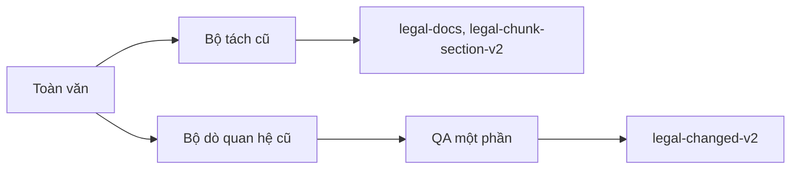
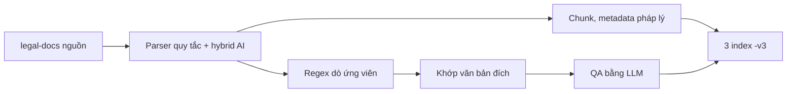
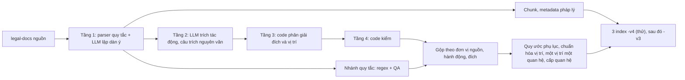

# 5. Ba phiên bản dữ liệu: v2, v3, v4

Tài liệu này so sánh 3 phiên bản. Mỗi phiên bản có: bên ghi, luồng, cải tiến, chất lượng đo được, trạng thái. Đọc tài liệu này trước khi đọc hợp đồng của từng phiên bản.

- Hợp đồng chi tiết: v2 ở [03](03-hop-dong-du-lieu-v2.md), v3 ở [04](04-hop-dong-du-lieu-v3.md), v4 ở [09](09-hop-dong-du-lieu-v4.md).
- "v4" có 2 nghĩa. **Hợp đồng v4** là dữ liệu mà luồng chốt tạo ra. Code chốt hiện tại là commit `8b023ca` (27/10/2026). **Index `-v4`** là bản thử trên ES đích. Index này có 11.000 văn bản, ghi lại ngày 22/10/2026 bằng code `2911b77`. Dữ liệu này chưa có các thay đổi code 26–27/10/2026 (mục 5.2.4).
- Mọi số liệu ghi ngày đo.

## 5.1. Tóm tắt

Trạng thái ngày 27/10/2026.

| Mục | v2 | v3 | v4 |
| --- | --- | --- | --- |
| Bên ghi | Luồng realtime | `vbpl_v3`, chế độ `rules` | `vbpl_v3`, chế độ `llm` (luồng 4 tầng) |
| Cụm ES | Nguồn `10.1.10.10` | Đích `10.1.10.23` | Đích `10.1.10.23` |
| Index | `legal-docs`, `legal-chunk-section-v2`, `legal-changed-v2` | `legal-docs-v3`, `legal-chunk-section-v3`, `legal-changed-v3` | `legal-docs-v4`, `legal-chunk-section-v4`, `legal-changed-v4` |
| Code tạo dữ liệu | Bộ tách cũ | Quy tắc ngày 09–13/10/2026 | Index `-v4`: code chốt 22/10/2026 (`2911b77`). Code chốt hiện tại: `8b023ca` (27/10/2026), chưa ghi ES. |
| Số bản ghi | 518.261 văn bản, 10.331.917 chunk, 180.452 quan hệ (16/10) | 204 văn bản, 6.291 chunk, 733 quan hệ (19/10) | Index `-v4`: 11.000 văn bản, 447.597 chunk, 42.771 quan hệ (40.496 `validated`, 2.275 `unresolved`) (22/10) |
| Phạm vi văn bản | Toàn kho | 204 văn bản chọn để thử | 11.000 văn bản mới nhất, ban hành từ 08/10/2025 đến 30/09/2026 |
| Vai trò | Nguồn. Công cụ chỉ đọc. | Bản đang đọc. Công cụ sẽ ghi lại theo hợp đồng v4. | Bản thử. Bên Graph duyệt trước khi ghi lại v3. |
| Trạng thái | Không đổi | Không đổi. Chỉ ghi lại khi bên Graph duyệt v4. | Ghi lại 22/10/2026. Chưa quyết có ghi lại bằng code `8b023ca` hay không. Đợt 10.000 văn bản tiếp theo chưa chạy. |

Sau khi bên Graph duyệt, công cụ ghi lại v3 theo hợp đồng v4. Khi đó v3 và v4 có cùng dữ liệu, chỉ khác hậu tố index. Đến ngày 27/10/2026, bên dữ liệu chỉ ghi các index `-v4`.

## 5.2. Luồng của từng phiên bản

### 5.2.1. v2: luồng realtime

- Bộ tách cũ tách Điều, khoản, điểm. 46,6% văn bản có chunk Điều rỗng nội dung (09/10/2026).
- Bộ dò cũ ghi nhiều vị trí vào một chuỗi `scope` tự do. 60,5% quan hệ chưa có văn bản đích (09/10/2026).
- `vbpl_v3` không dùng code của luồng này.

### 5.2.2. v3: chế độ `rules`

1. Parser quy tắc dựng Điều, khoản, điểm, phụ lục. LLM chỉ trả lời 2 câu hỏi mơ hồ, bằng số dòng ([02, mục 2.5.1](02-luong-hoat-dong.md#251-parser-và-hybrid-ai)).
2. Regex tìm ứng viên quan hệ ([02, mục 2.5.2](02-luong-hoat-dong.md#252-dò-ứng-viên-quan-hệ-nhánh-quy-tắc)).
3. Code khớp số hiệu với `legal-docs` nguồn.
4. LLM kiểm từng ứng viên (QA). Chỉ ứng viên đạt QA thành quan hệ.

Giới hạn: regex chỉ bắt cách viết đã gặp. LLM chỉ kiểm, không thêm được quan hệ regex bỏ sót ([08, mục 8.1](08-quan-he-4-tang-va-danh-gia.md#81-vì-sao-đổi)).

### 5.2.3. v4: chế độ `llm` (luồng chốt)

| Tầng | Module | Làm gì |
| --- | --- | --- |
| 1. Cấu trúc | `structure.py`, `structure_ai.py` | Quy tắc tách văn bản. LLM lập dàn ý cho văn bản không chia Điều. LLM chỉ trả số dòng. |
| 2. Trích | `extract.py` | LLM đọc từng đơn vị có từ chỉ hành động, kèm ngữ cảnh. LLM trả hành động, văn bản đích, vị trí nguyên văn và câu trích. Đơn vị nêu từ 8 số hiệu được hỏi theo phần, mỗi phần 5 văn bản. |
| 3. Phân giải | `resolver.py` | Code đổi văn bản đích và vị trí sang định dạng hợp đồng. Code áp quy ước phụ lục. Code không đoán. |
| 4. Kiểm | `validate.py`, `governance.py` | Code kiểm sự thật: câu thực hiện theo cấu trúc, bằng chứng nguyên văn, ngoặc kép theo vai trò, ghi chú lịch sử, thẩm quyền ([08, mục 8.11.3](08-quan-he-4-tang-va-danh-gia.md#8113-quy-tắc)). |

Nhánh quy tắc của v3 vẫn chạy. Code gộp hai nhánh theo bộ (đơn vị nguồn, hành động, văn bản đích). Quy tắc gộp ở [08, mục 8.2](08-quan-he-4-tang-va-danh-gia.md#82-bốn-tầng).

Mốc chốt của luồng. Mỗi mốc là một commit. Số đo của từng mốc ở [08](08-quan-he-4-tang-va-danh-gia.md).

| Ngày | Commit | Nội dung chính | Dữ liệu ES ghi bằng code này |
| --- | --- | --- | --- |
| 20/10/2026 | Mã băm ở `work/final-20261021-code.json` | Luồng 4 tầng thành chế độ mặc định ([08, mục 8.8.4](08-quan-he-4-tang-va-danh-gia.md#884-chốt-luồng-20102026)) | Không có |
| 21/10/2026 | `013e897` | Kiểm sự thật, không kiểm hình thức: quy tắc 1–14 ([08, mục 8.11](08-quan-he-4-tang-va-danh-gia.md#811-rule-tổng-quát-kiểm-sự-thật-không-kiểm-hình-thức-21102026)) | 11.000 văn bản `-v4` (21–22/10). Đã bị ghi đè. |
| 22/10/2026 | `2911b77` | Quy tắc 15–19: danh mục ở phụ lục mọi dạng, câu ngoài bảng, ngoặc kép lồng nhau, đích chỉ nằm trong nội dung mới ([08, mục 8.14](08-quan-he-4-tang-va-danh-gia.md#814-sửa-lỗi-sau-benchmark-500-văn-bản-22102026)) | **Index `-v4` hiện có**: 11.000 văn bản, ghi lại 22/10 |
| 26/10/2026 | `bfb699b` | Ghi chú lịch sử phủ hết danh sách, quy ước phụ lục, giữ phần LLM đọc được (mục 5.2.4) | Không có |
| 27/10/2026 | `8ccb1da` | Thu hẹp quy ước phụ lục, ghi chú lịch sử ở đơn vị bị cắt (mục 5.2.4) | Không có |
| 27/10/2026 | `8b023ca` | Quy ước phụ lục cho mọi vị trí, giữ chữ gốc ở `chi_tiet_vi_tri` (mục 5.2.4). **Code chốt hiện tại.** | Không có |

### 5.2.4. Thay đổi code 22–27/10/2026

Các thay đổi dưới đây có sau commit `2911b77`. **Index `-v4` hiện có chưa theo các thay đổi này.** Mọi thay đổi nằm ở bước sau LLM. Khóa cache của câu trả lời LLM không đổi. Vì vậy công cụ ghi lại được bằng câu trả lời đã lưu, không phải hỏi lại LLM.

| Ngày | Thay đổi | Code | Hệ quả cho dữ liệu |
| --- | --- | --- | --- |
| 26/10 | Ghi chú lịch sử "… đã được sửa đổi, bổ sung bởi/theo/tại …" phủ hết danh sách văn bản đi sau nó. Các mục nối bằng dấu phẩy, "và", ngày, cơ quan ban hành. | `validate.history_spans`, `validate.only_in_history`, `relations.LIST_GAP` | Văn bản chỉ có tên trong ghi chú này không là đích. Tầng 4 loại với lý do `ghi_chu_lich_su`. |
| 26/10 | Luật trên áp cho quan hệ của nhánh quy tắc, sau QA | `convert.model_relations` | Như dòng trên, cho cả hai nhánh |
| 26/10 | Quy ước phụ lục, dạng ban đầu: mọi phần nêu bằng tên thành phụ lục | `resolver.appendix_scope` | Thay bằng dòng 27/10 |
| 26/10 | Bỏ phiếu trong một câu không còn đổi phần LLM đọc được thành cả văn bản. Nhánh quy tắc ghi "toàn bộ" mà LLM nêu tên phần thì giữ tên phần. | `convert.model_relations` | Ít cạnh "toàn bộ" sai hơn |
| 27/10 (`8ccb1da`) | Quy ước phụ lục thu hẹp: phần nêu bằng tên chỉ thành phụ lục khi chữ nêu thứ phụ lục chứa | `resolver.APPENDIX_KIND`, `resolver.appendix_like` | Mục 5.4.1. Hợp đồng ở [09](09-hop-dong-du-lieu-v4.md). |
| 27/10 (`8ccb1da`) | Đơn vị dài vẫn được hỏi theo phần. Mỗi phần giữ toàn văn đơn vị ở khóa `_noi_dung_goc`. Khóa bắt đầu bằng `_` không gửi cho LLM. | `extract.list_parts`, `extract.extract` | Khóa cache không đổi |
| 27/10 (`8ccb1da`) | Tầng 4 kiểm ghi chú lịch sử trên toàn văn đơn vị, không chỉ trên phần LLM đọc. Câu thực hiện lấy từ phần bị cắt là câu của chính đơn vị. | `validate.only_noted`, `validate.check` | Bỏ 101 quan hệ ở 10 văn bản: 8 văn bản của bộ stress, 2 văn bản của hold-out 300. Recall không đổi (27/10/2026). |
| 27/10 (`8b023ca`) | Quy ước phụ lục chạy thêm một lần, sau khi code tính vị trí của nhánh quy tắc từ `scope` và vị trí của dòng danh mục. Quy ước áp cả cho `cum_tu[].vi_tri`. | `convert.tidy_positions` (`appendix=True`), `resolver.appendix_scope` | Mọi vị trí qua quy ước. Code `8ccb1da` để lọt 57/9.759 quan hệ; code `8b023ca` để lọt 0 (27/10/2026). |
| 27/10 (`8b023ca`) | Vị trí bị đổi thành phụ lục giữ chữ gốc ở `chi_tiet_vi_tri`. Nhiều vị trí gốc về cùng một phụ lục thì gộp thành một cạnh. | `resolver.appendix_scope` | Ví dụ `683435_14`: `vi_tri = ["Phụ lục"]`, `chi_tiet_vi_tri = "Mục 14; Mục 89; Mục 90"` |
| 27/10 (`8b023ca`) | Vị trí của phần thân giữ nguyên: chữ "điểm", "khoản", "Điều", "Chương", `tên văn bản`, `tên Mục <n>`. `Mục <n>` đứng một mình thành phụ lục. Bộ chấm dùng cùng phép thử. | `resolver.body_place`, `eval/score.place` | `694149_152` giữ `tên văn bản` |

- Ví dụ lỗi của dòng cuối: văn bản 675210, Điều 86 khoản 4, nêu "Luật Phí và lệ phí số 97/2015/QH13 đã được sửa đổi, bổ sung … theo Luật số 09/2017/QH14, …". Phần thứ hai của đơn vị mất đoạn ghi chú. Code 26/10 ghi `sua-doi`, `bo-sung` tới 35/2024/QH15 và 89/2025/QH15.
- Muốn dữ liệu `-v4` theo code `8b023ca`, bên dữ liệu phải ghi lại 11.000 văn bản. Việc này chờ người dùng quyết ([07, mục 7.5](07-gioi-han-va-can-chot.md#75-việc-còn-lại-ở-bên-dữ-liệu)).
- Chi tiết và số đo ở [08, mục 8.16](08-quan-he-4-tang-va-danh-gia.md#816-văn-bản-sửa-đổi-đi-kèm-quy-ước-phụ-lục-hold-out-300-26102026) và [08, mục 8.17](08-quan-he-4-tang-va-danh-gia.md#817-thu-hẹp-quy-ước-phụ-lục-ghi-chú-lịch-sử-ở-đơn-vị-bị-cắt-27102026).

## 5.3. Cải tiến từ v2 sang v3

| Mục | v2 | v3 |
| --- | --- | --- |
| Toàn văn | Có văn bản NFD (7,6%) | NFC |
| Cấu trúc | 46,6% văn bản có chunk Điều rỗng | Parser mới + hybrid AI. Không có chunk Điều rỗng. |
| Quan hệ | Bộ cũ. QA một phần (35,2%). 39,5% có đích. | Dò lại từ toàn văn. Mọi quan hệ qua QA. |
| Vị trí bị tác động | `scope` chữ tự do, nhiều vị trí trong một bản ghi | `scope` giữ chữ gốc. `vi_tri` theo định dạng cố định. |
| Nguyên tắc quan hệ | — | Chỉ tác động văn bản nêu trực tiếp. Không suy ra tác động lên đơn vị cha, con hay văn bản khác. |
| Metadata cho đồ thị | Không có | Ngày hiệu lực, ngày hết hiệu lực, hồi tố, `la_vbqppl`, `cap_hieu_luc`, `hieu_luc_tac_dong`, `cap_quan_he`, `dan_chieu` |
| Hành động | 5 giá trị | 13 giá trị |

Số liệu v2 đo ngày 09/10/2026 trên toàn kho.

## 5.4. Cải tiến từ v3 sang v4

### 5.4.1. Dữ liệu

| Mục | v3 hiện có | Hợp đồng v4 |
| --- | --- | --- |
| Một quan hệ có mấy vị trí | Có thể nhiều (68/733) | Đúng một, hoặc rỗng |
| Vị trí mẫu biểu | `Mẫu số 01 Phụ lục I` | Phụ lục chứa mẫu: `Phụ lục I` |
| Vị trí ngoài định dạng | Có (4 quan hệ) | Chuyển sang `doi_tuong`. Vị trí không theo điều – khoản – điểm theo quy ước phụ lục (2 dòng dưới). |
| Vị trí không theo điều – khoản – điểm (Mục, Phần của phương án hoặc thông tư cũ, dòng danh mục) | `Mục …` ngoài định dạng (`662238_13`) hoặc `vi_tri` rỗng | Code `8b023ca`: `Phụ lục <n>` khi chữ nêu đúng một số phụ lục, `Phụ lục` khi không nêu số. Chữ gốc ở `chi_tiet_vi_tri`. Ví dụ `689945_1`: "TTHC tại số thứ tự 1, 2, 3, 4 Mục I …" → `vi_tri = ["Phụ lục"]`, `chi_tiet_vi_tri = "Mục I; số thứ tự 1, 2, 3, 4"`. `tên văn bản`, `tên Mục <n>`, Mục dưới Chương giữ nguyên. |
| Phần nêu bằng tên, thuộc phụ lục (danh mục, thủ tục, biểu mẫu, phương án, quy trình nội bộ, Mục hoặc Phần có số, số thứ tự) | `doi_tuong`, `vi_tri` rỗng | Code `8b023ca`: `vi_tri = ["Phụ lục <n>"]` hoặc `["Phụ lục"]`, `doi_tuong` giữ chữ gốc, `cap_quan_he = vi_tri`. Ví dụ `694022_0`: `Phụ lục 1`. Phần nêu tên khác giữ `doi_tuong`, `vi_tri` rỗng. |
| Văn bản chỉ nêu trong ghi chú lịch sử ("… đã được sửa đổi, bổ sung bởi Luật A, Luật B, …") | Chưa đo | Code 26–27/10/2026: không là đích, ở cả hai nhánh, kể cả cuối danh sách dài. Tầng 4 loại với lý do `ghi_chu_lich_su`. |
| Tiểu điểm | Không có | Chunk `tieu_diem`, vị trí `tiểu điểm …` |
| Ngày hiệu lực theo đơn vị | Không có | `hieu_luc_rieng` ở văn bản, ngày hiệu lực ở mọi chunk |
| Quan hệ hợp nhất | Không có | `hop-nhat` (`hn_`) |
| Trạng thái cạnh | Không có | `resolution_status`, `resolution_reason`, `extraction`, `evidence`, `target_section` |
| Tác động suy ra | Có một số tác động lên đơn vị cha, đơn vị con | Chỉ tác động văn bản nêu trực tiếp |
| Dòng bảng phụ lục | Không đọc | Một dòng nêu văn bản đích và hành động cho một quan hệ: `Phụ lục <n> [Mục <m>] STT <k>` |
| Phụ lục viết thành đoạn văn | Không đọc | Đơn vị `Phụ lục <n> Mục <m>` |
| `noi_nhan` | Dính dòng chữ ký (132/204 văn bản) | Chỉ có nơi nhận |
| Quan hệ lên thủ tục hành chính | Không tách | `doi_tuong_loai = thu_tuc_hanh_chinh`, `ma_thu_tuc` |
| Văn bản có toàn văn tiếng Anh | Có thể có bản ghi sai cấu trúc | Bỏ qua |

Danh sách đầy đủ ở [04, mục 4.10](04-hop-dong-du-lieu-v3.md#410-khác-với-hợp-đồng-đích-và-lỗi-đã-biết). Hợp đồng v4 đầy đủ ở [09](09-hop-dong-du-lieu-v4.md).

- 3 dòng cuối có từ code 26–27/10/2026. Index `-v4` hiện có (code `2911b77`) chưa theo 3 dòng này.
- Ví dụ `689945_1`, `694022_0` lấy từ lượt chạy lại `fix9-H56` (code `8b023ca`, 27/10/2026). Hai ví dụ chưa có trong ES.
- Đo 27/10/2026 trên lượt `fix9-H56` và `fix9-ho` (876 văn bản): 557/9.760 quan hệ `validated` (5,7%) có vị trí chỉ là phụ lục. 196 quan hệ trong số này có `chi_tiet_vi_tri`. 292 quan hệ có `Phụ lục` không số. Bên Graph chưa chốt cách nối vị trí này ([11](11-cau-hoi-graph.md)).

### 5.4.2. Cách dò quan hệ

| Vấn đề của v3 | Cách v4 giải quyết | Ngày |
| --- | --- | --- |
| Regex bỏ sót cách viết mới | LLM đọc mọi đơn vị có từ chỉ hành động | 15/10 |
| Câu nhắc tới bị nhận là hành động (ghi chú lịch sử, tên danh mục, câu dẫn chiếu) | Prompt định nghĩa "thực hiện". Tầng 4 loại câu trong ngoặc kép, tên danh mục, ghi chú lịch sử. | 15/10 |
| Danh sách văn bản trong phụ lục không được đọc | Điều "bãi bỏ các văn bản tại Phụ lục …" nhận danh sách dòng của phụ lục. Danh sách dài được hỏi theo phần. | 19–20/10 |
| Danh mục thủ tục hành chính | Dòng có quan hệ khi dòng nêu quyết định đã công bố thủ tục, cùng cơ quan, và hành động nằm ở dòng hoặc đề mục | 19/10 |
| Hành động ở tên văn bản | Prompt định nghĩa hành động của tên văn bản. Chỉ đọc tên in trong văn bản, không đọc tên lưu ở nguồn (Q11). | 20/10 |
| "Kết thúc", "chấm dứt" | LLM phân loại theo định nghĩa: `bai-bo`, `ngung-hieu-luc` hoặc không phải hành động | 20/10 |
| Văn bản cấp dưới "sửa đổi Luật" | Tầng 4 loại với lý do `vuot_tham_quyen` | 20/10 |
| Danh sách vị trí lẫn cấp ("khoản 1 và điểm c khoản 3 Điều 15") | Nhánh quy tắc đọc từng mục | 20/10 |
| Văn bản đích bị nhầm với văn bản nêu trong nội dung | Prompt: đích là văn bản chứa nội dung bị tác động | 20/10 |
| Cổng kiểm hình thức chặn nhầm hành động thật: 96/197 quan hệ bị sót (49%) trên 5 bộ, đo 21/10/2026 | Kiểm sự thật bằng cấu trúc: câu thực hiện, bằng chứng nhiều đoạn, ngoặc kép theo vai trò (quy tắc 1–14, [08, mục 8.11.3](08-quan-he-4-tang-va-danh-gia.md#8113-quy-tắc)) | 21/10 |
| Danh mục ở phụ lục dạng danh sách đánh số, câu ngoài bảng, ngoặc kép lồng nhau, đích chỉ nằm trong nội dung mới | Quy tắc 15–19 | 22/10 |
| Ghi chú lịch sử dài: văn bản ở cuối danh sách thành đích (luật sửa nhiều luật) | Ghi chú lịch sử phủ hết danh sách văn bản đi sau nó, ở cả hai nhánh | 26/10 |
| Một câu bãi bỏ cả văn bản và một phần: phần LLM đọc được bị đổi thành cả văn bản | Bỏ phiếu không đổi phần LLM đọc được thành cả văn bản | 26/10 |
| Vị trí không theo điều – khoản – điểm không có node | Quy ước phụ lục (mục 5.4.1) | 26–27/10 |
| Đơn vị dài hỏi theo phần: phần sau mất đoạn ghi chú lịch sử | Tầng 4 kiểm ghi chú lịch sử trên toàn văn đơn vị (`_noi_dung_goc`) | 27/10 |

Index `-v4` hiện có theo các dòng đến 22/10. Các dòng 26–27/10 chưa có trong dữ liệu (mục 5.2.4).

### 5.4.3. Chất lượng đo được

**Luồng hiện tại (code `8b023ca`, bộ chấm 27/10/2026).** Bộ chấm là `eval/score.py` của commit `8b023ca`. Bộ chấm dùng 2 chỉ số:

- Phát hiện: đúng văn bản nguồn, hành động và văn bản đích.
- Phạm vi: đúng thêm vị trí hoặc phần bị tác động.

Bộ chấm áp quy ước phụ lục như nhau cho nhãn và công cụ. Công cụ ghi thừa một vế của cặp sửa đổi, bổ sung mà vế kia đúng thì vế thừa không tính là sai.

| Bộ | Độc lập | Phát hiện P / R / F1 | Phạm vi P / R / F1 | F1 của code 26/10 (phát hiện / phạm vi) |
| --- | --- | --- | --- | --- |
| Hold-out 300 (bỏ văn bản 675259) | Có. Nhãn do agent gán, chưa qua người duyệt. | 0,900 / 0,861 / 0,880 | 0,711 / 0,673 / 0,691 | 0,876 / 0,683 |
| Stress C4/B8c (57 văn bản, 18 văn bản đối chứng) | Một phần. Văn bản 675210 đã dùng để dò lỗi 27/10. | 0,915 / 0,909 / 0,912 | 0,677 / 0,794 / 0,731 | 0,751 / 0,654 |
| H5 + H6 (500 văn bản) | Không. Đã dùng để sửa lỗi từ 22/10. | 0,895 / 0,873 / 0,884 | 0,833 / 0,773 / 0,801 | 0,884 / 0,801 |
| 7 bộ cũ (dev, H1–H4, Blind, review50) | Không. Đã dùng để sửa lỗi. | 0,923 / 0,888 / 0,905 | 0,861 / 0,792 / 0,825 | 0,905 / 0,809 |

- Công cụ chạy lại chặt (`LLM_REPLAY=strict`) trên cùng câu trả lời LLM. Có 0 câu trả lời thiếu (lượt `fix9-*`). Mọi khác biệt giữa code 26/10 và 27/10 do code tạo ra.
- Code `8b023ca` cho cùng điểm như code `8ccb1da`, trừ phạm vi của hold-out 300 (F1 0,690 → 0,691).
- Số độc lập duy nhất là hold-out 300. Người duyệt CSV `bernmark/ho300/duyet_ho300.csv` (1.431 dòng) xong thì bên dữ liệu chấm lại để có số chính thức.
- Dữ liệu `-v4` hiện có (code `2911b77`) đo trên H5 + H6 ngày 22/10/2026 bằng bộ chấm cũ: phát hiện P / R 0,890 / 0,873; phạm vi P / R 0,785 / 0,743 ([08, mục 8.15](08-quan-he-4-tang-va-danh-gia.md#815-chốt-luồng-và-ghi-lại-v4-22102026)). Không so trực tiếp với bảng trên, vì bộ chấm khác.
- Phạm vi thấp hơn phát hiện. Nguyên nhân theo cơ chế ở [07, mục 7.2](07-gioi-han-va-can-chot.md#72-lỗi-dữ-liệu-đã-biết).
- Chi tiết ở [08, mục 8.17](08-quan-he-4-tang-va-danh-gia.md#817-thu-hẹp-quy-ước-phụ-lục-ghi-chú-lịch-sử-ở-đơn-vị-bị-cắt-27102026). Bảng đầy đủ của code `8ccb1da` ở `bernmark/fix3/ket_qua_fix7.txt`.

**Các mốc trước (bộ chấm cũ, 09–21/10/2026).** Không so các dòng này với bảng trên.

| Phiên bản | Bộ đo | Văn bản P / R | Quan hệ P / R | Điều khoản P / R |
| --- | --- | --- | --- | --- |
| v2 | Toàn kho (09/10) | 39,5% quan hệ có đích | — | — |
| v3 (chế độ `rules`, parser mới) | Blind 250 văn bản (15/10) | 62,1% / 46,4% | 94,5% / 35,0% | — |
| v4 (chế độ `llm`, 15/10) | Blind 250 văn bản (15/10) | 77,7% / 67,6% | 90,5% / 48,3% | — |
| v4 (luồng chốt 20/10) | Hold-out 3, 158 văn bản mới (20/10) | 97,4% / 92,6% | 96,9% / 93,1% | 84,1% / 73,7% |
| v4 (luồng chốt 20/10, commit `4e0a5c7`) | Hold-out 4, 158 văn bản mới (21/10) | 92,2% / 67,1% | 90,5% / 72,7% | 65,3% / 51,8% |

- Metadata của luồng chốt trên hold-out 3: 98,0% theo trường, 91,8% văn bản đúng cả 6 trường.
- Hold-out 3 có ít văn bản dạng danh sách dưới câu dẫn. Hold-out 4 cho số thấp hơn nhiều ([08, mục 8.10](08-quan-he-4-tang-va-danh-gia.md#810-hold-out-4-21102026)).
- Bộ chấm đổi ngày 20/10/2026: đơn vị nguồn cha hoặc con cùng hành động, cùng đích cũng tính là khớp. Các bộ đo khác nhau.
- Cùng code, hai lượt chạy lệch 2–4 điểm ở mức quan hệ ([08, mục 8.8.4](08-quan-he-4-tang-va-danh-gia.md#884-chốt-luồng-20102026)).
- Nhãn chuẩn do agent LLM (Claude) gán. Chưa có nhãn của người.

## 5.5. Ánh xạ trường: `legal-docs` → `legal-docs-v3`

Mục 5.5 đến 5.7 ánh xạ v2 sang v3. Hợp đồng v4 giữ các ánh xạ này. Trường v4 thêm ở mục 5.4.1.

| Trường | v2 | v3 | Thay đổi |
| --- | --- | --- | --- |
| `document_number`, `title`, `legal_type`, `legal_sectors`, `issuing_authority`, `issuance_date`, `signers`, `tom_tat`, `action`, `url`, `pdf_minio_path`, `pdf_vbpl_id` | Có | Có | Chép nguyên. |
| `embedding` | Có | Có | Chép nguyên. Nguồn thiếu thì tạo vector của `title`. |
| `full_content` | Có, có văn bản NFD | Có, NFC | Chuẩn hóa. |
| `can_cu`, `can_cu_refs`, `noi_nhan`, `has_tail` | Có | Có | Tính lại. |
| `intro` | Có văn bản chứa cả dòng căn cứ | Chỉ phần sau căn cứ, trước Điều đầu | Tính lại. |
| `n_dieu` | Bộ cũ đếm. 3,7% lệch. | Đếm Điều văn bản chính | Tính lại. |
| `phu_luc[]` | `{tieu_de, noi_dung}`. `tieu_de` chỉ có dòng nhãn. | Thêm `loai`, `ky_hieu`, `has_table`, `n_tables`, `n_table_rows`, `dieu_luat`. `tieu_de` gồm ghi chú "(Kèm theo …)". | Tính lại. Văn bản kèm theo nằm trong phần chính chuyển vào `phu_luc[]`. |
| `content_sha256`, `grade`, `text_source` | Chỉ 6 văn bản tải lên | Mọi văn bản | Mới cho `legacy`. |
| `origin`, `ingest_job_id`, `ingest_revision`, `ingested_at`, `uploaded_by` | Chỉ 6 văn bản tải lên (`uploaded_by = api`) | Mọi văn bản (`uploaded_by = migration-v3`) | Mới cho `legacy`. |
| `la_vbqppl`, `la_vbqppl_cach`, `cap_hieu_luc`, `cap_hieu_luc_nhan`, `cap_hieu_luc_ghi_chu` | Không có | Có | Mới. |
| `ngay_hieu_luc`, `ngay_hieu_luc_cach`, `ngay_hieu_luc_trich` | Không có | Có | Mới. |
| `ngay_het_hieu_luc`, `ngay_het_hieu_luc_cach`, `ngay_het_hieu_luc_trich` | Không có | Có | Mới. |
| `hoi_to`, `ngay_hoi_to`, `ngay_hoi_to_trich`, `hoi_to_vi_tri` | Không có | Có | Mới. |
| `ngay_hieu_luc_so_ngay`, `hieu_luc_rieng` | Không có | Hợp đồng v4 | Mới. Số ngày sau mốc; ngày hiệu lực riêng của từng Điều, khoản, điểm. |

## 5.6. Ánh xạ trường: `legal-chunk-section-v2` → `legal-chunk-section-v3`

| Mục | v2 | v3 |
| --- | --- | --- |
| `chunk_type` | 10 giá trị | Thêm `noi_dung_full`, `tieu_diem` (12 giá trị) |
| Dưới cấp điểm | Không có | Chunk `tieu_diem` `<doc>_d<x>_k<y>_p<z>_t<n>` cho mục gạch đầu dòng của điểm. Trường `diem_uid`, `so_tieu_diem`. |
| Ngày hiệu lực | Không có | Mọi chunk có `ngay_hieu_luc`, `ngay_hieu_luc_cach`, `ngay_hieu_luc_so_ngay`, `ngay_hieu_luc_rieng`. Chunk hồi tố có `ngay_hoi_to`. |
| Văn bản không cấu trúc, nội dung dài | Một chunk `<doc>_nd` | `<doc>_nd_full` và các đoạn `<doc>_nd<k>` (trường `so_doan`). Mỗi đoạn tối đa khoảng 200 âm tiết. |
| Văn bản kèm theo nằm trong phần chính | `<doc>_s<s>_d<x>…` | `<doc>_pl<i>_d<x>…`. **ID đổi.** |
| Trùng ID | — | Chunk sau có thêm `_2`, `_3`… |
| Chunk Điều rỗng nội dung | 46,6% văn bản | 0 |
| `dan_chieu[]` | Không có | Mới |
| `embedding` | Có | Dùng lại vector v2 khi chuỗi `tieu_de + " " + noi_dung` không đổi. Chuỗi khác thì tạo vector mới. |
| 5 trường truy vết | Chỉ chunk của văn bản tải lên | Mọi chunk |
| Các trường khác | — | Giữ tên, kiểu và nghĩa |

Tiểu điểm và ngày hiệu lực trên chunk chỉ có từ hợp đồng v4. v3 hiện có chưa có ([04, mục 4.10](04-hop-dong-du-lieu-v3.md#410-khác-với-hợp-đồng-đích-và-lỗi-đã-biết)).

## 5.7. Ánh xạ trường: `legal-changed-v2` → `legal-changed-v3`

Công cụ không chép quan hệ v2. Công cụ dò lại mọi quan hệ từ toàn văn. **Không có ánh xạ một–một giữa bản ghi v2 và bản ghi v3.**

| Mục | v2 | v3 và v4 |
| --- | --- | --- |
| `_id` | `<n>` là bộ đếm chung. Có hậu tố `_split`, `_f<n>`. Ví dụ `602450_78359`. | `<n>` đếm từ 0 theo từng văn bản nguồn và tiền tố. Không có hậu tố, không khuyết số. Ví dụ `602450_1`. |
| Tiền tố `_id` | `hidden_`, `hhl_`, `intro_` | Thêm `hd_` (quan hệ hướng dẫn), `hn_` (quan hệ hợp nhất) |
| `action` | 5 giá trị | 13 giá trị. Thêm `thay-cum-tu`, `dinh-chi`, `ngung-hieu-luc`, `dinh-chinh`, `gia-han`, `huong-dan`, `quy-dinh-chi-tiet`, `hop-nhat`. |
| `detection_mode` | `hidden`, `het_hieu_luc`, `intro` | Thêm `title_guidance`, `hop_nhat`. Hợp đồng v4 thêm `llm`. |
| Một bản ghi | Một câu, nhiều vị trí | Một vị trí. Câu có N vị trí cho N quan hệ cùng `scope`. |
| `scope` | Chữ tự do, một chuỗi cho nhiều vị trí | Chữ gốc, chuẩn hóa `toàn bộ`. Không dùng để nối. |
| `vi_tri` | Không có | Mảng có tối đa một vị trí đủ cấp, định dạng cố định |
| Đơn vị nguồn | Thường dừng ở khoản | Xuống tới điểm (`Điều 1 Khoản 1 điểm a`). Hợp đồng v4 thêm dòng bảng và đề mục của phụ lục. |
| Văn bản hợp nhất | Có thể có quan hệ từ ghi chú | Chỉ có quan hệ `hop-nhat` tới văn bản được hợp nhất |
| Lời dẫn và Điều cùng đích | Có ca bị bỏ | Luôn có quan hệ riêng |
| QA | `scope_grounding_checked` ở 35,2% | v3: mọi quan hệ qua QA hành động. Hợp đồng v4: quan hệ do LLM đọc qua tầng 4. |
| `unresolved = true` | 13,0% | Index `-v4`: 2.275/42.771 quan hệ có `resolution_status = unresolved` (5,3%, 22/10) |
| `scope_resolution_method` | text + keyword. Chỉ `explicit_declaration`. | keyword. Thêm `liet_ke_vi_tri`. |
| `target_issuing_authority` | text + keyword | keyword |
| `inherited_from_v1` | 1.580 bản ghi | Không ghi. Mapping còn trường này. |
| Trường mới | — | `vi_tri`, `cap_quan_he`, `hieu_luc_tac_dong`, `source_ngay_hieu_luc`, `source_ngay_hoi_to`, `cum_tu`, `doi_tuong`, `kem_theo`, `dinh_chi_tu_ngay`, `dinh_chi_den_ngay`, `dinh_chi_den_khi`, `gia_han_den_ngay`, `gia_han_den_khi`, `target_match_note`. Hợp đồng v4 thêm `resolution_status`, `resolution_reason`, `extraction`, `evidence`, `target_section`. |

So sánh trên cùng văn bản `602450` (NĐ 31/2024/NĐ-CP):

| | v2 | v3 |
| --- | --- | --- |
| Số quan hệ | 18 | 40. Mỗi điểm sửa đổi là một quan hệ. |
| Ví dụ | `602450_78359`: `source_path = Điều 1 Khoản 1`, `scope = Điều 2` | `602450_1`: `source_path = Điều 1 Khoản 1 điểm a`, `vi_tri = ["điểm a khoản 3 Điều 2"]` |
| Ca lỗi | `602450_78360`: `scope = Phụ lục ba`, `unresolved = true` | Vị trí phụ lục theo định dạng `Phụ lục <ký hiệu>` |

## 5.8. Việc cần làm ở bên đọc

1. Đổi tên index. Đề xuất: dùng alias riêng, ví dụ `legal-docs-current`, trỏ tới index đang dùng.
2. Đọc `vi_tri` để nối node. Không phân tích `scope`.
3. Không lưu `_id` quan hệ làm khóa lâu dài. `_id` đổi khi chạy lại văn bản nguồn.
4. Mỗi quan hệ có tối đa một vị trí. Gom các quan hệ cùng câu bằng `source_id`, `source_path`, `action`, `scope`.
5. Cập nhật ID chunk đã lưu: `<doc>_s<s>_…` của v2 thành `<doc>_pl<i>_…` của v3.
6. Phân biệt 2 trường `action`. `legal-docs-v3.action` phân loại văn bản (`huongdan`). `legal-changed-v3.action` là hành động của quan hệ (`huong-dan`).
7. `target_matched_id` và `dan_chieu[].target_id` trỏ tới `legal-docs` nguồn. Văn bản đích chỉ có trong v3 khi văn bản đó đã chuyển.
8. `legal_sectors` trên chunk và `source_legal_sectors` trên quan hệ vẫn là chuỗi, không phải mảng.
9. Với hợp đồng v4: chỉ dựng cạnh khi `resolution_status = validated`. Quan hệ `unresolved` là hành động thật, chưa đủ căn cứ, chờ duyệt.
10. Với code từ 27/10/2026: `vi_tri = ["Phụ lục"]` (không số) không chỉ tới một node phụ lục cụ thể. Cách nối chờ bên Graph chốt ([11](11-cau-hoi-graph.md)). Chữ của vị trí gốc nằm ở `chi_tiet_vi_tri`.
