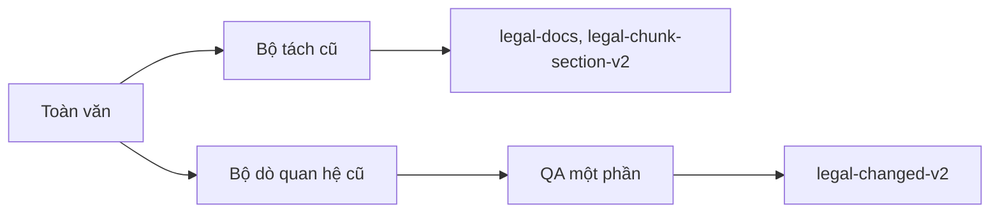
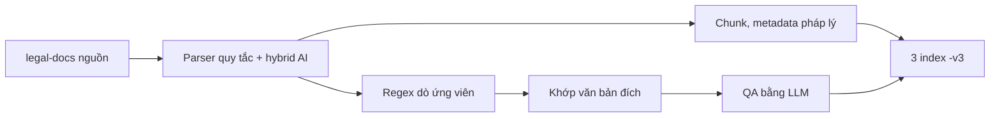
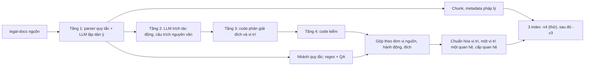

# 5. Ba phiên bản dữ liệu: v2, v3, v4

Tài liệu này so sánh 3 phiên bản. Mỗi phiên bản có: bên ghi, luồng, cải tiến, chất lượng đo được, trạng thái. Đọc tài liệu này trước khi đọc hợp đồng của từng phiên bản.

- Hợp đồng chi tiết: v2 ở [03](03-hop-dong-du-lieu-v2.md), v3 ở [04](04-hop-dong-du-lieu-v3.md), v4 ở [09](09-hop-dong-du-lieu-v4.md).
- "v4" có 2 nghĩa. **Hợp đồng v4** là dữ liệu mà luồng chốt ngày 20/10/2026 tạo ra. **Index `-v4`** là bản thử trên ES đích, ghi ngày 14/10/2026 bằng code cũ hơn. Mục 5.1 ghi rõ khác biệt.
- Mọi số liệu ghi ngày đo.

## 5.1. Tóm tắt

| Mục | v2 | v3 | v4 |
| --- | --- | --- | --- |
| Bên ghi | Luồng realtime | `vbpl_v3`, chế độ `rules` | `vbpl_v3`, chế độ `llm` (luồng 4 tầng) |
| Cụm ES | Nguồn `10.1.10.10` | Đích `10.1.10.23` | Đích `10.1.10.23` |
| Index | `legal-docs`, `legal-chunk-section-v2`, `legal-changed-v2` | `legal-docs-v3`, `legal-chunk-section-v3`, `legal-changed-v3` | `legal-docs-v4`, `legal-chunk-section-v4`, `legal-changed-v4` |
| Code tạo dữ liệu | Bộ tách cũ | Quy tắc ngày 09–13/10/2026 | Index `-v4`: code 14/10/2026. Hợp đồng v4: code chốt 20/10/2026. |
| Số bản ghi | 518.261 văn bản, 10.331.917 chunk, 180.452 quan hệ (16/10) | 204 văn bản, 6.291 chunk, 733 quan hệ (19/10) | Index `-v4`: 532 văn bản, 22.825 chunk, 2.009 quan hệ (16/10) |
| Vai trò | Nguồn. Công cụ chỉ đọc. | Bản đang đọc. Công cụ sẽ ghi lại theo hợp đồng v4. | Bản thử. Bên Graph duyệt trước khi ghi lại v3. |
| Trạng thái | Không đổi | Chờ ghi lại | Luồng đã chốt 20/10/2026. Index `-v4` chưa ghi lại bằng luồng chốt. |

Sau khi bên Graph duyệt, công cụ ghi lại v3 theo hợp đồng v4. Khi đó v3 và v4 có cùng dữ liệu, chỉ khác hậu tố index.

## 5.2. Luồng của từng phiên bản

### 5.2.1. v2: luồng realtime

- Bộ tách cũ tách Điều, khoản, điểm. 46,6% văn bản có chunk Điều rỗng nội dung (09/10/2026).
- Bộ dò cũ ghi nhiều vị trí vào một chuỗi `scope` tự do. 60,5% quan hệ chưa có văn bản đích (09/10/2026).
- `vbpl_v3` không dùng code của luồng này.

### 5.2.2. v3: chế độ `rules`

1. Parser quy tắc dựng Điều, khoản, điểm, phụ lục. LLM chỉ trả lời 2 câu hỏi mơ hồ, bằng số dòng ([02, mục 2.5.1](02-luong-hoat-dong.md#251-parser-và-hybrid-ai)).
2. Regex tìm ứng viên quan hệ ([02, mục 2.5.2](02-luong-hoat-dong.md#252-dò-ứng-viên-quan-hệ-nhánh-quy-tắc)).
3. Code khớp số hiệu với `legal-docs` nguồn.
4. LLM kiểm từng ứng viên (QA). Chỉ ứng viên đạt QA thành quan hệ.

Giới hạn: regex chỉ bắt cách viết đã gặp. LLM chỉ kiểm, không thêm được quan hệ regex bỏ sót ([08, mục 8.1](08-quan-he-4-tang-va-danh-gia.md#81-vì-sao-đổi)).

### 5.2.3. v4: chế độ `llm` (luồng chốt 20/10/2026)

| Tầng | Module | Làm gì |
| --- | --- | --- |
| 1. Cấu trúc | `structure.py`, `structure_ai.py` | Quy tắc tách văn bản. LLM lập dàn ý cho văn bản không chia Điều. LLM chỉ trả số dòng. |
| 2. Trích | `extract.py` | LLM đọc từng đơn vị có từ chỉ hành động, kèm ngữ cảnh. LLM trả hành động, văn bản đích, vị trí nguyên văn và câu trích. |
| 3. Phân giải | `resolver.py` | Code đổi văn bản đích và vị trí sang định dạng hợp đồng. Code không đoán. |
| 4. Kiểm | `validate.py` | Code kiểm câu trích có trong nguồn, có động từ của hành động, không nằm trong ngoặc kép, không là tên danh mục, đúng thẩm quyền. |

Nhánh quy tắc của v3 vẫn chạy. Code gộp hai nhánh theo bộ (đơn vị nguồn, hành động, văn bản đích). Quy tắc gộp ở [08, mục 8.2](08-quan-he-4-tang-va-danh-gia.md#82-bốn-tầng).

## 5.3. Cải tiến từ v2 sang v3

| Mục | v2 | v3 |
| --- | --- | --- |
| Toàn văn | Có văn bản NFD (7,6%) | NFC |
| Cấu trúc | 46,6% văn bản có chunk Điều rỗng | Parser mới + hybrid AI. Không có chunk Điều rỗng. |
| Quan hệ | Bộ cũ. QA một phần (35,2%). 39,5% có đích. | Dò lại từ toàn văn. Mọi quan hệ qua QA. |
| Vị trí bị tác động | `scope` chữ tự do, nhiều vị trí trong một bản ghi | `scope` giữ chữ gốc. `vi_tri` theo định dạng cố định. |
| Nguyên tắc quan hệ | — | Chỉ tác động văn bản nêu trực tiếp. Không suy ra tác động lên đơn vị cha, con hay văn bản khác. |
| Metadata cho đồ thị | Không có | Ngày hiệu lực, ngày hết hiệu lực, hồi tố, `la_vbqppl`, `cap_hieu_luc`, `hieu_luc_tac_dong`, `cap_quan_he`, `dan_chieu` |
| Hành động | 5 giá trị | 13 giá trị |

Số liệu v2 đo ngày 09/10/2026 trên toàn kho.

## 5.4. Cải tiến từ v3 sang v4

### 5.4.1. Dữ liệu

| Mục | v3 hiện có | Hợp đồng v4 |
| --- | --- | --- |
| Một quan hệ có mấy vị trí | Có thể nhiều (68/733) | Đúng một, hoặc rỗng |
| Vị trí mẫu biểu | `Mẫu số 01 Phụ lục I` | Phụ lục chứa mẫu: `Phụ lục I` |
| Vị trí ngoài định dạng | Có (4 quan hệ) | Chuyển sang `doi_tuong` |
| Tiểu điểm | Không có | Chunk `tieu_diem`, vị trí `tiểu điểm …` |
| Ngày hiệu lực theo đơn vị | Không có | `hieu_luc_rieng` ở văn bản, ngày hiệu lực ở mọi chunk |
| Quan hệ hợp nhất | Không có | `hop-nhat` (`hn_`) |
| Trạng thái cạnh | Không có | `resolution_status`, `resolution_reason`, `extraction`, `evidence`, `target_section` |
| Dòng bảng phụ lục | Không đọc | Một dòng nêu văn bản đích và hành động cho một quan hệ: `Phụ lục <n> [Mục <m>] STT <k>` |
| Phụ lục viết thành đoạn văn | Không đọc | Đơn vị `Phụ lục <n> Mục <m>` |
| `noi_nhan` | Dính dòng chữ ký (132/204 văn bản) | Chỉ có nơi nhận |
| Quan hệ lên thủ tục hành chính | Không tách | `doi_tuong_loai = thu_tuc_hanh_chinh`, `ma_thu_tuc` |
| Văn bản có toàn văn tiếng Anh | Có thể có bản ghi sai cấu trúc | Bỏ qua |

Danh sách đầy đủ ở [04, mục 4.10](04-hop-dong-du-lieu-v3.md#410-khác-với-hợp-đồng-đích-và-lỗi-đã-biết) và [09, mục 9.2](09-hop-dong-du-lieu-v4.md#92-khác-với-v3-hiện-có).

### 5.4.2. Cách dò quan hệ

| Vấn đề của v3 | Cách v4 giải quyết | Ngày |
| --- | --- | --- |
| Regex bỏ sót cách viết mới | LLM đọc mọi đơn vị có từ chỉ hành động | 15/10 |
| Câu nhắc tới bị nhận là hành động (ghi chú lịch sử, tên danh mục, câu dẫn chiếu) | Prompt định nghĩa "thực hiện". Tầng 4 loại câu trong ngoặc kép, tên danh mục, ghi chú lịch sử. | 15/10 |
| Danh sách văn bản trong phụ lục không được đọc | Điều "bãi bỏ các văn bản tại Phụ lục …" nhận danh sách dòng của phụ lục. Danh sách dài được hỏi theo phần. | 19–20/10 |
| Danh mục thủ tục hành chính | Dòng có quan hệ khi dòng nêu quyết định đã công bố thủ tục, cùng cơ quan, và hành động nằm ở dòng hoặc đề mục | 19/10 |
| Hành động ở tên văn bản | Prompt định nghĩa hành động của tên văn bản. Chỉ đọc tên in trong văn bản, không đọc tên lưu ở nguồn (Q11). | 20/10 |
| "Kết thúc", "chấm dứt" | LLM phân loại theo định nghĩa: `bai-bo`, `ngung-hieu-luc` hoặc không phải hành động | 20/10 |
| Văn bản cấp dưới "sửa đổi Luật" | Tầng 4 loại với lý do `vuot_tham_quyen` | 20/10 |
| Danh sách vị trí lẫn cấp ("khoản 1 và điểm c khoản 3 Điều 15") | Nhánh quy tắc đọc từng mục | 20/10 |
| Văn bản đích bị nhầm với văn bản nêu trong nội dung | Prompt: đích là văn bản chứa nội dung bị tác động | 20/10 |

### 5.4.3. Chất lượng đo được

| Phiên bản | Bộ đo | Văn bản P / R | Quan hệ P / R | Điều khoản P / R |
| --- | --- | --- | --- | --- |
| v2 | Toàn kho (09/10) | 39,5% quan hệ có đích | — | — |
| v3 (chế độ `rules`, parser mới) | Blind 250 văn bản (15/10) | 62,1% / 46,4% | 94,5% / 35,0% | — |
| v4 (chế độ `llm`, 15/10) | Blind 250 văn bản (15/10) | 77,7% / 67,6% | 90,5% / 48,3% | — |
| **v4 (luồng chốt)** | **Hold-out 3, 158 văn bản mới (20/10)** | **97,4% / 92,6%** | **96,9% / 93,1%** | **84,1% / 73,7%** |

- Metadata của luồng chốt trên hold-out 3: 98,0% theo trường, 91,8% văn bản đúng cả 6 trường.
- Không so trực tiếp các dòng. Bộ chấm đổi ngày 20/10/2026: đơn vị nguồn cha hoặc con cùng hành động, cùng đích cũng tính là khớp. Các bộ đo khác nhau.
- Cùng code, hai lượt chạy lệch 2–4 điểm ở mức quan hệ ([08, mục 8.8.4](08-quan-he-4-tang-va-danh-gia.md#884-chốt-luồng-20102026)).
- Nhãn chuẩn do LLM (Claude) gán, chưa có nhãn của người.

## 5.5. Ánh xạ trường: `legal-docs` → `legal-docs-v3`

Mục 5.5 đến 5.7 ánh xạ v2 sang v3. Hợp đồng v4 giữ các ánh xạ này. Trường v4 thêm ở mục 5.4.1.

| Trường | v2 | v3 | Thay đổi |
| --- | --- | --- | --- |
| `document_number`, `title`, `legal_type`, `legal_sectors`, `issuing_authority`, `issuance_date`, `signers`, `tom_tat`, `action`, `url`, `pdf_minio_path`, `pdf_vbpl_id` | Có | Có | Chép nguyên. |
| `embedding` | Có | Có | Chép nguyên. Nguồn thiếu thì tạo vector của `title`. |
| `full_content` | Có, có văn bản NFD | Có, NFC | Chuẩn hóa. |
| `can_cu`, `can_cu_refs`, `noi_nhan`, `has_tail` | Có | Có | Tính lại. |
| `intro` | Có văn bản chứa cả dòng căn cứ | Chỉ phần sau căn cứ, trước Điều đầu | Tính lại. |
| `n_dieu` | Bộ cũ đếm. 3,7% lệch. | Đếm Điều văn bản chính | Tính lại. |
| `phu_luc[]` | `{tieu_de, noi_dung}`. `tieu_de` chỉ có dòng nhãn. | Thêm `loai`, `ky_hieu`, `has_table`, `n_tables`, `n_table_rows`, `dieu_luat`. `tieu_de` gồm ghi chú "(Kèm theo …)". | Tính lại. Văn bản kèm theo nằm trong phần chính chuyển vào `phu_luc[]`. |
| `content_sha256`, `grade`, `text_source` | Chỉ 6 văn bản tải lên | Mọi văn bản | Mới cho `legacy`. |
| `origin`, `ingest_job_id`, `ingest_revision`, `ingested_at`, `uploaded_by` | Chỉ 6 văn bản tải lên (`uploaded_by = api`) | Mọi văn bản (`uploaded_by = migration-v3`) | Mới cho `legacy`. |
| `la_vbqppl`, `la_vbqppl_cach`, `cap_hieu_luc`, `cap_hieu_luc_nhan`, `cap_hieu_luc_ghi_chu` | Không có | Có | Mới. |
| `ngay_hieu_luc`, `ngay_hieu_luc_cach`, `ngay_hieu_luc_trich` | Không có | Có | Mới. |
| `ngay_het_hieu_luc`, `ngay_het_hieu_luc_cach`, `ngay_het_hieu_luc_trich` | Không có | Có | Mới. |
| `hoi_to`, `ngay_hoi_to`, `ngay_hoi_to_trich`, `hoi_to_vi_tri` | Không có | Có | Mới. |
| `ngay_hieu_luc_so_ngay`, `hieu_luc_rieng` | Không có | Hợp đồng v4 | Mới. Số ngày sau mốc; ngày hiệu lực riêng của từng Điều, khoản, điểm. |

## 5.6. Ánh xạ trường: `legal-chunk-section-v2` → `legal-chunk-section-v3`

| Mục | v2 | v3 |
| --- | --- | --- |
| `chunk_type` | 10 giá trị | Thêm `noi_dung_full`, `tieu_diem` (12 giá trị) |
| Dưới cấp điểm | Không có | Chunk `tieu_diem` `<doc>_d<x>_k<y>_p<z>_t<n>` cho mục gạch đầu dòng của điểm. Trường `diem_uid`, `so_tieu_diem`. |
| Ngày hiệu lực | Không có | Mọi chunk có `ngay_hieu_luc`, `ngay_hieu_luc_cach`, `ngay_hieu_luc_so_ngay`, `ngay_hieu_luc_rieng`. Chunk hồi tố có `ngay_hoi_to`. |
| Văn bản không cấu trúc, nội dung dài | Một chunk `<doc>_nd` | `<doc>_nd_full` và các đoạn `<doc>_nd<k>` (trường `so_doan`). Mỗi đoạn tối đa khoảng 200 âm tiết. |
| Văn bản kèm theo nằm trong phần chính | `<doc>_s<s>_d<x>…` | `<doc>_pl<i>_d<x>…`. **ID đổi.** |
| Trùng ID | — | Chunk sau có thêm `_2`, `_3`… |
| Chunk Điều rỗng nội dung | 46,6% văn bản | 0 |
| `dan_chieu[]` | Không có | Mới |
| `embedding` | Có | Dùng lại vector v2 khi chuỗi `tieu_de + " " + noi_dung` không đổi. Chuỗi khác thì tạo vector mới. |
| 5 trường truy vết | Chỉ chunk của văn bản tải lên | Mọi chunk |
| Các trường khác | — | Giữ tên, kiểu và nghĩa |

Tiểu điểm và ngày hiệu lực trên chunk chỉ có từ hợp đồng v4. v3 hiện có chưa có ([04, mục 4.10](04-hop-dong-du-lieu-v3.md#410-khác-với-hợp-đồng-đích-và-lỗi-đã-biết)).

## 5.7. Ánh xạ trường: `legal-changed-v2` → `legal-changed-v3`

Công cụ không chép quan hệ v2. Công cụ dò lại mọi quan hệ từ toàn văn. **Không có ánh xạ một–một giữa bản ghi v2 và bản ghi v3.**

| Mục | v2 | v3 và v4 |
| --- | --- | --- |
| `_id` | `<n>` là bộ đếm chung. Có hậu tố `_split`, `_f<n>`. Ví dụ `602450_78359`. | `<n>` đếm từ 0 theo từng văn bản nguồn và tiền tố. Không có hậu tố, không khuyết số. Ví dụ `602450_1`. |
| Tiền tố `_id` | `hidden_`, `hhl_`, `intro_` | Thêm `hd_` (quan hệ hướng dẫn), `hn_` (quan hệ hợp nhất) |
| `action` | 5 giá trị | 13 giá trị. Thêm `thay-cum-tu`, `dinh-chi`, `ngung-hieu-luc`, `dinh-chinh`, `gia-han`, `huong-dan`, `quy-dinh-chi-tiet`, `hop-nhat`. |
| `detection_mode` | `hidden`, `het_hieu_luc`, `intro` | Thêm `title_guidance`, `hop_nhat`. Hợp đồng v4 thêm `llm`. |
| Một bản ghi | Một câu, nhiều vị trí | Một vị trí. Câu có N vị trí cho N quan hệ cùng `scope`. |
| `scope` | Chữ tự do, một chuỗi cho nhiều vị trí | Chữ gốc, chuẩn hóa `toàn bộ`. Không dùng để nối. |
| `vi_tri` | Không có | Mảng có tối đa một vị trí đủ cấp, định dạng cố định |
| Đơn vị nguồn | Thường dừng ở khoản | Xuống tới điểm (`Điều 1 Khoản 1 điểm a`). Hợp đồng v4 thêm dòng bảng và đề mục của phụ lục. |
| Văn bản hợp nhất | Có thể có quan hệ từ ghi chú | Chỉ có quan hệ `hop-nhat` tới văn bản được hợp nhất |
| Lời dẫn và Điều cùng đích | Có ca bị bỏ | Luôn có quan hệ riêng |
| QA | `scope_grounding_checked` ở 35,2% | v3: mọi quan hệ qua QA hành động. Hợp đồng v4: quan hệ do LLM đọc qua tầng 4. |
| `unresolved = true` | 13,0% | Bản thử `-v4`: 9/969 (0,9%, 14/10) |
| `scope_resolution_method` | text + keyword. Chỉ `explicit_declaration`. | keyword. Thêm `liet_ke_vi_tri`. |
| `target_issuing_authority` | text + keyword | keyword |
| `inherited_from_v1` | 1.580 bản ghi | Không ghi. Mapping còn trường này. |
| Trường mới | — | `vi_tri`, `cap_quan_he`, `hieu_luc_tac_dong`, `source_ngay_hieu_luc`, `source_ngay_hoi_to`, `cum_tu`, `doi_tuong`, `kem_theo`, `dinh_chi_tu_ngay`, `dinh_chi_den_ngay`, `dinh_chi_den_khi`, `gia_han_den_ngay`, `gia_han_den_khi`, `target_match_note`. Hợp đồng v4 thêm `resolution_status`, `resolution_reason`, `extraction`, `evidence`, `target_section`. |

So sánh trên cùng văn bản `602450` (NĐ 31/2024/NĐ-CP):

| | v2 | v3 |
| --- | --- | --- |
| Số quan hệ | 18 | 40. Mỗi điểm sửa đổi là một quan hệ. |
| Ví dụ | `602450_78359`: `source_path = Điều 1 Khoản 1`, `scope = Điều 2` | `602450_1`: `source_path = Điều 1 Khoản 1 điểm a`, `vi_tri = ["điểm a khoản 3 Điều 2"]` |
| Ca lỗi | `602450_78360`: `scope = Phụ lục ba`, `unresolved = true` | Vị trí phụ lục theo định dạng `Phụ lục <ký hiệu>` |

## 5.8. Việc cần làm ở bên đọc

1. Đổi tên index. Đề xuất: dùng alias riêng, ví dụ `legal-docs-current`, trỏ tới index đang dùng.
2. Đọc `vi_tri` để nối node. Không phân tích `scope`.
3. Không lưu `_id` quan hệ làm khóa lâu dài. `_id` đổi khi chạy lại văn bản nguồn.
4. Mỗi quan hệ có tối đa một vị trí. Gom các quan hệ cùng câu bằng `source_id`, `source_path`, `action`, `scope`.
5. Cập nhật ID chunk đã lưu: `<doc>_s<s>_…` của v2 thành `<doc>_pl<i>_…` của v3.
6. Phân biệt 2 trường `action`. `legal-docs-v3.action` phân loại văn bản (`huongdan`). `legal-changed-v3.action` là hành động của quan hệ (`huong-dan`).
7. `target_matched_id` và `dan_chieu[].target_id` trỏ tới `legal-docs` nguồn. Văn bản đích chỉ có trong v3 khi văn bản đó đã chuyển.
8. `legal_sectors` trên chunk và `source_legal_sectors` trên quan hệ vẫn là chuỗi, không phải mảng.
9. Với hợp đồng v4: chỉ dựng cạnh khi `resolution_status = validated`. Quan hệ `unresolved` là hành động thật, chưa đủ căn cứ, chờ duyệt.
