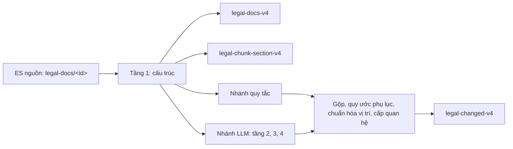

# 9. Hợp đồng dữ liệu v4

Tài liệu này là hợp đồng dữ liệu của 3 index v4 trên ES đích `10.1.10.23`. Bên dữ liệu ghi các index này bằng công cụ `vbpl_v3`. Bên Graph và bên tìm kiếm đọc các index này.

- Hợp đồng mô tả dữ liệu mà lệnh `convert` ghi ở chế độ `llm` (mặc định), code chạy hiện hành master `1117e63` (27/10/2026).
- Index `-v4` ghi bằng code `1117e63` ngày 27–28/10/2026, trừ 7 văn bản. Mục 9.1 nêu trạng thái và các điểm lệch.
- Nguyên tắc chung: **chỉ lưu tác động mà văn bản nêu trực tiếp. Không suy ra tác động mà văn bản không nói.**
- Cột "Đo 28/10" là số đếm ngày 28/10/2026 trên toàn bộ `-v4` (30.988 văn bản), chỉ đọc ES.
- Cột "Đo 21/10" là số đo ngày 21/10/2026 trên 1.000 văn bản ghi đầu tiên (code `013e897`). Dữ liệu đó đã bị ghi đè. Số này chỉ cho biết cỡ, không mô tả dữ liệu hiện có.
- Ví dụ viết dạng `<index>/<_id>`, hoặc chỉ `_id` khi index đã rõ. Ví dụ không ghi lượt là bản ghi có trong index `-v4`; kiểm lại ngày 28/10/2026.
- Ví dụ ghi "lượt `<tên>`" lấy từ lượt chạy thử bằng code `8b023ca` (27/10/2026), chưa ghi ES. Kết quả ở `work/<tên>/dry-run/<doc>.json`. Bản ghi cùng `_id` trong `-v4` có thể khác, vì `_id` quan hệ đổi khi chạy lại (mục 9.10.3).
- Nghĩa của giá trị enum ở [06-bang-enum.md](06-bang-enum.md). Cách công cụ tạo dữ liệu ở [02-luong-hoat-dong.md](02-luong-hoat-dong.md). Luồng 4 tầng và cách đánh giá ở [08](08-quan-he-4-tang-va-danh-gia.md).

## 9.1. Trạng thái v4

| Index | Số bản ghi (đo 28/10/2026) |
| --- | --- |
| `legal-docs-v4` | 30.988 |
| `legal-chunk-section-v4` | 1.534.375. Mọi chunk có `embedding`. |
| `legal-changed-v4` | 75.506: 70.954 `validated`, 4.552 `resolution_status = unresolved` |

- **Phạm vi.** 30.988 văn bản ban hành từ `2025-03-12` đến `2026-09-30`. Năm 2025: 27.980 văn bản. Năm 2026: 3.008 văn bản.
- **Code ghi.** 30.981 văn bản ghi bằng code `1117e63`. 7 văn bản còn bản ghi ngày 22/10/2026 (code `2911b77`), xem bảng điểm lệch dưới.
- **Lượt ghi.** Hai lượt chạy đêm 27/10/2026. `ingest_job_id` cho biết lượt đã ghi văn bản (đếm 28/10/2026):

| `ingest_job_id` | Lượt | Văn bản | Chunk | Quan hệ |
| --- | --- | --- | --- | --- |
| `v3:20261027T154058Z` | `v4-next20000`: văn bản mới, ban hành 12/03/2025–08/10/2025. Danh sách: `work/v4-next20000-ids.txt`. | 19.988 | 908.071 | 44.509 |
| `v3:20261027T154523Z` | `v4-2710`: ghi lại 11.000 văn bản cũ của `-v4`. Câu trả lời LLM lấy từ bộ đệm lượt `v4-2210`. | 10.993 | 626.304 | 30.982 |
| `v3:20261022T044254Z`, `v3:20261022T083345Z` | Bản ghi ngày 22/10/2026 của 7 văn bản lỗi ở lượt `v4-2710` | 6 + 1 | 0 | 9 + 6 |

- **Văn bản lỗi.** Lượt `v4-next20000` còn 10 văn bản lỗi, chưa có bản ghi văn bản: 650872, 651044, 651412, 663486, 668834, 670096, 671294, 672275, 672379, 675570.
- **Vector.** Mọi vector của chunk là vector bge-m3 đủ độ dài, không cắt ở 256 token (mục 9.9). Lượt `v4-2710` dùng lại vector của `-v4` khi chữ của chunk không đổi (`EMBEDDING_REUSE=target`).
- **Kiểm hợp đồng.** Lệnh `python -m eval.check_contract v4` chưa chạy lại trên 30.988 văn bản. Mục 9.12 ghi kết quả kiểm bằng truy vấn ES ngày 28/10/2026.
- **Đợt tiếp theo.** Chưa có lệnh chạy. Còn các ID sau 10.000 ID đầu của `work/v4-next10000b-ids.txt` và `work/v4-next10000c-ids.txt` (chưa đếm).
- **Đánh giá theo đợt.** Mỗi đợt văn bản mới có một mẫu để gán nhãn và chấm (`python -m eval.sample_batch`, `eval/README.md`). Đợt 20.000: mẫu 2.000 văn bản `eval/sets/dot-20000-20261028`, nhãn agent chưa người duyệt.
- **Duyệt.** Bên Graph duyệt v4. Sau khi duyệt, bên dữ liệu ghi lại v3 theo hợp đồng này, chỉ đổi hậu tố `-v4` thành `-v3`. Các bước ở [02, "Ghi thử vào v4"](02-luong-hoat-dong.md#ghi-thử-vào-v4-trước-khi-ghi-lại-v3).

**Điểm lệch của dữ liệu `-v4` so với hợp đồng (đo 28/10/2026).**

| Điểm | Dữ liệu | Ảnh hưởng |
| --- | --- | --- |
| 7 văn bản lỗi ở lượt `v4-2710` | 679994, 682498, 685655, 686325, 694929, 694935, 696357. Bản ghi văn bản và quan hệ là bản ngày 22/10/2026 (code `2911b77`). Chunk cũ đã bị xóa. Chunk là chunk của lượt `v4-2710`, có thể chỉ ghi được một phần: 0 đến 1.800 chunk mỗi văn bản, luôn là bội của 300. Không chunk nào trong số đó nằm trong phụ lục. | Chunk của 7 văn bản này có thể thiếu. Ghi lại 7 văn bản để sửa. |
| Văn bản không có chunk | 682498, 685655 (2 trong 7 văn bản trên). | Sai bất biến 1 (mục 9.12). |
| Chunk không có văn bản | `doc_id` 672275 có 1.500 chunk. Văn bản này lỗi ở lượt `v4-next20000`, nên chưa có bản ghi văn bản và quan hệ. | Sai bất biến 1. Số `doc_id` khác nhau của chunk: 30.987. |
| Vector văn bản | Văn bản ghi bằng `1117e63` có vector chép từ `legal-docs` nguồn (mục 9.8.2). 7 văn bản trên có vector của `title`, tạo lại ngày 26/10/2026. | Không ảnh hưởng nối. |
| `thay-cum-tu` thiếu `cum_tu` | 205/11.042 quan hệ `thay-cum-tu`. | Sai bất biến 18. |

Khi ghi lại, công cụ xóa chunk và quan hệ cũ trước, rồi ghi bản mới (mục 9.2). Văn bản lỗi giữa chừng có thể mất chunk như 682498, 685655. Chạy lại văn bản đó để sửa.

## 9.2. Luồng tạo dữ liệu



| Bản ghi | Công cụ lấy từ | Cách tạo | Bước ở [02, mục 2.4](02-luong-hoat-dong.md#24-luồng-một-văn-bản) |
| --- | --- | --- | --- |
| Văn bản | `legal-docs/<id>` nguồn | Chép metadata. Tách cấu trúc. Tính địa vị pháp lý và thời điểm hiệu lực bằng quy tắc. | 1–4 |
| Chunk | Cấu trúc của văn bản | Một chunk cho mỗi Điều, khoản, điểm, tiểu điểm, phụ lục, đề mục, đoạn. Gắn dẫn chiếu, ngày hiệu lực, vector. | 5, 7, 8 |
| Quan hệ | Câu chữ của văn bản | Nhánh LLM và nhánh quy tắc cùng dò. Công cụ gộp hai nhánh, nối văn bản đích, tách một vị trí một quan hệ. | 6, 9–12 |

Quan hệ đi qua các bước sau, theo thứ tự. Chi tiết ở [02, mục 2.5.8](02-luong-hoat-dong.md#258-nhánh-llm-4-tầng-và-gộp).

| # | Bước | Code |
| --- | --- | --- |
| 1 | Nhánh quy tắc tìm ứng viên bằng regex. QA (model LLM) giữ ứng viên có căn cứ. | `relations.detect`, `qa.verify` |
| 2 | Tầng 2: LLM đọc các đơn vị có tín hiệu, gom theo Điều. LLM ghi hành động, đích, phạm vi và câu trích. | `extract.extract` |
| 3 | Đơn vị nêu từ 8 văn bản trở lên: công cụ hỏi LLM theo phần. Văn bản nằm trong chữ của đơn vị hoặc trong danh sách kèm theo. Mỗi phần có 5 văn bản và giữ lời dẫn của đơn vị. | `extract.list_parts`, `LIST_MIN`, `LIST_PART` |
| 4 | Mỗi phần mang toàn văn đơn vị ở khóa `_noi_dung_goc`. Công cụ không gửi khóa bắt đầu bằng `_` cho LLM. | `extract.list_parts` |
| 5 | Tầng 3: code đổi chữ LLM đọc thành đích, vị trí, `doi_tuong`. Câu "Bỏ cụm từ X …" mà LLM ghi `bai-bo` thành `thay-cum-tu` với `cum_tu[].moi` rỗng (R4). | `resolver` |
| 6 | Tầng 4: code kiểm từng hàng với câu nguồn. Hàng bị loại không ghi ES. Lý do loại ghi ở `work/<run>/extract/<doc>/rejected.json`. | `validate.check` |
| 7 | Tầng 4 kiểm ghi chú lịch sử trên toàn văn đơn vị (`_noi_dung_goc`), không chỉ trên phần LLM đọc. Câu lấy từ phần bị cắt là câu của chính đơn vị. | `validate.only_noted` |
| 8 | Công cụ bỏ quan hệ của nhánh quy tắc có đích chỉ nằm trong ghi chú lịch sử. Bước này chạy sau QA. | `convert.model_relations`, `validate.only_in_history` |
| 9 | Công cụ gộp hai nhánh theo đơn vị nguồn, hành động và văn bản đích. | `convert.model_relations` |
| 10 | Công cụ áp quy ước phụ lục (mục 9.5.1) lần thứ nhất, cho quan hệ của cả hai nhánh. | `resolver.appendix_scope` |
| 11 | Công cụ thêm quan hệ hướng dẫn (`hd_`) và hợp nhất (`hn_`). Các quan hệ này không qua bước 10. | `references.guidance`, `relations.consolidation` |
| 11a | Công cụ bỏ mọi quan hệ có `source_path` là `intro`, `Tiêu đề`, `Lời dẫn`, `Căn cứ` hoặc `Phần đầu`, trừ `hop-nhat` (R6). Vì vậy dữ liệu không có quan hệ `intro_` và `hd_`. Các Điều mang tác động. | `convert.convert_document`, `convert.DOCUMENT_LEVEL` |
| 12 | Quan hệ chưa có `vi_tri` nhận vị trí đọc từ `scope`. | `convert.convert_document` |
| 12a | Tầng 4 kiểm lại vị trí trên quan hệ đã gộp của cả hai nhánh. Mỗi cấp của vị trí phải có câu nêu nó. Điều lấy nhầm số Điều của đơn vị nguồn được sửa theo câu dẫn, hoặc thành `unresolved`. | `validate.check_positions` |
| 12b | `sua-doi` và `bo-sung` theo động từ của câu nêu vị trí (R3). Quan hệ `sua-doi` hoặc `bo-sung` có câu nêu vị trí là "Bãi bỏ …" thành `bai-bo`. Câu "Bổ sung cụm từ Y vào trước/sau Z" không tạo quan hệ (R5). | `validate.own_verbs`, `validate.inserts_phrase` |
| 13 | Vị trí ngoài định dạng chuyển sang `doi_tuong`. Dòng "số thứ tự" của danh mục nhận phụ lục chứa dòng. | `convert.tidy_positions` |
| 14 | Công cụ áp quy ước phụ lục lần thứ hai, cho mọi quan hệ. Lần này phủ vị trí và `doi_tuong` ghi ở bước 12–13, và `cum_tu[].vi_tri`. Áp lại không đổi kết quả của bước 10. | `convert.tidy_positions(appendix=True)`, `resolver.appendix_scope` |
| 15 | Cùng đơn vị nguồn, hành động và văn bản đích: công cụ bỏ vị trí cha, giữ vị trí con. | `convert.tidy_positions` |
| 16 | Công cụ tách một vị trí một quan hệ. Cặp cụm từ nêu vị trí riêng thì vị trí của cặp là vị trí của quan hệ. Chữ vị trí gốc của bước 10 và 14 ghi vào `chi_tiet_vi_tri`. | `convert.one_per_position` |
| 16a | Một cạnh ghi một lần. Cạnh là bộ (hành động, đích, vị trí, `doi_tuong`, cặp cụm từ). Cạnh có ở đơn vị cha và đơn vị con thì công cụ giữ đơn vị con. Cạnh lặp trong một đơn vị thì công cụ giữ một, ưu tiên `validated`. | `convert.distinct_edges` |
| 16b | Câu dẫn không có vị trí, `doi_tuong`, cặp cụm từ, mà đơn vị con nêu cùng hành động lên cùng đích: công cụ bỏ câu dẫn (R2). Câu dẫn không có cặp cụm từ mà đơn vị con có cặp tại cùng vị trí: công cụ bỏ câu dẫn. | `convert.distinct_edges` |
| 16c | Đơn vị nguồn là Điều, khoản hoặc điểm: `evidence` là một câu nguyên văn của chính đơn vị đó (R12). Thay cụm từ: câu chứa cụm từ cũ. Hành động khác: câu nêu vị trí, hoặc câu đầu của đơn vị. Không nối đoạn bằng "…". Bước này chạy cho cả quan hệ của nhánh quy tắc. | `validate.own_quotes` |
| 17 | Công cụ tính `cap_quan_he`, `resolution_status` (mục 9.10.7, 9.10.8). | `convert.settle` |

Bước 14 chỉ chạy ở chế độ `llm`.

- Công cụ ghi theo thứ tự: chunk, văn bản, quan hệ.
- Khi ghi lại một văn bản, công cụ xóa chunk và quan hệ cũ của văn bản đó. Chunk khớp theo `doc_id`. Quan hệ khớp theo `source_id`. Sau đó công cụ ghi bản ghi mới.
- Văn bản hợp nhất không qua nhánh LLM. Quan hệ duy nhất của văn bản hợp nhất là `hop-nhat`.

## 9.3. Phạm vi và quy ước

| Index | Một bản ghi là | Số bản ghi (đo 28/10/2026) | Mẫu `_id` |
| --- | --- | --- | --- |
| `legal-docs-v4` | Một văn bản | 30.988 | `<doc>`, bằng `_id` ở `legal-docs` nguồn. Ví dụ: `694952`. |
| `legal-chunk-section-v4` | Một chunk | 1.534.375 | `<doc>_<đơn vị>`. Ví dụ: `694952_d1_k3_pa`. |
| `legal-changed-v4` | Một quan hệ | 75.506 | `[<tiền tố>]<source_id>_<n>`. Ví dụ: `694952_4`. |

Quy tắc chung:

1. Trường ghi "Luôn" hoặc "Mọi …" có ở mọi bản ghi. Trường ghi "Có khi X" có khi X đúng và thiếu khi X sai.
2. Bên đọc chỉ dùng trường có trong hợp đồng. Đo 28/10/2026: mapping của 3 index trên ES bằng mapping trong `vbpl_v3/mappings/`. ES chưa tự thêm trường nào.
3. Mapping cho phép ES tự thêm trường. Công cụ không ghi trường ngoài hợp đồng.
4. Mapping `legal-changed-v4` có trường `inherited_from_v1`. Dữ liệu không có trường này. Không dùng trường này.
5. Vector có 1.024 chiều, model `BAAI/bge-m3`, đã chuẩn hóa. `legal-changed-v4` không có vector.

| Ký hiệu | Nghĩa |
| --- | --- |
| Có khi X | Trường có khi X đúng. Trường thiếu khi X sai. |
| `null` | Trường có. Giá trị là `null`. |
| Rỗng | Giá trị là `""` hoặc `[]`. |
| Ngày | Chuỗi `YYYY-MM-DD` hợp lệ. |
| Thời điểm | Chuỗi ISO 8601 có múi giờ. |
| A ⇔ B | A đúng khi và chỉ khi B đúng. |

## 9.4. Khóa nối

| Từ | Đến | Quy tắc | Đo | Ví dụ |
| --- | --- | --- | --- | --- |
| chunk `doc_id` | văn bản `_id` | Mọi chunk thuộc một văn bản có trong `legal-docs-v4`. Mọi văn bản có ít nhất một chunk. | 28/10/2026: sai ở 3 văn bản. `doc_id` 672275 có chunk, không có văn bản. 682498, 685655 không có chunk (mục 9.1). | `694952_d1_k3_pa` → `694952` |
| chunk `dieu_uid`, `khoan_uid`, `diem_uid` | node Điều, khoản, điểm | Các trường này gom chunk con với đơn vị chứa nó. `_id` của chunk bắt đầu bằng `dieu_uid`. | — | `694952_d1_k3_pa`: `dieu_uid = 694952_d1`, `khoan_uid = 694952_d1_k3` |
| chunk `phu_luc_uid` | node phụ lục | Mọi chunk của phần thứ `i` có `phu_luc_uid = <doc>_pl<i>`: chunk `phu_luc`, `phu_luc_doan`, chunk Điều trong phụ lục. | 28/10/2026: 701.376 chunk có trường này, bằng số chunk có `in_phu_luc`. | `674935_pl0_doan2` → `674935_pl0` |
| chunk `muc_uid` | node đề mục | Chunk `muc` và `muc_doan` của một đề mục có `muc_uid` bằng `_id` của chunk `muc`. | 28/10/2026: 20.717 `muc`, 101.033 `muc_doan` có trường này. | `674626_mI_doan2` → `674626_mI` |
| quan hệ `source_id` | văn bản `_id` | Văn bản nguồn luôn có trong `legal-docs-v4`. `source_id` là số nguyên. `_id` là chuỗi. | 28/10/2026: 13.627 văn bản nguồn | `694952_4` → `694952` |
| quan hệ `target_matched_id` | `legal-docs._id` nguồn | Văn bản đích có trong v4 chỉ khi văn bản đó nằm trong 30.988 văn bản của mục 9.1. | 28/10/2026: 64.277 quan hệ có đích, 19.318 đích khác nhau. 9.164 quan hệ có đích trong v4 (2.956 đích). | `694952_4` → `legal-docs/643741` |
| chunk `dan_chieu[].target_id` | `legal-docs._id` nguồn | Như `target_matched_id`. `null` khi công cụ chưa nối được. | 21/10/2026: 1.395/6.469 dẫn chiếu `ngoai`, `van_ban_bi_sua` có `null` | `697023_d22_k3` → `legal-docs/657421` |

## 9.5. Vị trí

Các trường `vi_tri`, `cum_tu[].vi_tri`, `dan_chieu[].vi_tri`, `hoi_to_vi_tri` và `hieu_luc_rieng[].vi_tri` dùng định dạng này. Vị trí thuộc văn bản đích, văn bản được dẫn chiếu, hoặc chính văn bản (`hoi_to_vi_tri`, `hieu_luc_rieng`).

Cột "Quy ước phụ lục" cho biết bước 10 và 14 ở mục 9.2 làm gì với dạng đó (mục 9.5.1).

| Dạng | Nghĩa | Quy ước phụ lục | Ví dụ (`legal-changed-v4`) |
| --- | --- | --- | --- |
| `Điều <x>` | Cả Điều | Giữ | `Điều 8` (`900000017_0`), `Điều 36a` (`697023_66`) |
| `khoản <y> Điều <x>` | Cả khoản | Giữ | `khoản 3 Điều 39` (`900000015_15`), `khoản 1b Điều 4` (`hidden_696341_0`) |
| `điểm <z> khoản <y> Điều <x>` | Cả điểm | Giữ | `điểm a khoản 1 Điều 8` (`694952_4`), `điểm đ1 khoản 3 Điều 4` (`697025_6`), `điểm 2.2 khoản 2 Điều 3` (`693628_7`) |
| `tiểu điểm <n> điểm <z> khoản <y> Điều <x>` | Mục gạch đầu dòng thứ `n` của một điểm | Giữ | `tiểu điểm 3 điểm b khoản 6 Điều 37` (`697176_24`) |
| `tên Điều <x>` | Chỉ tên Điều. Nội dung Điều giữ nguyên. | Giữ | `tên Điều 7` (`694599_35`) |
| `tên Chương <c>` | Chỉ tên Chương | Giữ | `tên Chương III` (`900000011_11`) |
| `Chương <c>` | Cả Chương | Giữ | `Chương I` (`672539_6`) |
| `tên Mục <n> Chương <c>` | Chỉ tên Mục của một Chương | Giữ | `tên Mục 2 Chương II` (`681550_6`) |
| `Mục <n> Chương <c>` | Cả Mục của một Chương | Giữ | `Mục 6 Chương II` (`694149_54`) |
| `Phụ lục <ký hiệu>` | Phụ lục có ký hiệu đó | Kết quả của quy ước | `Phụ lục II` (`696878_0`), `Phụ lục 1` (`694022_0`) |
| `Phụ lục` | Phụ lục. Câu nguồn không nêu ký hiệu, hoặc nêu nhiều ký hiệu. | Kết quả của quy ước | `Phụ lục` (`697544_2`) |
| `tên Mục <n>` | Chỉ tên Mục. Câu không nêu Chương chứa Mục. | Giữ khi `<n>` là số Ả Rập | `tên Mục 1` (`694501_107`) |
| `Mục <n>` | Cả Mục. Câu không nêu Chương chứa Mục. | Đổi thành `Phụ lục`. Chữ gốc ở `chi_tiet_vi_tri`. | `693608_0`: `vi_tri = ["Phụ lục"]`, `chi_tiet_vi_tri` "Mục I" |
| `Mục <ký hiệu> Phụ lục [<ký hiệu>]`, `Mục <ký hiệu> Phần <ký hiệu> Phụ lục [<ký hiệu>]` | Mục, Phần của một phụ lục | Đổi thành `Phụ lục <ký hiệu>`, hoặc `Phụ lục` khi không có ký hiệu. Chữ gốc ở `chi_tiet_vi_tri`. | `696025_0`: `Phụ lục I`, `chi_tiet_vi_tri` "Mục A Phụ lục I". `697544_0`: `Phụ lục I`, `chi_tiet_vi_tri` "Mục A Phần I Phụ lục I". |
| `tên văn bản` | Chỉ tên văn bản | Giữ | `697028_2` |
| `toàn bộ` | Cả văn bản | Giữ | `697547_0` |

Code `1117e63` không ghi dạng có cột "Đổi …". Ô ví dụ của các dạng này ghi kết quả sau khi đổi.

Thành phần:

- `<x>`, `<y>`: số, có thể kèm một chữ thường. Ví dụ: `36a`, `1b`.
- `<z>`: chữ cái, có thể kèm số (`a`, `đ`, `đ1`, `b1`), hoặc số thập phân (`2.2`).
- `<c>`: số La Mã hoặc số (`II`, `1`). Công cụ ghi đúng như văn bản đích viết.
- `tiểu điểm`, `khoản`, `điểm`, `tên` viết thường. `Điều`, `Chương`, `Mục`, `Phần`, `Phụ lục` viết hoa chữ đầu.

Quy tắc:

1. Một quan hệ có một vị trí. Câu "khoản 2, 3, 4 Điều 7" cho 3 quan hệ: `khoản 2 Điều 7`, `khoản 3 Điều 7`, `khoản 4 Điều 7`.
2. Câu "điểm a và điểm b khoản 2 Điều 11" cho `điểm a khoản 2 Điều 11` và `điểm b khoản 2 Điều 11`. Điểm trước nhận khoản và Điều của điểm sau.
3. Gạch đầu dòng của khoản hoặc của Điều, câu, đoạn không có node. Vị trí dừng ở khoản hoặc Điều chứa nó. Câu "đoạn 3, điểm a, khoản 2, Điều 4" cho `điểm a khoản 2 Điều 4`.
4. Gạch đầu dòng của một điểm là tiểu điểm. Câu "gạch đầu dòng thứ 3 điểm b khoản 6" cho `tiểu điểm 3 điểm b khoản 6 Điều 37` (`697176_24`).
5. Tiết hoặc mục số La Mã bên trong một Điều không có node. Câu "điểm b tiết 3.5, mục III, Điều 1" cho `Điều 1`.
6. Mẫu biểu nằm ở phụ lục chứa nó. Câu "Mẫu số 04 Phụ lục I" cho `Phụ lục I`. Tên mẫu nằm ở `chi_tiet_vi_tri` (mục 9.10.6).
7. Một dòng "số thứ tự N" của danh mục hoặc bảng không có node. Vị trí là phụ lục chứa danh mục. Câu chỉ nêu danh mục bằng tên thì `vi_tri` là phụ lục và `doi_tuong` là tên danh mục (mục 9.5.1).
8. Câu nêu Mục mà câu dẫn nêu đúng một phụ lục ("Sửa đổi, bổ sung Phụ lục III …: 2. Bổ sung Mục 6") cho Mục 6 của Phụ lục III. Theo quy ước phụ lục, vị trí là `Phụ lục III` và `chi_tiet_vi_tri` là "Mục 6 Phụ lục III".
9. Vị trí nằm sau số hiệu văn bản đích là một phần tên của văn bản đó. Câu "thay thế Quyết định số 42/2018/QĐ-UBND … sửa đổi Điểm a, Khoản 2 Điều 3 …" cho `toàn bộ`.
10. Công cụ đổi `Tên Điều` thành `tên Điều` và `Phụ lục số 07` thành `Phụ lục 07`.
11. Vị trí không theo định dạng này là tên của một phần. Ở bước 13, công cụ chuyển vị trí đó sang `doi_tuong` (mục 9.10.6). Bước 14 xét `doi_tuong` đó theo quy ước phụ lục.
12. Cùng đơn vị nguồn, hành động và văn bản đích thì không có cả vị trí cha lẫn vị trí con. Công cụ giữ vị trí con. Câu "Sửa đổi điểm a, khoản 16 Điều 2" cho `điểm a khoản 16 Điều 2`, không cho `khoản 16 Điều 2`.

Đo 28/10/2026 trên `-v4`: 0/71.777 vị trí ngoài định dạng (`temporal.in_format`, 5.119 giá trị khác nhau). 3.729 quan hệ có `vi_tri` rỗng. Mục 9.12, dòng 10.

### 9.5.1. Quy ước phụ lục

Phần ngoài thân văn bản đích thường nằm trong phụ lục hoặc văn bản kèm theo: danh mục, thủ tục, biểu mẫu, phương án. Phần đó không có node riêng. Công cụ ghi vị trí là phụ lục chứa phần đó. Code: `resolver.appendix_scope`, `resolver.body_place`. Công cụ áp quy ước ở bước 10 và bước 14 (mục 9.2).

Vị trí của thân văn bản (`resolver.body_place`):

- vị trí có chữ `điểm`, `khoản`, `Điều` hoặc `Chương`, kể cả `tên Điều <x>`, `tên Chương <c>`, `Mục <n> Chương <c>`;
- `tên văn bản`;
- `tên Mục <n>`, với `<n>` là số Ả Rập.

`Mục <n>` không nêu Chương không thuộc thân văn bản. Vị trí này thường là Mục của một phương án hoặc danh mục.

| # | Quan hệ khi áp quy ước | Công cụ làm | Ví dụ |
| --- | --- | --- | --- |
| 1 | Có `vi_tri` khác `toàn bộ` | Mỗi vị trí ngoài thân văn bản đổi thành phụ lục. `scope` bằng vị trí mới. `doi_tuong` không đổi. Chữ vị trí gốc ghi ở `chi_tiet_vi_tri` của cạnh tới phụ lục. Công cụ đổi cả `cum_tu[].vi_tri` theo cùng luật. | `692884_0` (lượt `fix9-H56`): `Mục II Phần B Phụ lục I` → `vi_tri = ["Phụ lục I"]`, `chi_tiet_vi_tri` "Mục II Phần B Phụ lục I". `690014_81` (lượt `fix9-ho`, `thay-cum-tu`): `vi_tri = ["Phụ lục II"]`, `chi_tiet_vi_tri` "Mục III Phần XI Phụ lục II". |
| 2 | Không có `vi_tri`, có `doi_tuong`, và một điều kiện ở bảng dưới đúng | Ghi `vi_tri` là phụ lục, đọc ký hiệu từ chữ của `doi_tuong`. `scope` bằng vị trí mới. `doi_tuong` và `kem_theo` giữ chữ gốc. Công cụ không ghi `chi_tiet_vi_tri` mới. | `685249_0` (lượt `fix9-H56`): `doi_tuong` "03 thủ tục hành chính cấp tỉnh thuộc lĩnh vực hoạt động khoa học và công nghệ", `kem_theo = false` → `vi_tri = ["Phụ lục"]`. `694022_0` (lượt `fix9-H56`): `doi_tuong` "danh mục và nội dung 02 thủ tục hành chính có số thứ tự 11, 17 mục I, phần A, Phụ lục 1", `kem_theo = true` → `vi_tri = ["Phụ lục 1"]`. |
| 3 | Không có `vi_tri`, có `doi_tuong`, không điều kiện nào đúng | Giữ tên ở `doi_tuong`. `vi_tri` rỗng. | `676559_0` (lượt `fix9-H56`): `doi_tuong` "một số điều của các Thông tư trong lĩnh vực lâm nghiệp", `cap_quan_he = noi_dung`. Khác: "phần căn cứ", "đơn giá ban hành kèm theo Quyết định X". |
| 4 | Vị trí của thân văn bản, `toàn bộ` | Giữ | `694952_4`; `694149_152` (lượt `fix9-ho`): `tên văn bản` |

Ký hiệu phụ lục:

- `Phụ lục <n>` khi chữ nêu đúng một phụ lục có ký hiệu: số La Mã, số hoặc một chữ cái. "Phụ lục số 01" cho `Phụ lục 01`.
- `Phụ lục` khi chữ không nêu ký hiệu, hoặc nêu từ hai ký hiệu trở lên.

Điều kiện của ca 2 (một điều kiện đúng là đủ):

| Điều kiện | Code | Ví dụ (chưa ghi ES) |
| --- | --- | --- |
| `doi_tuong` có một trong các chữ: "phụ lục", "danh mục", "thủ tục", "TTHC", "biểu mẫu", "mẫu" hoặc "mẫu số" kèm ký hiệu, "phương án", "quy trình nội bộ", "Mục <số>", "Phần <số hoặc chữ>", "số thứ tự", "STT" | `resolver.appendix_like` | `678019_2` (lượt `fix9-H56`): `doi_tuong` "số thứ tự 65 mục III, phần B, phụ lục II" → `vi_tri = ["Phụ lục II"]`. `675263_8` (lượt `fix9-ho`): `doi_tuong` "Phụ lục 02 Danh Mục hàng hóa, dịch vụ do Nhà nước định giá" → `vi_tri = ["Phụ lục 02"]`. |
| `doi_tuong_loai = thu_tuc_hanh_chinh` | `resolver.appendix_scope` | `680352_0` (lượt `fix9-H56`): `doi_tuong` "Cấp chứng chỉ nghiệp vụ chuyên môn về đấu thầu" → `vi_tri = ["Phụ lục"]` |
| `source_path` là dòng bảng (có ` STT `) hoặc bắt đầu bằng "Phụ lục" | `resolver.appendix_scope` | `685697_0` (lượt `fix9-ho`): `source_path` "Phụ lục 1 Mục 11 STT 6", `doi_tuong` "Bổ sung nhà cung cấp Dược liệu: …" → `vi_tri = ["Phụ lục"]` |

`chi_tiet_vi_tri` của ca 1:

- Trường có các đoạn nối bằng `; `: chữ vị trí gốc, rồi chi tiết đã có (ví dụ dòng số thứ tự). Ví dụ: `689945_1` (lượt `fix9-H56`) có `vi_tri = ["Phụ lục"]`, `chi_tiet_vi_tri` "Mục I; số thứ tự 1, 2, 3, 4".
- Nhiều vị trí gốc đổi về cùng một phụ lục thì công cụ gộp thành một cạnh. Ví dụ: `683435_14` (lượt `fix9-H56`) có `vi_tri = ["Phụ lục"]`, `chi_tiet_vi_tri` "Mục 14; Mục 89; Mục 90".
- Một đoạn có thể lặp lại trong trường. Ví dụ: `680742_0` (lượt `fix9-ho`) có `chi_tiet_vi_tri` "Phụ lục stt 6; stt 6". Đo 27/10/2026: 12/197 quan hệ `validated` có `chi_tiet_vi_tri` có đoạn lặp.

Hệ quả:

- Quan hệ ở ca 1 và ca 2 có `cap_quan_he = vi_tri`, kể cả khi còn `doi_tuong` (mục 9.10.8).
- `cap_quan_he` là `noi_dung` hoặc `van_ban_kem_theo` chỉ ở ca 3.
- `Phụ lục <n>` nối vào node phụ lục có ký hiệu `<n>`. `Phụ lục` chưa có node xác định (mục 9.11.2).
- Code `1117e63` không ghi các dạng có cột "Đổi …" ở bảng mục 9.5.

Đo 27/10/2026 trên lượt `fix9-H56` và `fix9-ho` (876 văn bản, code `8b023ca`, chưa ghi ES). Có 9.760 quan hệ `validated`. 557 quan hệ (5,7%) có vị trí là phụ lục:

| `vi_tri` | Quan hệ | Còn `doi_tuong` | Có `chi_tiet_vi_tri` |
| --- | --- | --- | --- |
| `Phụ lục <n>` | 265 | 16 | 95 |
| `Phụ lục` | 292 | 150 | 101 |

Cùng lượt đo: 0 vị trí ngoài thân văn bản còn dạng khác `Phụ lục`. 0 quan hệ có `doi_tuong` đúng điều kiện ca 2 mà `vi_tri` rỗng.

Đo 28/10/2026 trên `-v4` (code `1117e63`): 70.954 quan hệ `validated`. 14.911 quan hệ (21,0%) có vị trí là phụ lục:

| `vi_tri` | Quan hệ | Còn `doi_tuong` | Có `chi_tiet_vi_tri` | `doi_tuong_loai = thu_tuc_hanh_chinh` |
| --- | --- | --- | --- | --- |
| `Phụ lục <n>` | 3.921 | 434 | 1.136 | 517 |
| `Phụ lục` | 10.990 | 7.904 | 2.413 | 6.808 |

Phần lớn `Phụ lục` không ký hiệu là thủ tục hành chính nêu bằng tên (ca 2).

Giới hạn: `Phụ lục` không ký hiệu không chỉ tới một node phụ lục. Câu hỏi cho bên Graph ở [11, mục 11.6](11-cau-hoi-graph.md#116-việc-3-cạnh-vào-phụ-lục-không-nêu-ký-hiệu).

## 9.6. Đơn vị nguồn

`source_path` chỉ đơn vị của văn bản nguồn chứa câu tác động. `source_path` không dùng định dạng Vị trí: `Khoản` viết hoa, thứ tự từ Điều xuống điểm. Không so sánh trực tiếp `source_path` với `vi_tri`.

| Dạng | Nghĩa | Chunk tương ứng | Đo | Ví dụ (`legal-changed-v4`) |
| --- | --- | --- | --- | --- |
| `Điều <x>` | Cả Điều của văn bản nguồn | `<doc>_d<x>` hoặc `<doc>_d<x>_full` | 21/10: 782 | `Điều 2` (`697671_0`) |
| `Điều <x> Khoản <y>` | Khoản | `<doc>_d<x>_k<y>` hoặc `…_full` | 21/10: 1.913 | `Điều 1 Khoản 1` (`694952_0`) |
| `Điều <x> Khoản <y> điểm <z>` | Điểm | `<doc>_d<x>_k<y>_p<z>` | 21/10: 437 | `Điều 1 Khoản 3 điểm a` (`694952_4`) → chunk `694952_d1_k3_pa` |
| `Phụ lục <n> ` + một dạng ở trên | Điều trong phần thứ `n` của `phu_luc[]`, đếm từ 1 | `<doc>_pl<n−1>_d<x>…` | 21/10: 9 | `Phụ lục 1 Điều 10` (`696841_1`) |
| `… Văn bản kèm theo <s> …` | Điều thuộc chuỗi Điều kèm theo thứ `s` | `…_s<s>_d<x>…` | Gồm trong 9 ở trên | `Phụ lục 2 Văn bản kèm theo 3 Điều 3 Khoản 12 điểm c` |
| `intro` | Tên in trong văn bản, hoặc lời dẫn. Code `1117e63` bỏ quan hệ có giá trị này (R6, mục 9.2 bước 11a). | Node văn bản | 28/10: 0 | — |
| `Tiêu đề`, `Lời dẫn` | Quan hệ hướng dẫn `hd_`. Code `1117e63` bỏ quan hệ có giá trị này (R6). | Node văn bản | 28/10: 0 | — |
| `Phần đầu` | Phần đầu của văn bản hợp nhất. Phần này nêu văn bản được hợp nhất. Chỉ có ở `hn_`. | Node văn bản | 28/10: 652 | `hn_697639_0` |
| `Mục <n>` | Đề mục của văn bản không chia Điều. Node nguồn là chunk `muc`, không là `muc_doan`. `<n>` là nhãn như văn bản viết (`1`, `IX`, `PHẦN I`). | `<doc>_m<n>` | 28/10: 475 | `Mục 8` (`697108_0`) |
| `Nội dung` | Văn bản không chia Điều, không có đề mục | `<doc>_nd` hoặc `<doc>_nd_full` | 28/10: 95 | `697506_0` |
| `Phụ lục <n> Mục <m>`, `Phụ lục <n>` | Đề mục `<m>` của phụ lục thứ `n` viết thành đoạn văn, không chia Điều, không là bảng. `Phụ lục <n>` khi phụ lục không có đề mục. | Chunk `phu_luc` `<doc>_pl<n−1>` là node nguồn. Đoạn `phu_luc_doan` không là node. | 21/10: 62, 3 | `Phụ lục 1 Mục 2` (`697671_2`), `Phụ lục 2` (`694298_0`) |
| `Phụ lục <n> STT <k>`, `Phụ lục <n> Mục <m> STT <k>` | Một dòng bảng của phụ lục thứ `n` không chia Điều. `<m>` là ký hiệu đề mục chứa bảng. `<k>` là số ở cột "TT"/"STT", hoặc thứ tự dòng khi cột không có số. | Chunk `phu_luc` `<doc>_pl<n−1>` là node nguồn. | 28/10: 4.103 (cả hai dạng) | `Phụ lục 1 STT 27` (`693445_0`), `Phụ lục 1 Mục A STT 4` (`697309_0`) |

Quy tắc của dòng bảng:

1. Dòng có quan hệ khi dòng nêu số hiệu văn bản đích. Chữ chỉ hành động nằm ở một trong các nơi sau:
   - chính dòng đó, hoặc cột hành động của dòng;
   - đề mục của danh sách thủ tục chứa dòng;
   - Điều thực hiện hành động lên danh sách.
2. Văn bản ở cột căn cứ pháp lý không là văn bản đích. Công cụ bỏ cột này trước khi đọc.
3. Một Điều đã nêu cùng hành động lên cùng văn bản đích thì dòng của phụ lục chỉ là chi tiết. Quan hệ thuộc Điều đó. Dòng không có quan hệ riêng.
4. Một Điều thực hiện hành động lên "các văn bản tại Phụ lục …" thì mỗi văn bản của danh sách có một quan hệ. `source_path` là Điều đó.
5. Danh mục mà văn bản chỉ "công bố" (kết quả rà soát, danh mục thủ tục) không có quan hệ.
6. Danh sách việc cần làm (cột "Thời hạn thực hiện", "Cơ quan chủ trì") không có quan hệ.
7. Thủ tục nêu bằng tên: `doi_tuong` là tên thủ tục, `doi_tuong_loai = thu_tuc_hanh_chinh`, `vi_tri` là phụ lục (mục 9.5.1, ca 2). Ví dụ: `686631_0` (lượt `fix9-H56`), `source_path` "Phụ lục 1 Mục B STT 1", `vi_tri = ["Phụ lục"]`.

## 9.7. Trường truy vết

Cả 3 index có 5 trường này.

| Trường | Kiểu | Quy tắc | Đo 28/10 |
| --- | --- | --- | --- |
| `origin` | keyword | `legacy` hoặc `user_upload`. Công cụ chép từ nguồn. Nguồn thiếu thì `legacy`. | `legacy` 30.982, `user_upload` 6 |
| `ingest_job_id` | keyword | `v3:<run_id>`. `run_id` là giờ UTC bắt đầu lượt, dạng `YYYYMMDDTHHMMSSZ`. Tiền tố `v3:` là tên công cụ, không là tên index. | Mục 9.1 |
| `ingest_revision` | integer | Luôn bằng `1`. | `1` |
| `ingested_at` | date | Thời điểm ghi (UTC). | `2026-10-27T23:40:20.843587+00:00` (`694952`) |
| `uploaded_by` | keyword | Luôn bằng `migration-v3`. | `migration-v3` |

Chunk có 5 trường bằng giá trị của văn bản chứa nó. Quan hệ có 5 trường bằng giá trị của văn bản nguồn.

## 9.8. `legal-docs-v4`

### 9.8.1. Ví dụ: `legal-docs-v4/694952`

Chuỗi dài giữ phần đầu và "…". Mảng dài giữ phần tử đầu. `embedding` giữ 3 số đầu.

```json
{
  "_index": "legal-docs-v4",
  "_id": "694952",
  "_source": {
    "document_number": "120/2026/UBTVQH15",
    "title": "Nghị quyết 120/2026/UBTVQH15 sửa đổi Nghị quyết 70/2025/UBTVQH15 quy định về nguyên tắc, tiêu chí và định mức phân bổ vốn đầu tư công …",
    "legal_type": "Nghị quyết",
    "legal_sectors": ["Đầu tư", "Tài chính nhà nước"],
    "issuing_authority": "Uỷ ban Thường vụ Quốc hội",
    "issuance_date": "2026-02-03",
    "signers": "Trần Thanh Mẫn:2140",
    "tom_tat": "Nghị quyết này sửa đổi, bổ sung một số quy định về phân bổ vốn đầu tư công từ ngân sách nhà nước giai đoạn 2026-2030 …",
    "action": "sua-doi",
    "url": "https://thuvienphapluat.vn/van-ban/Dau-tu/Nghi-quyet-120-2026-UBTVQH15-…-694952.aspx",
    "pdf_minio_path": "tvpl-pdf/120-2026-UBTVQH15_694952.pdf",
    "embedding": [-0.0371, -0.0115, 0.0023, "… (1.024 số)"],
    "full_content": "ỦY BAN THƯỜNG VỤ QUỐC HỘI | CỘNG HÒA XÃ HỘI CHỦ NGHĨA VIỆT NAM …",
    "content_sha256": "2a99f3c2cb86564d6aa306576621abcf4ca20aaa868c13dcb58c89090647745b",
    "text_source": "source_full_content",
    "can_cu": ["Căn cứ Hiến pháp nước Cộng hòa xã hội chủ nghĩa Việt Nam …", "… (4 phần tử)"],
    "can_cu_refs": ["203/2025/QH15", "58/2024/QH15", "… (6 phần tử)"],
    "intro": "QUYẾT NGHỊ:",
    "noi_nhan": [],
    "phu_luc": [],
    "has_tail": true,
    "n_dieu": 2,
    "grade": "full",
    "la_vbqppl": true,
    "la_vbqppl_cach": "so_hieu_co_nam",
    "cap_hieu_luc": 3,
    "cap_hieu_luc_nhan": "UBTV_QUOC_HOI",
    "cap_hieu_luc_ghi_chu": null,
    "ngay_hieu_luc": "2026-02-03",
    "ngay_hieu_luc_cach": "ngay_thong_qua",
    "ngay_hieu_luc_so_ngay": 0,
    "ngay_hieu_luc_trich": "Nghị quyết này có hiệu lực thi hành từ ngày thông qua và áp dụng cho các năm ngân sách giai đoạn 2026 - 2030.",
    "hieu_luc_rieng": [],
    "ngay_het_hieu_luc": null,
    "ngay_het_hieu_luc_cach": "khong_ghi",
    "ngay_het_hieu_luc_trich": null,
    "hoi_to": false,
    "ngay_hoi_to": null,
    "ngay_hoi_to_trich": null,
    "hoi_to_vi_tri": [],
    "origin": "legacy",
    "ingest_job_id": "v3:20261027T154523Z",
    "ingest_revision": 1,
    "ingested_at": "2026-10-27T23:40:20.843587+00:00",
    "uploaded_by": "migration-v3"
  }
}
```

### 9.8.2. Định danh và metadata

Công cụ chép các trường này từ `legal-docs` nguồn. Công cụ chỉ sửa `document_number` (dòng của trường).

| Trường | Kiểu | Có | Quy tắc | Đo 28/10 |
| --- | --- | --- | --- | --- |
| `_id` | chuỗi | Mọi văn bản | Chỉ có chữ số. Bằng `_id` nguồn. | 30.988 |
| `document_number` | keyword | Mọi văn bản | Khác rỗng. Không duy nhất. Công cụ đổi chữ Kirin giống chữ Latin thành chữ Latin (`CР` → `CP`), bỏ ký tự không có độ rộng, gộp khoảng trắng (`convert.clean_number`, R15). | 30.988 |
| `title` | text | Mọi văn bản | Khác rỗng. Tên lưu ở nguồn. Công cụ chỉ dùng trường này cho tìm kiếm, đối chiếu và `source_title`. | 30.988 |
| `legal_type` | keyword | Mọi văn bản | Khác rỗng. | 20 giá trị. Nhiều nhất: Quyết định 19.586, Nghị quyết 3.110, Công văn 3.046, Kế hoạch 1.733, Thông tư 867. |
| `legal_sectors` | mảng keyword | Có khi nguồn có | Mỗi phần tử khác rỗng. | 30.988 |
| `issuing_authority` | keyword | Mọi văn bản | Khác rỗng. | 30.988 |
| `issuance_date` | date | Mọi văn bản | Là Ngày. | 30.988 |
| `signers` | keyword, không index | Có khi nguồn có | Dạng `Tên:mã`. Nhiều người cách nhau bằng dấu phẩy. Văn bản tải lên chỉ có tên. | 30.978 |
| `tom_tat` | text | Mọi văn bản | Khác rỗng. | 30.988 |
| `action` | keyword | Mọi văn bản | Phân loại văn bản ở nguồn. **Không là** hành động của quan hệ. | 30.988 |
| `url` | keyword, không index | Mọi văn bản | `legacy`: bắt đầu bằng `https://thuvienphapluat.vn/`. `user_upload`: `upload://<_id>` (`900000017`). | 30.988 |
| `pdf_minio_path` | keyword | Có khi nguồn có | `tvpl-pdf/…_<_id>.pdf` hoặc `legal-upload/pdf/<sha256>.pdf`. | 20.269 |
| `pdf_vbpl_id` | keyword | Có khi nguồn có | Chỉ có chữ số. | 4.933 |
| `embedding` | dense_vector 1.024 | Mọi văn bản | Công cụ chép từ nguồn. Nguồn thiếu thì công cụ tạo vector của `title`. 7 văn bản lỗi ở lượt `v4-2710` có vector của `title`, tạo lại ngày 26/10/2026 (mục 9.1). | 30.988 |

### 9.8.3. Nội dung và cấu trúc

Công cụ tính các trường này từ toàn văn.

| Trường | Kiểu | Có | Quy tắc | Đo |
| --- | --- | --- | --- | --- |
| `full_content` | text | Mọi văn bản | Toàn văn nguồn, chuẩn hóa NFC. Chữ bị tách âm do lớp chữ PDF được ghép lại ("N ơi nh ận" → "Nơi nhận", `text.join_split`, R15). Khác rỗng. | 28/10: 30.988 |
| `content_sha256` | keyword | Mọi văn bản | SHA-256 (hex) của `full_content` mã hóa UTF-8. | 28/10: 30.988 |
| `text_source` | keyword | Mọi văn bản | Nơi lấy chữ. `legacy` luôn là `source_full_content`. `user_upload`: giá trị của nguồn. | 28/10: `source_full_content` 30.982, `ocr` 5, `mixed` 1 |
| `can_cu` | mảng chuỗi, không index | Mọi văn bản | Mỗi phần tử là một dòng bắt đầu bằng "Căn cứ". Dòng nêu văn bản ("Luật Hợp tác xã số 17/2023/QH15;") nằm giữa hai dòng căn cứ cũng là một phần tử (R15). Rỗng khi văn bản không có căn cứ. | 21/10: rỗng ở 205 |
| `can_cu_refs` | mảng keyword | Mọi văn bản | Số hiệu nêu trong `can_cu`. | 28/10: khác rỗng ở 25.694 |
| `intro` | text | Mọi văn bản | Lời dẫn sau căn cứ, trước Điều đầu tiên. Công văn: phần trước đề mục đầu tiên. Rỗng khi không có. | 21/10: rỗng ở 60 |
| `noi_nhan` | mảng chuỗi, không index | Mọi văn bản | Mỗi dòng sau "Nơi nhận" là một phần tử. Rỗng khi văn bản không có mục "Nơi nhận". Dòng chữ ký không là nơi nhận. | 21/10: rỗng ở 89 |
| `phu_luc` | mảng object, `enabled: false` | Mọi văn bản | Phụ lục và văn bản kèm theo. ES không tìm kiếm được trường này. Mục 9.8.4. | 28/10: 17.238 văn bản có chunk phụ lục |
| `has_tail` | boolean | Mọi văn bản | `true` khi văn bản có chữ ký hoặc mục "Nơi nhận". Dòng chức danh người ký đứng riêng ("CHỦ TỊCH") hoặc câu "đã được Quốc hội … thông qua ngày" cũng tính là chữ ký (R15). | 28/10: `true` 30.787 |
| `n_dieu` | integer | Mọi văn bản | Số Điều của văn bản chính. Không tính Điều trong phụ lục và chuỗi Điều kèm theo. | 28/10: `0` ở 6.323 |
| `grade` | keyword | Mọi văn bản | Chất lượng tách cấu trúc: `full`, `partial`, `minimal`. Không đo giá trị pháp lý. | 28/10: `full` 29.143, `minimal` 1.497, `partial` 348 |

### 9.8.4. `phu_luc[]`

- Mỗi phần tử là một phụ lục có nhãn, hoặc một văn bản kèm theo không nhãn.
- Thứ tự phần tử là thứ tự trong văn bản.
- Phần tử thứ `i` (đếm từ 0) có chunk ID bắt đầu bằng `<doc>_pl<i>`.
- Phụ lục không chia Điều có một chunk `phu_luc` chứa toàn bộ phụ lục. Bảng, danh mục, biểu mẫu nằm trong chunk đó. Phụ lục dài hơn 300 từ có thêm chunk `phu_luc_doan` để tìm kiếm (mục 9.9.2).
- Biểu mẫu in sẵn có "Điều 1. … (Tên tổ chức) …" không là Điều. Chuỗi Điều đầu của phần có chỗ trống để điền, hoặc phần có tiêu đề "MẪU …", thì `dieu_luat` rỗng. Phần đó lưu phẳng như bảng (`structure.sample_form`).
- Đo 21/10/2026 trên 1.000 văn bản (code cũ): 965 phần tử ở 534 văn bản. `labeled` 691, `unlabeled` 274. 114 phần tử chia Điều. 657 phần tử có bảng.
- Đo 28/10/2026 qua chunk: 27.550 phần không chia Điều có chunk `phu_luc`. 17.238 văn bản có chunk phụ lục.

| Trường | Kiểu | Quy tắc | Ví dụ `697598`, `phu_luc[0]` |
| --- | --- | --- | --- |
| `loai` | chuỗi | `labeled` hoặc `unlabeled`. | `labeled` |
| `ky_hieu` | chuỗi \| `null` | Ký hiệu trong nhãn. `null` khi `unlabeled` hoặc nhãn không có ký hiệu. Không duy nhất trong một văn bản. | `D` |
| `tieu_de` | chuỗi | Tiêu đề đầy đủ, gồm ghi chú "(Kèm theo …)". Khác rỗng. | `PHỤ LỤC DANH MỤC 13 THUỐC BIỆT DƯỢC GỐC … (Kèm theo Quyết định số 142/QĐ-QLD …)` |
| `noi_dung` | chuỗi | Nội dung sau tiêu đề. Bảng ở dạng dòng `\| … \|`. Có thể rỗng. | `\| STT \| Tên thuốc \| Hoạt chất, hàm lượng \| …` |
| `has_table` | boolean | `true` ⇔ `n_table_rows ≥ 2`. | `true` |
| `n_tables` | integer | Số bảng. | `1` |
| `n_table_rows` | integer | Số dòng bắt đầu bằng `\|`. | `15` |
| `dieu_luat` | mảng object | Các Điều của phần này. Rỗng khi phần không chia Điều. Mục 9.8.5. | `[]` |

Ví dụ phần tử chia Điều: `legal-docs-v4/697599`, `phu_luc[0]` là Quy chế kèm theo Quyết định 1784/QĐ-BKHCN. Phần tử này có `loai = unlabeled`, `ky_hieu = null` và 29 Điều trong `dieu_luat`.

### 9.8.5. `phu_luc[].dieu_luat[]`

| Trường | Kiểu | Có | Nghĩa |
| --- | --- | --- | --- |
| `so_dieu` | integer | Luôn | Phần số của Điều. |
| `ky_hieu` | chuỗi | Luôn | Ký hiệu đầy đủ, ví dụ `47a`. Bắt đầu bằng `so_dieu`. |
| `tieu_de` | chuỗi | Luôn | Tên Điều. Rỗng khi Điều không có tên. |
| `noi_dung` | chuỗi | Luôn | Toàn bộ nội dung Điều, gồm các khoản. |
| `so_van_ban_refs` | mảng chuỗi | Luôn | Số hiệu nêu trong Điều. |
| `khoan` | mảng object | Luôn | Các khoản. Rỗng khi Điều không chia khoản. |
| `mo_dau` | chuỗi | Có khi `khoan` khác rỗng | Phần trước khoản đầu tiên. |
| `chuong` | chuỗi | Có khi Điều nằm trong một Chương | Tên Chương. Ví dụ: `Chương I - QUY ĐỊNH CHUNG` (`697599`). |
| `muc` | chuỗi | Có khi Điều nằm trong một Mục của Chương | Tên Mục. |
| `van_ban_kem_theo` | integer | Có khi Điều thuộc chuỗi Điều kèm theo | Thứ tự chuỗi, từ 1. Bằng `segment` của chunk. |
| `khoan[].so_khoan`, `khoan[].ky_hieu` | integer, chuỗi | Luôn | Như `so_dieu`, `ky_hieu`. |
| `khoan[].noi_dung` | chuỗi | Luôn | Toàn bộ nội dung khoản, gồm các điểm. |
| `khoan[].so_van_ban_refs` | mảng chuỗi | Luôn | Số hiệu nêu trong khoản. |
| `khoan[].diem` | mảng object | Luôn | Các điểm. Rỗng khi khoản không chia điểm. |
| `khoan[].mo_dau` | chuỗi | Có khi `diem` khác rỗng | Phần trước điểm đầu tiên. |
| `khoan[].diem[].ky_hieu`, `noi_dung`, `so_van_ban_refs` | chuỗi, chuỗi, mảng chuỗi | Luôn | Ký hiệu, nội dung, số hiệu của điểm. |
| `khoan[].diem[].tieu_diem` | mảng object | Có khi điểm có từ 2 dòng gạch đầu dòng | Các tiểu điểm. Mỗi phần tử có `ky_hieu` (`"1"`, `"2"`… theo thứ tự), `noi_dung`, `so_van_ban_refs`. |
| `khoan[].diem[].mo_dau` | chuỗi | Cùng `tieu_diem` | Phần trước tiểu điểm đầu tiên. |

### 9.8.6. Địa vị pháp lý

Công cụ tính các trường này bằng quy tắc, từ `legal_type`, `issuing_authority`, `document_number`, `issuance_date`, `title`. Công cụ không gọi model. Thứ tự xét ở [06, `la_vbqppl_cach`](06-bang-enum.md#la_vbqppl_cach).

| Trường | Kiểu | Quy tắc | Đo 28/10 |
| --- | --- | --- | --- |
| `la_vbqppl` | boolean \| `null` | `true`: văn bản quy phạm pháp luật. `null` ⇔ `la_vbqppl_cach = can_kiem`. | `true` 8.120, `false` 22.859, `null` 9 |
| `la_vbqppl_cach` | keyword | Căn cứ phân loại. | `so_hieu_khong_nam` 7.486, `theo_loai` 7.068, `so_hieu_co_nam` 6.718, `tieu_de_ca_biet` 6.276, `quyet_dinh_bo_tu_2009` 1.852, `van_ban_hop_nhat` 652, `chi_thi_tu_2016` 356, `co_quan_khong_ban_hanh_vbqppl` 310, `van_ban_dang` 261, `can_kiem` 9 |
| `cap_hieu_luc` | integer \| `null` | 1..15 theo Luật 87/2025/QH15. `null` khi `la_vbqppl` khác `true`. | Có giá trị ở 8.092 |
| `cap_hieu_luc_nhan` | keyword \| `null` | Nhãn của `cap_hieu_luc`. `null` ⇔ `cap_hieu_luc = null`. | `UBND_TINH` 4.673, `HDND_TINH` 1.864, `THONG_TU` 867, `CHINH_PHU` 365, `QUOC_HOI` 113, `CHU_TICH_NUOC` 87, `THU_TUONG` 53, `UBTV_QUOC_HOI` 45, `THONG_TU_LIEN_TICH` 13, `HDTP_TANDTC` 5, `UBND_XA` 5, `HDND_XA` 2 |
| `cap_hieu_luc_ghi_chu` | keyword \| `null` | `hinh_thuc_cu`, `cap_huyen`, `khong_xac_dinh` hoặc `null`. `cap_huyen` và `khong_xac_dinh` đi với `cap_hieu_luc = null`. | `null` 30.959, `cap_huyen` 28, `hinh_thuc_cu` 1 |

`la_vbqppl` chỉ có ở văn bản. Chunk và quan hệ không có trường này. Để lọc chunk hoặc quan hệ theo `la_vbqppl`, nối qua `doc_id` hoặc `source_id`.

### 9.8.7. Thời điểm hiệu lực

Công cụ chỉ đọc câu của chính văn bản. Công cụ bỏ câu nằm trong ngoặc kép. Chủ ngữ của câu phải đúng loại văn bản, ví dụ "Thông tư này" với Thông tư.

| Trường | Kiểu | Quy tắc | Ví dụ |
| --- | --- | --- | --- |
| `ngay_hieu_luc` | date \| `null` | Ngày có hiệu lực. `null` khi cách đọc không cho ngày. Đo 28/10: `null` ở 1.126. | `2026-02-03` (`694952`) |
| `ngay_hieu_luc_cach` | keyword | Mốc tính ngày, hoặc lý do không có ngày. Bảng dưới. | `ngay_thong_qua` |
| `ngay_hieu_luc_so_ngay` | integer \| `null` | Số ngày sau mốc mà câu nêu. "sau 45 ngày kể từ ngày ký" cho `45`. "kể từ ngày ký" cho `0`. `null` khi câu ghi ngày cụ thể hoặc không có câu. | `0` |
| `ngay_hieu_luc_trich` | keyword, không index \| `null` | Câu gốc, tối đa 300 ký tự. `null` ⇔ cách đọc là `mac_dinh_ngay_ban_hanh`, `khong_tim_thay` hoặc `van_ban_hop_nhat`. | `Nghị quyết này có hiệu lực thi hành từ ngày thông qua …` |
| `ngay_het_hieu_luc` | date \| `null` | Ngày hết hiệu lực do chính văn bản ghi. `null` ⇔ `ngay_het_hieu_luc_cach = khong_ghi`. Công cụ bỏ dòng có "ngày", "khi", "thời điểm" hoặc "lúc" đứng ngay trước chủ ngữ ("trước ngày Luật này có hiệu lực …", R15). | `2026-12-31` (`695333`) |
| `ngay_het_hieu_luc_cach` | keyword | `ngay_cu_the`, `het_nam`, `khong_ghi`. | Đo 28/10: `khong_ghi` 30.687, `ngay_cu_the` 292, `het_nam` 9 |
| `ngay_het_hieu_luc_trich` | keyword, không index \| `null` | Câu gốc. `null` ⇔ `khong_ghi`. | `Thông tư này có hiệu lực thi hành kể từ ngày ký đến hết ngày 31 tháng 12 năm 2026` (`695333`) |
| `hoi_to` | boolean | `true`: văn bản áp dụng từ một ngày trước `issuance_date`. `hoi_to = true` ⇔ `ngay_hoi_to` khác `null`. | Đo 28/10: `true` ở 371 (`900000017`) |
| `ngay_hoi_to` | date \| `null` | Ngày bắt đầu áp dụng hồi tố. Trước `issuance_date`. | `2026-01-01` (`900000017`, ban hành `2026-09-09`) |
| `ngay_hoi_to_trich` | keyword, không index \| `null` | Câu gốc. `null` ⇔ `hoi_to = false`. | `Các mức phụ cấp ưu đãi nghề quy định tại Nghị định này được thực hiện kể từ ngày 01 tháng 01 năm 2026` |
| `hoi_to_vi_tri` | mảng keyword | Vị trí hồi tố trong chính văn bản. Rỗng là cả văn bản. | `[]` (`900000017`) |
| `hieu_luc_rieng` | mảng object | Ngày hiệu lực văn bản nêu riêng cho một số Điều, khoản, điểm của chính nó. Rỗng khi không có. | Đo 28/10: khác rỗng ở 59 (`695172`) |

| `ngay_hieu_luc_cach` | `ngay_hieu_luc` | Đo 28/10 | Ví dụ |
| --- | --- | --- | --- |
| `ngay_ky` | Ngày ký cộng `ngay_hieu_luc_so_ngay` | 12.827 | `697007` |
| `mac_dinh_ngay_ban_hanh` | `issuance_date`. Giá trị suy ra. Chỉ khi `la_vbqppl = false`. | 7.201 | `696470` (Công văn) |
| `ngay_cu_the` | Ngày câu ghi | 9.248 | `695172` |
| `van_ban_hop_nhat` | `null`. Văn bản hợp nhất không có ngày hiệu lực riêng. | 652 | `696338` |
| `khong_doc_duoc` | `null`. Câu có, nhưng công cụ không đọc được ngày. | 335 | `696498`: "… kể từ ngày Thông tư số 03/2026/TT-BYT có hiệu lực thi hành" |
| `ngay_thong_qua` | Ngày thông qua | 586 | `694952` |
| `khong_tim_thay` | `null` | 139 | `688849` |
| `ngay_dang_cong_bao` | `null`. Công cụ không biết ngày đăng Công báo. | 0 | — |

`hieu_luc_rieng[]` có các trường `vi_tri` (mảng Vị trí), `ngay_hieu_luc`, `ngay_hieu_luc_cach`, `ngay_hieu_luc_so_ngay`, `ngay_hieu_luc_trich`. Công cụ bỏ câu nêu điều khoản của văn bản khác.

Ví dụ `695172` có một phần tử: `vi_tri = ["khoản 4 Điều 4"]`, `ngay_hieu_luc = 2026-07-01`. Câu gốc: "Quy định tại khoản 4 Điều 4 của Nghị định này có hiệu lực thi hành từ ngày 01 tháng 7 năm 2026".

**`ngay_het_hieu_luc = null` không có nghĩa là văn bản còn hiệu lực.** Văn bản khác có thể thay thế, bãi bỏ hoặc hủy bỏ văn bản này. Thông tin đó nằm ở `legal-changed-v4`: quan hệ có `target_matched_id` là văn bản này và `vi_tri = ["toàn bộ"]`.

## 9.9. `legal-chunk-section-v4`

- Một chunk là một đơn vị nội dung để tìm kiếm.
- Chunk có `is_full = true` chứa trọn một đơn vị: Điều, khoản, toàn bộ nội dung, hoặc phụ lục, đề mục có đoạn tìm kiếm.
- Đơn vị có chunk con thì chunk `is_full` lặp lại nội dung của chunk con. Khi gộp kết quả tìm kiếm, bỏ trùng theo `dieu_uid`, `khoan_uid`, `phu_luc_uid` và `muc_uid`.
- Phụ lục và đề mục dài có thêm chunk đoạn: `phu_luc_doan`, `muc_doan` (mục 9.9.5). Đoạn chỉ dùng để tìm kiếm. Đoạn không là node của đồ thị.
- Vector là vector bge-m3 của `tieu_de + " " + noi_dung`, đủ độ dài, không cắt ở 256 token (mục 9.9.6).

### 9.9.1. Ví dụ: `legal-chunk-section-v4/694952_d1_k3_pa`

Chunk này chứa câu tạo ra quan hệ `legal-changed-v4/694952_4`.

```json
{
  "_index": "legal-chunk-section-v4",
  "_id": "694952_d1_k3_pa",
  "_source": {
    "doc_id": "694952",
    "chunk_type": "diem",
    "tieu_de": "Sửa đổi, bổ sung một số điều của Nghị quyết số 70/2025/UBTVQH15 ngày 07 tháng 02 năm 2025 …",
    "noi_dung": "Sửa đổi, bổ sung điểm a khoản 1 Điều 8 như sau: “a) Bảo đảm tương quan hợp lý giữa việc phát triển các vùng kinh tế trọng điểm …",
    "so_van_ban_refs": [],
    "dieu_uid": "694952_d1",
    "segment": 0,
    "so_dieu": 1,
    "ky_hieu_dieu": "1",
    "khoan_uid": "694952_d1_k3",
    "so_khoan": 3,
    "ky_hieu_khoan": "3",
    "so_diem": "a",
    "diem_uid": "694952_d1_k3_pa",
    "ngay_hieu_luc": "2026-02-03",
    "ngay_hieu_luc_cach": "ngay_thong_qua",
    "ngay_hieu_luc_so_ngay": 0,
    "ngay_hieu_luc_rieng": false,
    "document_number": "120/2026/UBTVQH15",
    "title": "Nghị quyết 120/2026/UBTVQH15 sửa đổi Nghị quyết 70/2025/UBTVQH15 …",
    "action": "sua-doi",
    "legal_type": "Nghị quyết",
    "issuing_authority": "Uỷ ban Thường vụ Quốc hội",
    "issuance_date": "2026-02-03",
    "url": "https://thuvienphapluat.vn/van-ban/Dau-tu/Nghi-quyet-120-2026-UBTVQH15-…-694952.aspx",
    "signers": "Trần Thanh Mẫn:2140",
    "legal_sectors": "Đầu tư, Tài chính nhà nước",
    "embedding": [-0.0168, -0.0070, -0.0095, "… (1.024 số)"],
    "origin": "legacy",
    "ingest_job_id": "v3:20261027T154523Z",
    "ingest_revision": 1,
    "ingested_at": "2026-10-27T23:40:20.843587+00:00",
    "uploaded_by": "migration-v3"
  }
}
```

### 9.9.2. Loại chunk và ID

| `chunk_type` | Mẫu `_id` | Nội dung | Đo 28/10 | Ví dụ |
| --- | --- | --- | --- | --- |
| `dieu` | `<doc>_d<x>` | Trọn một Điều không có khoản | 68.729 | `697599_d2` |
| `dieu_full` | `<doc>_d<x>_full` | Trọn một Điều có khoản | 102.433 | `697599_pl0_d3_full` |
| `dieu_mo_dau` | `<doc>_d<x>_md` | Phần trước khoản đầu. Có khi phần này dài từ 40 ký tự. | 9.729 | `696826_d1_md` |
| `khoan` | `<doc>_d<x>_k<y>` | Trọn một khoản không có điểm | 316.669 | `697599_pl0_d2_k1` |
| `khoan_full` | `<doc>_d<x>_k<y>_full` | Trọn một khoản có điểm | 81.852 | `694952_d1_k3_full` |
| `khoan_mo_dau` | `<doc>_d<x>_k<y>_md` | Phần trước điểm đầu. Có khi phần này dài từ 40 ký tự. | 54.171 | `697599_pl0_d9_k1_md` |
| `diem` | `<doc>_d<x>_k<y>_p<z>` | Trọn một điểm, gồm các tiểu điểm | 323.338 | `694952_d1_k3_pa` |
| `tieu_diem` | `<doc>_d<x>_k<y>_p<z>_t<n>` | Mục gạch đầu dòng thứ `n` của một điểm. Có khi điểm có từ 2 dòng gạch đầu dòng. | 41.120 | `697648_pl0_d9_k3_pa_t1` |
| `phu_luc` | `<doc>_pl<i>` | Trọn phần thứ `i` (từ 0) của `phu_luc[]`. Có khi phần đó không chia Điều. Node phụ lục. | 27.550 | `697598_pl0` |
| `phu_luc_doan` | `<doc>_pl<i>_doan<k>` | Đoạn thứ `k` (từ 1) của chunk `phu_luc` dài hơn 300 từ. Chỉ để tìm kiếm. | 377.099 | `674935_pl0_doan2` |
| `muc` | `<doc>_m<n>` | Trọn một đề mục của văn bản không chia Điều. Node đề mục. | 20.717 | `674626_mI` |
| `muc_doan` | `<muc_uid>_doan<k>` | Đoạn thứ `k` (từ 1) của chunk `muc` dài hơn 150 từ. Chỉ để tìm kiếm. | 101.033 | `674626_mI_doan2` |
| `noi_dung` | `<doc>_nd`, `<doc>_nd<k>` | Văn bản không chia Điều, không có đề mục. `_nd`: nội dung tối đa 200 từ. `_nd<k>`: đoạn thứ `k` của nội dung dài. | 8.477 | `696897_nd1` |
| `noi_dung_full` | `<doc>_nd_full` | Trọn nội dung dài hơn 200 từ. | 1.458 | `696897_nd_full` |

Đo 28/10/2026: 701.376 chunk nằm trong phụ lục (`in_phu_luc = true`).

Quy tắc ID:

1. Điều trong phụ lục có thêm `_pl<i>` sau `<doc>`. Ví dụ: `697599_pl0_d2_k1`.
2. Điều thuộc chuỗi Điều kèm theo thứ `s` có thêm `_s<s>` trước `_d`. Ví dụ: `696972_pl3_s1_d1_k2`.
3. `_pl<i>` luôn có số. `_pl` ở cuối ID là điểm `l`. Ví dụ: `697024_d26_k2_pl`.
4. `_t<n>` sau `_p<z>` là tiểu điểm thứ `n`, đếm từ 1.
5. Hai chunk trùng ID thì chunk sau có thêm `_2`, `_3`… Ví dụ: `697061_mII_2`.
6. `_doan<k>` ở cuối ID là đoạn tìm kiếm thứ `k`, đếm từ 1. Đoạn của đề mục nối vào `_id` của chunk `muc`, kể cả khi `_id` đó có `_2`.

### 9.9.3. Trường

"Chunk thuộc Điều" là 8 loại: `dieu`, `dieu_full`, `dieu_mo_dau`, `khoan`, `khoan_full`, `khoan_mo_dau`, `diem`, `tieu_diem`.

| Trường | Kiểu | Có | Quy tắc | Đo 28/10 |
| --- | --- | --- | --- | --- |
| `_id` | chuỗi | Mọi chunk | Bắt đầu bằng `<doc_id>_`. Khớp mẫu của `chunk_type`. | — |
| `doc_id` | keyword | Mọi chunk | Bằng `_id` của văn bản. | 30.987 giá trị khác nhau (mục 9.1) |
| `chunk_type` | keyword | Mọi chunk | 14 giá trị ở mục 9.9.2. | 14 giá trị |
| `tieu_de` | text | Mọi chunk | Tên Điều với chunk thuộc Điều. Tiêu đề phần với `phu_luc` và `phu_luc_doan`. `muc_doan` từ đoạn thứ 2: dòng đầu của đề mục, tối đa 200 ký tự. Rỗng với `muc`, `muc_doan` đoạn 1, `noi_dung`, `noi_dung_full` và Điều không tên. | — |
| `noi_dung` | text | Mọi chunk | `tieu_de + noi_dung` khác rỗng. Chữ tách âm được ghép lại (`text.join_split`). | — |
| `so_van_ban_refs` | mảng keyword | Mọi chunk | Số hiệu nêu trong chunk. Chunk `_md` luôn rỗng. Chunk đoạn tính cả số hiệu trong `tieu_de`. | — |
| `embedding` | dense_vector 1.024 | Mọi chunk | Vector của `tieu_de + " " + noi_dung` (mục 9.9.6). | 1.534.375 |
| `document_number`, `title`, `action`, `legal_type`, `issuing_authority`, `issuance_date`, `url`, `signers` | như văn bản | Có khi văn bản có | Bằng trường cùng tên của văn bản. | — |
| `legal_sectors` | keyword (chuỗi) | Có khi văn bản có | Chuỗi, không là mảng. Các phần tử nối bằng `", "`. | — |
| `dieu_uid` | keyword | Chunk thuộc Điều | Phần đầu `_id` đến hết `_d<x>`. ID node Điều. | — |
| `segment` | integer | Chunk thuộc Điều | `0`: chuỗi Điều đầu. `s ≥ 1`: chuỗi Điều kèm theo thứ `s`. `segment > 0` ⇔ `_id` có `_s<s>`. | `> 0` ở 2.862 |
| `so_dieu`, `ky_hieu_dieu` | integer, keyword | Chunk thuộc Điều | Phần số và ký hiệu đầy đủ. `dieu_uid` kết thúc bằng `_d<ky_hieu_dieu>`. | — |
| `chuong` | text | Có khi Điều nằm trong Chương | Tên Chương. | 620.368 |
| `muc_lon` | text | Có khi Điều nằm trong Mục của Chương | Tên Mục. | 175.031 |
| `khoan_uid` | keyword | `khoan`, `khoan_full`, `khoan_mo_dau`, `diem`, `tieu_diem` | Phần đầu `_id` đến hết `_k<y>`. ID node khoản. | — |
| `so_khoan`, `ky_hieu_khoan` | integer, keyword | Cùng `khoan_uid` | Phần số và ký hiệu đầy đủ. | — |
| `so_diem` | keyword | `diem`, `tieu_diem` | Ký hiệu điểm. | — |
| `diem_uid` | keyword | `diem`, `tieu_diem` | `_id` của chunk `diem`. ID node điểm. | — |
| `so_tieu_diem` | integer | `tieu_diem` | Thứ tự tiểu điểm, từ 1. | — |
| `is_full` | boolean | `dieu`, `dieu_full`, `khoan`, `khoan_full`, `noi_dung_full`; `phu_luc` và `muc` có đoạn | Chỉ có giá trị `true`. Chunk `phu_luc`, `muc` có `is_full` ⇔ chunk đó có chunk đoạn. | 607.152. `phu_luc`: 23.001/27.550. `muc`: 13.010/20.717. |
| `in_phu_luc` | boolean | Có khi `_id` có `_pl<i>` | Chỉ có giá trị `true`. | 701.376 |
| `phu_luc_uid` | keyword | Cùng `in_phu_luc` | `<doc>_pl<i>`: ID node phụ lục chứa chunk. | 701.376 |
| `loai_phan` | keyword | Cùng `in_phu_luc` | `kem_theo`: phần chia Điều (quy chế, quy định kèm theo). `phu_luc`: phần lưu phẳng (bảng, danh mục, biểu mẫu, văn bản thường). | `kem_theo` 296.727, `phu_luc` 404.649 |
| `phu_luc_tieu_de` | text | Cùng `in_phu_luc` | 500 ký tự đầu của `phu_luc[i].tieu_de`. | — |
| `has_table` | boolean | Cùng `in_phu_luc` | Bằng `phu_luc[i].has_table`. | — |
| `so_muc` | keyword | `muc`, `muc_doan` | Ký hiệu đề mục: `4`, `II`. | 121.750 |
| `muc_uid` | keyword | `muc`, `muc_doan` | `_id` của chunk `muc`. ID node đề mục. | 121.750 |
| `so_doan` | integer | `phu_luc_doan`, `muc_doan`, `<doc>_nd<k>` | Thứ tự đoạn, từ 1, liên tục. `_id` kết thúc bằng `_doan<so_doan>` hoặc `_nd<so_doan>`. Văn bản có `_nd<k>` thì có đúng một `noi_dung_full`. | 486.484 |
| `dan_chieu` | mảng object | Có khi chunk có dẫn chiếu | Khác rỗng khi có. Mục 9.9.4. | 187.609 |
| `ngay_hieu_luc` | date \| `null` | Mọi chunk | Ngày hiệu lực của chính đơn vị. Văn bản nêu ngày riêng cho đơn vị (hoặc đơn vị cha) thì dùng ngày đó. Văn bản không nêu thì dùng ngày của văn bản. Chunk phụ lục dùng ngày của văn bản. | `null` ở 234.671 |
| `ngay_hieu_luc_cach` | keyword | Mọi chunk | Cách đọc của ngày trên. Cùng giá trị với văn bản (mục 9.8.7). | — |
| `ngay_hieu_luc_so_ngay` | integer \| `null` | Mọi chunk | Như trường cùng tên của văn bản. | — |
| `ngay_hieu_luc_rieng` | boolean | Mọi chunk | `true` khi ngày hiệu lực lấy từ `hieu_luc_rieng`. | `true` ở 921 |
| `ngay_hoi_to` | date | Có khi đơn vị nằm trong phạm vi hồi tố | Bằng `ngay_hoi_to` của văn bản. | 14.997 (`900000013_d1`) |
| 5 trường truy vết | | Mọi chunk | Mục 9.7. | — |

Đo 28/10/2026: 234.671 chunk có `ngay_hieu_luc = null`. Lý do: `van_ban_hop_nhat` 217.849, `khong_doc_duoc` 13.699, `khong_tim_thay` 3.123.

### 9.9.4. `dan_chieu[]`

| Trường | Kiểu | Quy tắc | Ví dụ (`697023_d22_k3`) |
| --- | --- | --- | --- |
| `loai` | keyword | `noi_bo`, `noi_bo_ngam`, `ngoai`, `van_ban_bi_sua`. Đo 28/10/2026, số chunk có loại đó: `noi_bo` 94.405, `ngoai` 94.030, `noi_bo_ngam` 80.755, `van_ban_bi_sua` 2.072. | `van_ban_bi_sua` |
| `vi_tri` | keyword | Là Vị trí (mục 9.5). | `Điều 25` |
| `van_ban` | keyword \| `null` | Số hiệu hoặc tên văn bản được dẫn. `null` khi `loai` là `noi_bo` hoặc `noi_bo_ngam`. | `106/2025/NĐ-CP` |
| `target_id` | integer \| `null` | `_id` văn bản được dẫn ở `legal-docs` nguồn. Bằng `doc_id` khi `loai` là `noi_bo` hoặc `noi_bo_ngam`. `null` khi công cụ chưa nối được. | `657421` |
| `trich` | keyword, không index | Câu chữ gốc, tối đa 200 ký tự. | `Điều 25 Nghị định này` |

Dẫn chiếu không là quan hệ. Số hiệu văn bản trong bảng hoặc danh mục chỉ là dẫn chiếu hoặc `so_van_ban_refs`. Ví dụ: chunk `696022_pl0` là danh mục thủ tục hành chính mà Quyết định 1091/QĐ-UBND công bố. Chunk này có `64/2025/TT-BTC` và `47/2019/TT-BTC` trong `so_van_ban_refs`. Văn bản `696022` không có quan hệ tới hai Thông tư đó.

### 9.9.5. Đoạn tìm kiếm

Chunk `phu_luc` và `muc` là node của đồ thị. Công cụ giữ trọn nội dung của hai loại này, kể cả khi dài. Phần dài có thêm chunk đoạn để tìm kiếm. Code: `structure.build_chunks`, `structure.search_passages`.

| Phần | Chunk đoạn | Giới hạn mỗi đoạn | Hằng số |
| --- | --- | --- | --- |
| Phụ lục không chia Điều | `phu_luc_doan` | 300 từ | `structure.APPENDIX_PASSAGE_WORDS` |
| Đề mục của văn bản không chia Điều | `muc_doan` | 150 từ | `structure.SECTION_PASSAGE_WORDS` |
| Văn bản không chia Điều, không có đề mục | `noi_dung` (`_nd<k>`), cùng một `noi_dung_full` | 200 từ | `structure.PASSAGE_WORDS` |

- Từ là chuỗi tách bằng khoảng trắng. Phần không quá giới hạn không có đoạn.
- Công cụ chia theo dòng bảng và đoạn văn trước, rồi theo câu, rồi theo từ. Dòng bảng giữ nguyên dòng. Dòng dài hơn giới hạn chia theo từ.
- Đoạn mở ở giữa bảng lặp lại dòng tên cột của bảng. Điều kiện: dòng tên cột không quá 1/3 giới hạn. Ví dụ: `674935_pl0_doan2` mở bằng "| TT | Tên thủ tục hành chính (Mã TTHC) | …".
- `phu_luc_doan` lặp `tieu_de` của phần. `muc_doan` từ đoạn thứ 2 có `tieu_de` là dòng đầu của đề mục.
- `phu_luc_doan` có các trường chung của phần: `in_phu_luc`, `phu_luc_uid`, `loai_phan = phu_luc`, `phu_luc_tieu_de`, `has_table`. `muc_doan` có `so_muc`, `muc_uid`. Cả hai có `so_doan`, không có `is_full`.
- Đo 28/10/2026: 23.001 phần phụ lục có đoạn, trung bình 16,4 đoạn mỗi phần. 13.010 đề mục có đoạn, trung bình 7,8 đoạn mỗi đề mục.
- Giới hạn chọn theo đo Hit@5 ngày 27/10/2026 (170 câu hỏi trên 400 văn bản, vector đủ độ dài). Phụ lục: 300 từ đạt 0,767, 150 từ đạt 0,667. Đề mục: 150 từ đạt 0,854, 300 từ đạt 0,732.
- Bên Graph dựng node từ `phu_luc_uid` và `muc_uid`. Bỏ qua chunk đoạn khi dựng node.

### 9.9.6. Vector

- Đầu vào của chunk: `tieu_de + " " + noi_dung`, gộp khoảng trắng (`embedding.chunk_input`). Model `bge-m3`, 1.024 chiều.
- Dịch vụ: API kiểu OpenAI khi `EMBEDDING_URL` kết thúc bằng `/v1` (`POST /v1/embeddings`, `EMBEDDING_KEY`, `EMBEDDING_MODEL`). Lượt ghi `-v4` ngày 27–28/10/2026 dùng `http://10.1.10.22:9999/v1`.
- `EMBEDDING_TRUNCATE` trống: vector đủ độ dài, tới giới hạn của máy chủ (8.192 token). `EMBEDDING_TRUNCATE=256`: vector như v2, v3.
- Mọi vector chunk của `-v4` là vector đủ độ dài (đo 28/10/2026: 1.534.375 chunk có `embedding`).
- Vector văn bản: công cụ chép `embedding` của `legal-docs` nguồn. Nguồn thiếu thì công cụ tạo vector của `title`.
- `--dry-run` không đọc và không tính vector.

Chunk có đầu vào giống hệt bản đã lưu thì nhận lại vector cũ. Công cụ không gọi embedding cho chunk đó (`convert.convert_document`).

| `EMBEDDING_REUSE` | Lấy vector cũ từ | Điều kiện (`config.py`) | Dùng khi |
| --- | --- | --- | --- |
| `yes` (mặc định) | Index chunk nguồn (`legal-chunk-section-v2`) | API `/v1` thì phải có `EMBEDDING_TRUNCATE=256` | Ghi v3 với vector 256 token |
| `target` | Index chunk đích (`legal-chunk-section-v4`) | API `/v1` và `EMBEDDING_TRUNCATE` trống | Ghi lại `-v4` (lượt `v4-2710`) |
| Giá trị khác (`no`) | Không dùng lại | — | Văn bản mới (lượt `v4-next20000`) |

**Cảnh báo.** File `.env` dùng chung (28/10/2026) vẫn trỏ dịch vụ cũ (`POST /embed`) với `EMBEDDING_REUSE=yes`. Dịch vụ này cho vector cắt ở 256 token. Lượt ghi `-v4` đặt biến embedding trong `work/.embedding.env`. Đặt các biến này trước khi ghi `-v4`.

## 9.10. `legal-changed-v4`

- Một quan hệ là một tác động của một đơn vị nguồn lên **một** vị trí của văn bản đích. Một vị trí là một cạnh và là một quan hệ.
- Câu nguồn nêu N vị trí thì công cụ ghi N quan hệ. Các quan hệ này có cùng `scope` và khác `vi_tri`. Ví dụ: `697309_0` có `scope` nêu 4 vị trí.
- "Sửa đổi, bổ sung" trên một vị trí cho 2 quan hệ riêng: `sua-doi` (`694952_4`) và `bo-sung` (`694952_5`). Công cụ không gộp hai quan hệ này.
- Một cạnh ghi một lần (mục 9.2, bước 16a, 16b). Đơn vị cha và đơn vị con nêu cùng cạnh thì quan hệ thuộc đơn vị con.
- Tên, lời dẫn, căn cứ và phần đầu của văn bản nguồn không tạo quan hệ, trừ `hop-nhat` (R6). Các Điều mang tác động.
- "Bỏ cụm từ X tại …" là `thay-cum-tu` có `cum_tu[].moi` rỗng (R4). "Bổ sung cụm từ Y vào trước/sau Z" không tạo quan hệ (R5).
- Quan hệ có trong câu chữ và là tác động trực tiếp. Công cụ không suy ra tác động lên đơn vị cha, đơn vị con hay văn bản khác.
- Văn bản chỉ có tên trong ghi chú lịch sử không là đích. Ví dụ: "Luật X đã được sửa đổi, bổ sung theo Luật số A, Luật số B". Công cụ loại quan hệ tới A và B (mục 9.10.7).
- Hai nhánh dò quan hệ: nhánh LLM (luồng 4 tầng, model `qwen3.6-35b`) và nhánh quy tắc. Trường `extraction` ghi nhánh nào đọc được quan hệ (mục 9.10.7).
- Quan hệ hợp nhất `hn_` lấy bằng quy tắc, không qua model. Quan hệ `huong-dan`, `quy-dinh-chi-tiet` đến từ câu trong Điều (`697147_0`).
- Đo 28/10/2026: 13.627/30.988 văn bản (44,0%) có ít nhất một quan hệ. Trung bình 5,54 quan hệ mỗi văn bản có quan hệ.

### 9.10.1. Ví dụ: `legal-changed-v4/694952_4`

Cả hai nhánh cùng đọc được quan hệ này. Câu tác động nằm ở chunk `694952_d1_k3_pa` (mục 9.9.1).

```json
{
  "_index": "legal-changed-v4",
  "_id": "694952_4",
  "_source": {
    "source_id": 694952,
    "source_document_number": "120/2026/UBTVQH15",
    "source_title": "Nghị quyết 120/2026/UBTVQH15 sửa đổi Nghị quyết 70/2025/UBTVQH15 … do Ủy ban Thường vụ Quốc hội ban hành",
    "source_action": "sua-doi",
    "source_issuing_authority": "Uỷ ban Thường vụ Quốc hội",
    "source_issuance_date": "2026-02-03",
    "source_legal_type": "Nghị quyết",
    "source_legal_sectors": "Đầu tư, Tài chính nhà nước",
    "source_url": "https://thuvienphapluat.vn/van-ban/Dau-tu/Nghi-quyet-120-2026-UBTVQH15-…-694952.aspx",
    "source_path": "Điều 1 Khoản 3 điểm a",
    "source_in_phu_luc": false,
    "source_ngay_hieu_luc": "2026-02-03",
    "target_doc": "70/2025/UBTVQH15",
    "target_matched_id": 643741,
    "target_candidates_count": 1,
    "target_issuance_date": "2025-02-07",
    "target_section": "quyet_dinh",
    "action": "sua-doi",
    "scope": "điểm a khoản 1 Điều 8",
    "vi_tri": ["điểm a khoản 1 Điều 8"],
    "cap_quan_he": "vi_tri",
    "doi_tuong_loai": "van_ban",
    "hieu_luc_tac_dong": "ve_sau",
    "unresolved": false,
    "extraction": "llm+rules",
    "resolution_status": "validated",
    "resolution_reason": null,
    "evidence": "Sửa đổi, bổ sung điểm a khoản 1 Điều 8 như sau:",
    "scope_grounding_checked": true,
    "scope_grounding_correct": true,
    "scope_resolution_method": "explicit_declaration",
    "origin": "legacy",
    "ingest_job_id": "v3:20261027T154523Z",
    "ingest_revision": 1,
    "ingested_at": "2026-10-27T23:40:20.843587+00:00",
    "uploaded_by": "migration-v3"
  }
}
```

### 9.10.2. Ví dụ khác

Các ví dụ chỉ nêu trường khác ví dụ ở mục 9.10.1.

`697176_24`: chỉ nhánh LLM đọc được. Câu "gạch đầu dòng thứ 3" cho vị trí tiểu điểm.

```json
{
  "source_path": "Điều 10 Khoản 3",
  "action": "sua-doi",
  "target_doc": "24/2024/TT-BGDĐT",
  "target_matched_id": 622931,
  "vi_tri": ["tiểu điểm 3 điểm b khoản 6 Điều 37"],
  "cap_quan_he": "vi_tri",
  "detection_mode": "llm",
  "extraction": "llm",
  "resolution_status": "validated",
  "target_section": "kem_theo",
  "evidence": "Sửa đổi, bổ sung gạch đầu dòng thứ 3 điểm b khoản 6 như sau:"
}
```

`672539_2`: chỉ nhánh LLM đọc được. Câu không nói "Điều 1" thuộc Thông tư hay thuộc văn bản ban hành kèm theo. Quan hệ chờ duyệt và không có cạnh.

```json
{
  "source_path": "Điều 10 Khoản 7 điểm a",
  "action": "bai-bo",
  "target_doc": "103/2014/TT-BTC",
  "vi_tri": ["Điều 1"],
  "cap_quan_he": "vi_tri",
  "unresolved": false,
  "detection_mode": "llm",
  "extraction": "llm",
  "resolution_status": "unresolved",
  "resolution_reason": "phan_kem_theo_chua_ro",
  "target_section": "khong_ro"
}
```

`685249_0`: tác động lên thủ tục hành chính do văn bản đích công bố. Thủ tục nêu bằng tên. Theo quy ước phụ lục (mục 9.5.1), `vi_tri` là phụ lục và `doi_tuong` giữ tên.

```json
{
  "source_path": "Điều 1",
  "action": "bai-bo",
  "target_doc": "1548/QĐ-UBND",
  "target_matched_id": 661664,
  "scope": "Phụ lục",
  "vi_tri": ["Phụ lục"],
  "doi_tuong": "03 thủ tục hành chính cấp tỉnh thuộc lĩnh vực hoạt động khoa học và công nghệ",
  "kem_theo": false,
  "doi_tuong_loai": "thu_tuc_hanh_chinh",
  "cap_quan_he": "vi_tri",
  "extraction": "llm+rules",
  "resolution_status": "validated",
  "target_section": "khong_ap_dung"
}
```

`696924_0`: mã thủ tục có trong câu nguồn, nên quan hệ có `ma_thu_tuc = "1.002483"`. `doi_tuong` là "Cấp giấy xác nhận nội dung quảng cáo mỹ phẩm (mã thủ tục hành chính 1.002483); …". `vi_tri = ["Phụ lục"]`.

`443680_27`: "Bãi bỏ cụm từ “Mỗi cặp vợ chồng chỉ nên có từ một đến hai con.” tại khoản 1 Điều 43 …" là `thay-cum-tu` có `cum_tu = [{"cu": "Mỗi cặp vợ chồng chỉ nên có từ một đến hai con.", "moi": "", "vi_tri": ["khoản 1 Điều 43"]}]` (R4).

### 9.10.3. ID

`_id` có dạng `<tiền tố><source_id>_<n>`.

| Tiền tố | `detection_mode` | Nơi có câu tác động | Đo 28/10 | Ví dụ |
| --- | --- | --- | --- | --- |
| không có | Thiếu (nhánh quy tắc) | Điều, khoản, điểm, đề mục | 33.684 | `694952_4` |
| không có | `llm` | Điều, khoản, điểm, đề mục, dòng bảng, phụ lục | 36.439 | `697176_24` |
| `hidden_` | `hidden` | Tiêu đề văn bản nguồn không nêu hành động. Câu tác động nằm trong một Điều. | 3.047 | `hidden_697643_0` |
| `intro_` | `intro` hoặc `llm` | Tên in trong văn bản, hoặc lời dẫn. Code `1117e63` không ghi (R6). | 0 | — |
| `hhl_` | `het_hieu_luc` | Câu "… hết hiệu lực kể từ ngày …" của văn bản nguồn. Hành động `bai-bo`. | 1.684 | `hhl_697399_0` |
| `hd_` | `title_guidance` | Tiêu đề hoặc lời dẫn nêu văn bản được hướng dẫn. Code `1117e63` không ghi (R6). | 0 | — |
| `hn_` | `hop_nhat` | Phần đầu văn bản hợp nhất | 652 | `hn_697639_0` |

Quy tắc:

1. `n` đếm từ 0 trong mỗi tiền tố của một văn bản nguồn. Công cụ đánh số sau khi tách theo vị trí. Dãy số không khuyết.
2. `n` đổi khi công cụ chạy lại văn bản nguồn. **Không dùng `_id` quan hệ làm khóa lâu dài.**
3. `detection_mode` có kiểu text. Lọc bằng `detection_mode.keyword`.
4. `detection_mode = llm` ⇔ `extraction = llm`. Quan hệ `llm+rules` giữ `detection_mode` của nhánh quy tắc.
5. `detection_mode = title_guidance` không có trong dữ liệu (R6). `huong-dan` và `quy-dinh-chi-tiet` đến từ câu trong Điều (`697147_0`).
6. `detection_mode = hop_nhat` ⇔ `action = hop-nhat`.

### 9.10.4. Văn bản nguồn

| Trường | Kiểu | Có | Quy tắc | Đo |
| --- | --- | --- | --- | --- |
| `source_id` | integer | Luôn | Bằng `_id` của một văn bản. | — |
| `source_document_number`, `source_title`, `source_action`, `source_issuing_authority`, `source_issuance_date`, `source_legal_type`, `source_url` | như văn bản | Luôn | Bằng trường cùng tên (bỏ `source_`) của văn bản nguồn. | — |
| `source_legal_sectors` | keyword (chuỗi) | Luôn | Lĩnh vực của văn bản nguồn nối bằng `", "`. | — |
| `source_path` | keyword | Luôn | Đơn vị nguồn (mục 9.6). | — |
| `source_in_phu_luc` | boolean | Luôn | `true` ⇔ `source_path` bắt đầu bằng "Phụ lục". | 28/10: `true` 7.082 |
| `source_ngay_hieu_luc` | date \| `null` | Luôn | Ngày hiệu lực của đơn vị nguồn: ngày văn bản nêu riêng cho đơn vị đó (`hieu_luc_rieng`), hoặc `ngay_hieu_luc` của văn bản nguồn. | 28/10: `null` 1.427 |
| `source_ngay_hoi_to` | date | Có khi `hieu_luc_tac_dong = ve_truoc` | Bằng `ngay_hoi_to` của văn bản nguồn. | 28/10: 1.475 |

### 9.10.5. Văn bản đích

| Trường | Kiểu | Có | Quy tắc | Đo |
| --- | --- | --- | --- | --- |
| `target_doc` | keyword | Luôn | Số hiệu đích như câu nguồn in, bỏ khoảng trắng: `70/2025/UBTVQH15`, `36-CP` (`900000015_0`). Luật nêu bằng tên không có số hiệu: tên luật, ví dụ `Luật Thi đua, khen thưởng`. | 28/10: 5.295 quan hệ có tên luật hoặc bộ luật |
| `target_matched_id` | integer \| `null` | Luôn | `_id` đích ở `legal-docs` nguồn. `null` khi công cụ chưa nối được. Khác `null` thì: khác `source_id`; ngày ban hành đích không sau `source_issuance_date`. | 28/10: `null` 11.229 (14,9%) |
| `target_candidates_count` | integer | Luôn | Số văn bản có cùng số hiệu, gồm dạng bỏ năm. Từ 1 khi `target_matched_id` khác `null`. | — |
| `target_issuance_date` | date | Có khi câu trích có ngày | Ngày ban hành đích theo câu trích. Đích đã nối thì bằng `issuance_date` của đích, trừ khi có `target_match_note`. | 28/10: 58.564 |
| `target_issuing_authority` | keyword | Có khi câu trích nêu cơ quan | Cơ quan ban hành đích theo câu trích. | 28/10: 9.924 |
| `target_match_note` | keyword | Có khi ngày lệch | Chỉ có giá trị `lech_ngay_trich_dan`. | 28/10: 262 (`697544_2`) |
| `target_section` | keyword | Có khi `extraction` là `llm` hoặc `llm+rules` | Phần của văn bản đích mà nhánh LLM đọc được. `quyet_dinh`: văn bản chính. `kem_theo`: văn bản ban hành kèm theo. `khong_ro`: câu không nói rõ. `khong_ap_dung`: tác động lên cả văn bản. | 28/10: `quyet_dinh` 31.967, `khong_ap_dung` 21.213, `kem_theo` 12.607, `khong_ro` 5.480 |

### 9.10.6. Tác động

| Trường | Kiểu | Có | Quy tắc | Đo 28/10 |
| --- | --- | --- | --- | --- |
| `action` | keyword | Luôn | 13 giá trị ở bảng `hieu_luc_tac_dong` dưới. | `bai-bo` 21.713, `sua-doi` 16.895, `bo-sung` 15.779, `thay-cum-tu` 11.042, `thay-the` 8.614, `hop-nhat` 652, `huong-dan` 318, `ngung-hieu-luc` 208, `dinh-chinh` 162, `huy-bo` 46, `gia-han` 37, `quy-dinh-chi-tiet` 35, `dinh-chi` 5 |
| `scope` | text + keyword | Luôn | Phạm vi theo câu nguồn. Khác rỗng. Không có định dạng cố định. Có thể nêu nhiều vị trí, nối bằng `; `. Giá trị đặc biệt: `toàn bộ`, `một số điều`, `một số cụm từ`, `chưa xác định`. **Dùng `vi_tri` để nối, không dùng `scope`.** | — |
| `vi_tri` | mảng keyword | Luôn | Một Vị trí trong văn bản đích (mục 9.5), hoặc rỗng. Mảng không có quá một phần tử. `scope = toàn bộ` thì `vi_tri = ["toàn bộ"]`. | Rỗng 3.729, `toàn bộ` 18.793 |
| `cap_quan_he` | keyword | Luôn | Mức chi tiết của quan hệ (mục 9.10.8). | — |
| `hieu_luc_tac_dong` | keyword | Luôn | Ý nghĩa thời gian. Công cụ tính từ `action` và hồi tố (bảng dưới). | `ve_sau` 72.605, `ve_truoc` 1.475, `khong_ap_dung` 1.005, `tam_ngung` 213, `tu_dau` 208 |
| `unresolved` | boolean | Luôn | Trường của phạm vi. `true`: công cụ chưa xác nhận phạm vi. `scope = chưa xác định` thì `true`. **Không dùng trường này để quyết định cạnh.** Dùng `resolution_status`. | `true` 2.147 |
| `doi_tuong` | keyword | Có khi câu nguồn nêu phần bị tác động bằng tên, không bằng số | Tên phần bị tác động, như câu nguồn viết. Phần thuộc phụ lục (danh mục, thủ tục, biểu mẫu, phương án, dòng danh mục) có `vi_tri` là phụ lục chứa nó (mục 9.5.1). Ví dụ: `685249_0` (lượt `fix9-H56`), `vi_tri = ["Phụ lục"]`. Phần khác đi với `vi_tri` rỗng. Câu nêu cả phần lẫn vị trí điều khoản của nó thì có cả hai. `dinh-chinh` có thể có `phần căn cứ`, `phần Nơi nhận`. | 10.280 |
| `kem_theo` | boolean | Có ⇔ có `doi_tuong` | `true`: phần đó thuộc văn bản ban hành kèm theo văn bản đích. Vị trí trong phần kèm theo do `target_section` cho biết, không do `kem_theo`. `kem_theo` không đổi `cap_quan_he` khi `vi_tri` khác rỗng (mục 9.10.8). Ví dụ: `694022_0` có `kem_theo = true`, `vi_tri = ["Phụ lục 1"]`, `cap_quan_he = vi_tri`. | `true` 3.361, `false` 6.919 |
| `chi_tiet_vi_tri` | keyword | Có khi tác động chỉ chạm một phần không có node riêng bên trong node `vi_tri` | Phần đó như câu nguồn viết: mẫu biểu, đoạn, câu, gạch đầu dòng của khoản, tiết, dòng số thứ tự. Ví dụ: `vi_tri = ["Phụ lục"]`, `chi_tiet_vi_tri = "Mẫu TP-TVPL-02-sđ"` (`694280_2`). Quy ước phụ lục cũng ghi ở đây chữ vị trí gốc đã đổi thành phụ lục (mục 9.5.1). Ví dụ: `692884_0` (lượt `fix9-H56`), `vi_tri = ["Phụ lục I"]`, `chi_tiet_vi_tri = "Mục II Phần B Phụ lục I"`. Các đoạn nối bằng `; `. Cạnh có trường này không làm cả node `vi_tri` chịu tác động. Chờ bên Graph chốt ([11](11-cau-hoi-graph.md#112-việc-2-cạnh-gắn-vào-node-chứa-tác-động-chỉ-lên-một-phần-của-node)). | 3.646 |
| `doi_tuong_loai` | keyword | Luôn | Loại đối tượng bị tác động (quy ước Q12). `van_ban`: văn bản đích hoặc một phần của nó. `thu_tuc_hanh_chinh`: một hoặc nhiều thủ tục hành chính do văn bản đích công bố. Công cụ gán `thu_tuc_hanh_chinh` khi phần bị tác động có tên là thủ tục. Công cụ cũng gán giá trị này cho dòng của danh mục thủ tục. | `van_ban` 67.789, `thu_tuc_hanh_chinh` 7.717 |
| `ma_thu_tuc` | keyword | Có khi `doi_tuong_loai = thu_tuc_hanh_chinh` và câu hoặc dòng có mã | Mã thủ tục quốc gia, dạng `<d>.<6 chữ số>`. Ví dụ: `1.002483` (`696924_0`). | 2.520 |
| `cum_tu` | mảng object | Có ⇔ `action = thay-cum-tu` | Khác rỗng. | 10.837. 205 quan hệ `thay-cum-tu` thiếu trường này (mục 9.1). |
| `cum_tu[].cu`, `cum_tu[].moi` | keyword | Cùng `cum_tu` | Cụm từ cũ, cụm từ mới. `cu` khác rỗng. `moi` rỗng: câu bỏ cụm từ `cu` (R4, `443680_27`). | 1.486 quan hệ có cặp `moi` rỗng |
| `cum_tu[].vi_tri` | mảng keyword | Cùng `cum_tu` | Bằng `vi_tri` của quan hệ. Quan hệ chỉ giữ các cặp áp dụng tại vị trí của nó. | — |
| `dinh_chi_tu_ngay` | date \| `null` | Có khi `action` là `dinh-chi` hoặc `ngung-hieu-luc` | Ngày bắt đầu. Câu không ghi ngày thì bằng `source_ngay_hieu_luc`. | `2026-02-04` (`693902_0`) |
| `dinh_chi_den_ngay` | date \| `null` | Như trên | Ngày kết thúc. | `2026-04-15` (`693902_0`) |
| `dinh_chi_den_khi` | keyword \| `null` | Như trên | Điều kiện kết thúc, ghi bằng lời. Câu "… cho đến khi có kết luận thanh tra" cho `có kết luận thanh tra`. | — |
| `gia_han_den_ngay` | date \| `null` | Có khi `action = gia-han` | Ngày hết hiệu lực mới. "đến hết tháng 12 năm 2016" cho `2016-12-31`. | — |
| `gia_han_den_khi` | keyword \| `null` | Như trên | Điều kiện ("có văn bản thay thế") hoặc thời hạn thêm ("thêm 06 tháng"). | — |
| `detection_mode` | text + keyword | Có khi `_id` có tiền tố, hoặc `extraction = llm` | Mục 9.10.3. | — |

| `action` | `hieu_luc_tac_dong` |
| --- | --- |
| `sua-doi`, `bo-sung`, `bai-bo`, `thay-the`, `thay-cum-tu`, `gia-han` | `ve_sau`. Đổi thành `ve_truoc` khi văn bản nguồn hồi tố và đơn vị nguồn nằm trong `hoi_to_vi_tri`. |
| `huy-bo`, `dinh-chinh` | `tu_dau` |
| `dinh-chi`, `ngung-hieu-luc` | `tam_ngung` |
| `huong-dan`, `quy-dinh-chi-tiet`, `hop-nhat` | `khong_ap_dung` |

### 9.10.7. Trạng thái cạnh và nhánh dò

| Trường | Kiểu | Có | Quy tắc | Đo 28/10 |
| --- | --- | --- | --- | --- |
| `extraction` | keyword | Luôn | `rules`: chỉ nhánh quy tắc đọc được, QA giữ. `llm`: chỉ nhánh LLM đọc được, qua tầng kiểm. `llm+rules`: cả hai nhánh cùng đọc được. | `llm` 36.439, `llm+rules` 34.828, `rules` 4.239 |
| `resolution_status` | keyword | Luôn | `validated`: đủ căn cứ. Bên Graph dựng cạnh. `unresolved`: hành động có thật nhưng chưa đủ căn cứ. Quan hệ chờ duyệt, không có cạnh. | `validated` 70.954, `unresolved` 4.552 |
| `resolution_reason` | keyword \| `null` | Luôn | `null` ⇔ `validated`. Giá trị ở bảng dưới. | Bảng dưới |
| `evidence` | text | Có khi `extraction` là `llm` hoặc `llm+rules`, hoặc đơn vị nguồn là Điều, khoản, điểm | Câu thực hiện hành động, tối đa 2.000 ký tự. Đơn vị nguồn là Điều, khoản, điểm: một câu nguyên văn của chính đơn vị, không có "…" (R12, mục 9.2 bước 16c). Đơn vị khác: câu trích của LLM, tầng kiểm đã xác nhận các đoạn có trong văn bản nguồn; các đoạn có thể nối bằng ` … `. | 74.847. Thiếu ở 652 quan hệ `hop-nhat` và 7 quan hệ `rules` của bản ghi ngày 22/10/2026. |

| `resolution_reason` | Nghĩa | Đo 28/10 | Ví dụ |
| --- | --- | --- | --- |
| `vi_tri_chua_xac_dinh` | Câu nêu tác động lên một phần, nhưng không nêu vị trí. | 1.708 | `697108_0` |
| `dich_chua_gan_cau_thuc_hien` | Có câu nêu hành động, văn bản có nêu đích, nhưng cấu trúc không gắn câu đó với đích. | 1.487 | `900000015_0` |
| `phan_kem_theo_chua_ro` | Vị trí có thể thuộc văn bản chính hoặc văn bản ban hành kèm theo. Câu không nói rõ. | 551 | `672539_2` |
| `van_ban_dich_khong_co_trong_nguon` | Văn bản đích không có trong đoạn nguồn mà LLM đọc. | 251 | `695439_0` |
| `vi_tri_khong_co_trong_nguon` | Số của vị trí không có trong đoạn nguồn, hoặc tầng kiểm sau gộp không tìm thấy câu nêu vị trí. | 555 | `695117_0` |

Quy tắc:

1. `cap_quan_he = chua_xac_dinh` thì `resolution_status = unresolved` và `resolution_reason = vi_tri_chua_xac_dinh`. Quy tắc này đúng ở mọi nhánh.
2. Quan hệ `rules` và `llm+rules` là `validated`, trừ quy tắc 1.
3. Quan hệ `llm`: tầng phân giải và tầng kiểm quyết định `resolution_status` ([02, mục 2.5.8](02-luong-hoat-dong.md#258-nhánh-llm-4-tầng-và-gộp)).
4. `resolution_status` và `unresolved` là hai trường khác nhau. `672539_2` có `unresolved = false` và `resolution_status = unresolved`.

**Quan hệ bị loại.** Tầng kiểm loại hàng không có căn cứ. Hàng bị loại không ghi ES và không có `resolution_reason`. Lý do loại ghi ở `work/<run>/extract/<doc>/rejected.json`. Danh sách lý do ở [08, mục 8.2.2](08-quan-he-4-tang-va-danh-gia.md#822-trạng-thái-của-quan-hệ).

| Lý do loại | Nghĩa | Ví dụ (lượt `fix9-ho`) |
| --- | --- | --- |
| `ghi_chu_lich_su` | Văn bản đích chỉ có tên trong ghi chú lịch sử ("… đã được sửa đổi, bổ sung bởi/theo/tại …"), hoặc trong danh sách văn bản đi sau ghi chú đó. Tầng kiểm đọc toàn văn đơn vị, kể cả khi LLM chỉ đọc một phần của đơn vị (mục 9.2, bước 7). | 675210, `Điều 86 Khoản 4`: "… Luật Phí và lệ phí số 97/2015/QH13 đã được sửa đổi, bổ sung … theo Luật số 09/2017/QH14, …, Luật số 89/2025/QH15". Tầng kiểm loại `sua-doi`, `bo-sung` tới `89/2025/QH15`. |

Nhánh quy tắc dùng cùng luật ghi chú lịch sử, sau QA (mục 9.2, bước 8). Công cụ bỏ quan hệ đó và không ghi lý do.

### 9.10.8. Cấp quan hệ

Công cụ xét các dòng từ trên xuống. Công cụ chọn dòng đầu tiên có điều kiện đúng.

| # | `cap_quan_he` | Điều kiện | `vi_tri` | Đo 28/10 | Ví dụ |
| --- | --- | --- | --- | --- | --- |
| 1 | `vi_tri` | `vi_tri` có một Vị trí khác `toàn bộ`. Câu nằm ở đâu cũng vậy: Điều, lời dẫn, tiêu đề. Quan hệ có cả `doi_tuong` cũng ở dòng này: phần nêu bằng tên thuộc phụ lục có `vi_tri` là phụ lục (mục 9.5.1). | Một phần tử | 52.984 | `694952_4`; `685249_0`: `vi_tri = ["Phụ lục"]` và có `doi_tuong` |
| 2 | `van_ban_kem_theo` | Có `doi_tuong` và `kem_theo = true`. Chỉ phần nêu bằng tên không thuộc phụ lục. | Rỗng | 351 | `696606_0` |
| 3 | `noi_dung` | Có `doi_tuong` và `kem_theo = false`. Chỉ phần nêu bằng tên không thuộc phụ lục. | Rỗng | 776 | `676559_0` |
| 4 | `van_ban` | `vi_tri = ["toàn bộ"]`; hoặc `detection_mode` là `intro`, `title_guidance`, `het_hieu_luc`, `hop_nhat`; hoặc `source_path` là `intro`, `Tiêu đề`, `Lời dẫn`, `Phần đầu`; hoặc `scope` là `toàn bộ`, `một số điều`, `một số cụm từ`. | `["toàn bộ"]` hoặc rỗng | 19.687 | `697547_0`, `697671_2` (`một số điều`) |
| 5 | `chua_xac_dinh` | Không đúng dòng nào ở trên. Công cụ ghi thêm quan hệ vào `work/<run>/review.jsonl`. | Rỗng | 1.708 | `697108_0` |

Cột "Đo 28/10" đếm mọi quan hệ. Chỉ đếm 70.954 quan hệ `validated` (28/10/2026): `vi_tri` 50.790, `van_ban` 19.112, `noi_dung` 726, `van_ban_kem_theo` 326.

### 9.10.9. QA phạm vi

Các trường này chỉ có ở quan hệ đi qua QA của nhánh quy tắc (`extraction` là `rules` hoặc `llm+rules`). Khi nhánh LLM thay phạm vi của nhánh quy tắc, công cụ bỏ các trường này.

| Trường | Kiểu | Có | Quy tắc | Đo 28/10 |
| --- | --- | --- | --- | --- |
| `scope_resolution_method` | keyword | Có khi quy tắc xác nhận phạm vi | `explicit_declaration` hoặc `liet_ke_vi_tri`. Khi có, `scope_grounding_correct = true`. | `explicit_declaration` 19.136, `liet_ke_vi_tri` 2.525 |
| `scope_grounding_checked` | boolean | Có khi công cụ đã kiểm phạm vi | Chỉ có giá trị `true`. | 25.143 |
| `scope_grounding_correct` | boolean | Cùng `scope_grounding_checked` | `true`: dẫn chứng hỗ trợ phạm vi. `false` thì `unresolved = true`. | `true` 24.432, `false` 711 |
| `scope_grounding_suggestion` | text + keyword | Có khi model đề xuất mà công cụ không áp dụng | Phạm vi do model LLM đề xuất. Chỉ để tham khảo. | 5.620 |
| `llm_refined` | boolean | Có khi công cụ áp dụng đề xuất | Chỉ có giá trị `true`. Khi có, `scope_grounding_correct = true` và `unresolved = false`. | 765 (`hhl_697179_0`) |
| `llm_hallucination_rejected` | boolean | Có khi QA phạm vi không đạt | `true`: dẫn chứng của model không có trong văn bản nguồn. `false`: dẫn chứng có trong nguồn, nhưng model trả `correct = false`. | `true` 286, `false` 425 |

## 9.11. Cách nối cho đồ thị

ES chỉ lưu tác động trực tiếp. Bên Graph tính trạng thái hiệu lực từ các cạnh.

### 9.11.1. Node

| Node | ID | Lấy từ |
| --- | --- | --- |
| Văn bản | `<doc>` | `legal-docs-v4/<doc>` |
| Chương, Mục của văn bản | — | Trường `chuong`, `muc_lon` trên chunk. Không có chunk riêng. |
| Điều | `dieu_uid` | Chunk `dieu`, `dieu_full`, `dieu_mo_dau` |
| Khoản | `khoan_uid` | Chunk `khoan`, `khoan_full`, `khoan_mo_dau` |
| Điểm | `diem_uid` | Chunk `diem` |
| Tiểu điểm | `_id` của chunk `tieu_diem` | Chunk `tieu_diem` |
| Phụ lục | `phu_luc_uid` (`<doc>_pl<i>`) | Chunk `phu_luc`, hoặc Điều trong phụ lục |
| Đề mục | `muc_uid` (`_id` của chunk `muc`) | Chunk `muc` |
| Nội dung | `_id` của chunk `noi_dung` (`_nd`) hoặc `noi_dung_full` | Chunk tương ứng |

Dựng một node cho mỗi `dieu_uid`, `khoan_uid`, `diem_uid`, `phu_luc_uid` và `muc_uid`. Không dựng một node cho mỗi chunk: chunk `_full` và `_md` cùng thuộc một node. Chunk đoạn `phu_luc_doan`, `muc_doan` và `noi_dung` `_nd<k>` không là node. Ví dụ: khoản có điểm `683793_d13_k18` không có chunk `khoan` riêng, nhưng là `khoan_uid` của chunk `683793_d13_k18_pb`.

### 9.11.2. Từ vị trí sang node

| Vị trí | ID node | Ví dụ |
| --- | --- | --- |
| `Điều <x>` | `<doc>_d<x>` | `Điều 8` (`900000017_0`) → `308262_d8` |
| `khoản <y> Điều <x>` | `<doc>_d<x>_k<y>` | `khoản 3 Điều 39` (`900000015_15`) → `660567_d39_k3` |
| `điểm <z> khoản <y> Điều <x>` | `<doc>_d<x>_k<y>_p<z>` | `điểm a khoản 1 Điều 8` (`694952_4`) → `643741_d8_k1_pa` |
| `tiểu điểm <n> điểm <z> khoản <y> Điều <x>` | `<doc>_d<x>_k<y>_p<z>_t<n>`. Văn bản đích không có tiểu điểm đó thì dùng node điểm. | `697176_24` có `target_section = kem_theo`, nên node nằm trong phụ lục: `622931_pl<i>_d37_k6_pb_t3` |
| `tên Điều <x>` | `<doc>_d<x>`. Cạnh tác động lên tên, không lên nội dung. | `tên Điều 7` (`694599_35`) → `88203_d7` |
| `Phụ lục <ký hiệu>` | `<doc>_pl<i>` với `phu_luc[i].ky_hieu` bằng ký hiệu | Văn bản 695478 có `phu_luc[1].ky_hieu = II`. `Phụ lục II` của văn bản này là `695478_pl1`. `694022_0`: `Phụ lục 1` → node phụ lục có ký hiệu `1` của văn bản đích. |
| `Mục <x> Phụ lục <ký hiệu>`, `Mục <x> Phần <y> Phụ lục <ký hiệu>` | Node phụ lục. Mục, Phần của phụ lục không có node riêng. Code `1117e63` đổi dạng này thành `Phụ lục <ký hiệu>` (mục 9.5). | `696025_0`: `Phụ lục I`, `chi_tiet_vi_tri` "Mục A Phụ lục I" → node phụ lục có `ky_hieu = I` |
| `toàn bộ` | Node văn bản | `697547_0` → `legal-docs/239508` |
| `Phụ lục` (không ký hiệu) | Chưa có node xác định. Văn bản đích có thể có nhiều phụ lục. Câu hỏi cho bên Graph ở [11, mục 11.6](11-cau-hoi-graph.md#116-việc-3-cạnh-vào-phụ-lục-không-nêu-ký-hiệu). | `697544_2`; `685249_0`. Đo 28/10/2026 (mục 9.5.1): 10.990/70.954 quan hệ `validated`. |
| `Chương <c>`, `tên Chương <c>`, `Mục <n> Chương <c>`, `tên Mục <n> Chương <c>`, `tên Mục <n>` | Chưa chốt. Chương và Mục không có node riêng (mục 9.11.1). | `tên Chương III` (`900000011_11`), `tên Mục 1` (`694501_107`) |
| `tên văn bản` | Node văn bản. Cạnh tác động lên tên, không lên nội dung. | `697028_2` → `legal-docs/565484` |

- Vị trí thuộc văn bản kèm theo thì ID có thêm `_pl<i>`. Ví dụ dạng ID: `697599_pl0_d3_k5`. Dữ liệu chỉ đánh dấu khi câu nguồn nói rõ (`target_section = kem_theo`). Công cụ không suy ra.
- Node đích chỉ có chunk khi văn bản đích có trong v4. Đo 28/10/2026: 9.164/64.277 quan hệ có đích trong v4.

### 9.11.3. Cạnh

1. Mỗi quan hệ có `resolution_status = validated` cho một cạnh chi tiết. Quan hệ `unresolved` không có cạnh.
2. Bỏ qua quan hệ có vị trí ngoài định dạng (mục 9.5).
3. Phía nguồn: node theo `source_path`. `source_path` là `Phần đầu` (`hn_`) thì phía nguồn là node văn bản. Dòng bảng và đề mục của phụ lục thì phía nguồn là node phụ lục. Đề mục của văn bản không chia Điều thì phía nguồn là node đề mục (`muc_uid`).
4. Phía đích: node theo `vi_tri`. `vi_tri = ["toàn bộ"]`, hoặc `vi_tri` rỗng, thì phía đích là node văn bản. `vi_tri = ["Phụ lục"]` chưa có node xác định (mục 9.11.2).
5. Cạnh có `chi_tiet_vi_tri` chỉ chạm một phần của node đích (mục 9.10.6).
6. Cạnh tổng hợp nối văn bản nguồn với văn bản đích. Bên Graph dựng cạnh này từ `source_id` và `target_matched_id`. Quan hệ có `target_matched_id = null` không có cạnh tổng hợp.

### 9.11.4. Không lan tác động

| Ca | ES lưu | ES không lưu |
| --- | --- | --- |
| Sửa đổi, thay thế, bãi bỏ cả Điều | Một quan hệ vào node Điều | Quan hệ vào khoản, điểm của Điều đó |
| Bãi bỏ một khoản | Một quan hệ vào node khoản | Trạng thái của Điều chứa khoản |
| Bổ sung đơn vị mới (Điều 36a, khoản 1b) | Một quan hệ có vị trí của đơn vị mới (`697023_66`) | Node mới. Bên Graph tạo node nếu cần. |
| Chuỗi sửa đổi: câu nêu "khoản 3 Điều 17 Thông tư A, được sửa đổi tại Thông tư B" | Một quan hệ vào Thông tư A | Quan hệ vào Thông tư B. Câu đó là ghi chú lịch sử. |
| Văn bản hết hiệu lực | Quan hệ vào văn bản đó | Hết hiệu lực của văn bản quy định chi tiết nó |
| Thay cụm từ "trong toàn bộ Thông tư" | Một quan hệ có `vi_tri = ["toàn bộ"]` | Danh sách khoản có cụm từ |
| Công bố thủ tục hành chính | Không có quan hệ | Quan hệ tới văn bản nêu trong bảng thủ tục (`696022_pl0`, mục 9.9.4) |
| Bãi bỏ, sửa đổi, thay thế thủ tục đã công bố | Một quan hệ tới quyết định đã công bố thủ tục. `doi_tuong_loai = thu_tuc_hanh_chinh`, `doi_tuong` là tên thủ tục. `vi_tri` là phụ lục chứa thủ tục (`685249_0`). | Quan hệ lên Điều, khoản của quyết định đó. Cạnh nói về thủ tục, không về nội dung quyết định. |

Trạng thái hiệu lực của node (còn, hết một phần, hết toàn bộ, tạm ngừng) do bên Graph tính từ các cạnh. ES không lưu trạng thái này.

### 9.11.5. Thời gian trên cạnh

| Trường | Dùng để |
| --- | --- |
| `source_ngay_hieu_luc` | Ngày tác động bắt đầu với `ve_sau`. Đây là ngày hiệu lực của đơn vị nguồn. |
| `source_ngay_hoi_to` | Ngày tác động bắt đầu với `ve_truoc`. |
| `dinh_chi_tu_ngay`, `dinh_chi_den_ngay`, `dinh_chi_den_khi` | Khoảng tạm ngừng với `tam_ngung`. |
| `gia_han_den_ngay`, `gia_han_den_khi` | Ngày hoặc điều kiện kết thúc mới với `gia-han`. |
| `ngay_hieu_luc`, `ngay_hieu_luc_so_ngay` của chunk đích | Ngày hiệu lực của chính node đích. |

## 9.12. Bất biến để kiểm

Lệnh `python -m eval.check_contract v4` kiểm các bất biến này. Lệnh chỉ đọc ES. Lệnh chưa chạy lại trên 30.988 văn bản: lệnh đọc mọi vector, quá nặng qua VPN `tun0`.

Cột "Kết quả 28/10" là kết quả đếm bằng truy vấn ES (chỉ đọc) ngày 28/10/2026 trên toàn bộ `-v4`. "Chưa đo" là bất biến chưa có truy vấn ES tương đương.

| # | Bất biến | Kết quả 28/10 |
| --- | --- | --- |
| 1 | Mọi chunk có `doc_id` trong `legal-docs-v4`. Mọi văn bản có ít nhất một chunk. | Không đạt: `doc_id` 672275 (1.500 chunk) không có văn bản. 682498, 685655 không có chunk (mục 9.1). |
| 2 | `tieu_de + noi_dung` của chunk khác rỗng. | Chưa đo |
| 3 | `_id` chunk bắt đầu bằng `dieu_uid`. `in_phu_luc` ⇔ `_id` có `_pl<i>`. `segment > 0` ⇔ `_id` có `_s<s>`. | Chưa đo |
| 3a | `phu_luc_uid` và `loai_phan` có ⇔ `in_phu_luc`. `muc_uid` và `so_muc` có ⇔ `chunk_type` là `muc` hoặc `muc_doan`. `so_doan` có ở mọi `phu_luc_doan`, `muc_doan`. | Đạt: 701.376 chunk có `in_phu_luc`, cùng số chunk có `phu_luc_uid` và `loai_phan`. 121.750 chunk có `muc_uid`. |
| 3b | `is_full = true` ở mọi `dieu`, `dieu_full`, `khoan`, `khoan_full`, `noi_dung_full`. Chunk `phu_luc`, `muc` có `is_full` ⇔ có chunk đoạn. Loại khác không có `is_full`. | Đạt: `phu_luc` 23.001 có `is_full`, bằng số phụ lục có đoạn. `muc` 13.010, bằng số đề mục có đoạn. |
| 3c | Mọi chunk có `embedding` 1.024 chiều. | Đạt: 1.534.375/1.534.375 có `embedding`. Số chiều chưa đo. |
| 4 | `vi_tri` có tối đa một phần tử. | Đạt |
| 5 | `scope = toàn bộ` thì `vi_tri = ["toàn bộ"]`. `scope = chưa xác định` thì `unresolved = true`. | Đạt phần đầu. Phần sau chưa đo. |
| 6 | `source_in_phu_luc` ⇔ `source_path` bắt đầu bằng "Phụ lục". `source_path` đúng dạng mục 9.6. | Đạt phần đầu. Phần sau chưa đo. |
| 7 | `target_matched_id` khác `source_id`. Có `target_matched_id` thì `target_candidates_count ≥ 1` và ngày đích không sau ngày nguồn. | Đạt: 0 quan hệ tự trỏ. 0 quan hệ có `target_issuance_date` sau `source_issuance_date`. |
| 8 | `la_vbqppl = null` ⇔ `la_vbqppl_cach = can_kiem`. | Đạt |
| 9 | `ngay_het_hieu_luc = null` ⇔ `khong_ghi`. `hoi_to` ⇔ có `ngay_hoi_to`. | Đạt |
| 10 | Vị trí đúng định dạng mục 9.5. | Đạt: 0/71.777 vị trí ngoài định dạng. |
| 11 | `noi_nhan` không có dòng chữ ký. | Chưa đo |
| 12 | `phu_luc[].n_table_rows` bằng số dòng bắt đầu bằng `\|`. | Chưa đo |
| 13 | Mọi quan hệ có `resolution_status`, `extraction`, `doi_tuong_loai`. `resolution_reason = null` ⇔ `validated`. | Đạt phần sau. |
| 14 | `cap_quan_he = chua_xac_dinh` thì `resolution_status = unresolved` và `resolution_reason = vi_tri_chua_xac_dinh`. `cap_quan_he` đúng thứ tự xét ở mục 9.10.8. | Đạt phần đầu. 22/1.708 quan hệ `chua_xac_dinh` có trường `unresolved = false`. |
| 15 | Tiền tố `_id` khớp `detection_mode`. `detection_mode = llm` ⇔ `extraction = llm`. `n` đếm từ 0, không khuyết. | Đạt phần giữa. Phần khác chưa đo. |
| 16 | `target_section` có ⇔ `extraction` là `llm` hoặc `llm+rules`. Quan hệ `llm`, `llm+rules` luôn có `evidence`. Quan hệ có đơn vị nguồn là Điều, khoản, điểm có `evidence` (R12). | Đạt, trừ 7 quan hệ `rules` của bản ghi ngày 22/10 thiếu `evidence`. |
| 17 | `kem_theo` có ⇔ `doi_tuong` có. | Đạt |
| 18 | `cum_tu` có ⇔ `action = thay-cum-tu`. `cum_tu[].cu` khác rỗng. `cum_tu[].vi_tri = vi_tri`. | Không đạt: 205 quan hệ `thay-cum-tu` thiếu `cum_tu`. 0 quan hệ khác có `cum_tu`. 0 cặp có `cu` rỗng. |
| 19 | `hieu_luc_tac_dong` khớp `action` (mục 9.10.6). `source_ngay_hoi_to` có ⇔ `ve_truoc`. | Đạt phần sau. |
| 20 | Không bản ghi nào có trường ngoài hợp đồng. | Đạt ở mức trường gốc: mapping trên ES bằng mapping trong `vbpl_v3/mappings/`. |
| 21 | `phu_luc[].dieu_luat[].ky_hieu` bắt đầu bằng `so_dieu` (mục 9.8.5). | Chưa đo |
| 22 | `scope_grounding_correct = false` thì `unresolved = true` (mục 9.10.9). | Không đạt: 9/711 quan hệ. Ví dụ `668735_51`: quan hệ chỉ do nhánh quy tắc đọc, `vi_tri = ["Phụ lục"]`. |

`eval/check_contract.py` (code `1117e63`) còn quy tắc cũ "`cum_tu` cu, moi khác rỗng". R4 cho phép `moi` rỗng. Sửa quy tắc này trước khi chạy lệnh, nếu không 1.486 quan hệ sẽ báo lỗi giả.

## 9.13. Giới hạn đã biết

| Giới hạn | Ảnh hưởng | Chi tiết |
| --- | --- | --- |
| v4 chỉ có văn bản ban hành từ 12/03/2025 đến 30/09/2026. | Phần lớn văn bản đích chưa có trong v4. Node đích chưa có chunk. Đo 28/10/2026: 9.164/64.277 quan hệ có đích trong v4. | Mục 9.1. Đợt tiếp theo chưa có lệnh chạy. |
| Ghi lại một văn bản xóa chunk và quan hệ cũ trước khi ghi bản mới. | Văn bản lỗi giữa chừng mất chunk. Đo 28/10/2026: 682498, 685655 không có chunk; 5 văn bản khác có thể thiếu chunk. | Mục 9.1. Chạy lại các văn bản này. |
| Chunk `phu_luc` rất dài vẫn là một chunk. | Máy chủ embedding nhận tối đa 8.192 token. Phần sau giới hạn không có trong vector của chunk `phu_luc`. Tìm nội dung phụ lục bằng `phu_luc_doan` (mục 9.9.5). | Mục 9.9.6 |
| Thủ tục hành chính không có node. | Quan hệ lên thủ tục trỏ vào văn bản đã công bố thủ tục, `vi_tri` là phụ lục chứa thủ tục. Bên Graph dùng `doi_tuong_loai` để tách cạnh lên thủ tục. | Mục 9.5.1, 9.10.6, 9.11.4 |
| `Phụ lục` không ký hiệu không chỉ tới một node phụ lục. | Bên Graph chưa nối được cạnh vào một phụ lục cụ thể. Đo 28/10/2026: 10.990/70.954 quan hệ `validated`, 7.904 quan hệ trong số đó còn `doi_tuong`. | Mục 9.5.1, 9.11.2, [11, mục 11.6](11-cau-hoi-graph.md#116-việc-3-cạnh-vào-phụ-lục-không-nêu-ký-hiệu) |
| `chi_tiet_vi_tri` của quy ước phụ lục có thể lặp một đoạn. | Ví dụ "Phụ lục stt 6; stt 6" (`680742_0`, lượt `fix9-ho`). Đo 27/10/2026: 12/197 quan hệ `validated` có `chi_tiet_vi_tri`. | Mục 9.5.1 |
| Chương và Mục của văn bản đích chưa có node chốt. | Bên Graph chưa nối được cạnh có các vị trí này. | Mục 9.11.2 |
| Biểu mẫu trong phụ lục nhận diện bằng dấu hiệu chữ. | Code `1117e63` lưu phẳng biểu mẫu có chỗ trống để điền (`structure.sample_form`). Biểu mẫu không có chỗ trống vẫn có thể thành Điều 1. Đo 26/10/2026 trên dữ liệu cũ: khoảng 187 văn bản bị lỗi này. Chưa đo lại. | [10, mục 10.2](10-khoang-trong-du-lieu.md#102-cấu-trúc-và-chunk) |
| Parser ghi cùng một Điều 1 từ hai lần trở lên, dưới mã khác nhau. | Tìm kiếm trả về hai lần. Đo 26/10/2026 trên dữ liệu cũ: 8 văn bản, tới 24 văn bản nếu chỉ so 400 ký tự đầu. Ví dụ: 53/2025/TT-NHNN, 08/2026/TT-BNNMT. Hai Điều 1 khác nội dung thường hợp lệ: Điều 1 của quyết định và Điều 1 của quy định kèm theo (`<doc>_d1`, `<doc>_pl0_d1`). Chưa đo lại. | [10, mục 10.2](10-khoang-trong-du-lieu.md#102-cấu-trúc-và-chunk) |
| Ngày hết hiệu lực bị bỏ khi cùng dòng có "ngày … này hết hiệu lực". | Quy tắc R15 bỏ cả dòng. Ví dụ: `696878` có câu "có hiệu lực kể từ ngày ký đến ngày 30 tháng 4 năm 2026. Sau ngày Nghị định này hết hiệu lực, …" nhưng `ngay_het_hieu_luc = null` (28/10/2026). Chưa đếm số văn bản bị ảnh hưởng. | Mục 9.8.7, `legal_status.TIME_OF` |
| Văn bản không có Điều: LLM xếp đoạn cuối vào phần kết. | Đoạn cuối ("Kế hoạch này thay thế …") không được trích quan hệ và không vào chunk. Chấm mẫu 2.000 văn bản (28/10/2026): khoảng 49 văn bản. Ví dụ: 681383, 671394, 669547. | Chưa sửa |
| Điều có phần đánh số La Mã (I., II., III.) bên trong. | Chỉ phần I vào chunk. Ví dụ: 672797 mất 13.843 ký tự, 87% văn bản (28/10/2026). | Chưa sửa |
| Tầng trích cắt `noi_dung` của đơn vị ở 6.000 ký tự. | Quan hệ ở phần sau 6.000 ký tự bị sót. Ví dụ: 669605 (28/10/2026). | Chưa sửa |
| Danh sách đích dài trong Nghị quyết HĐND. | Đích bị sót hoặc `unresolved`. Ví dụ: 663479, 663380; 668634 có cả 6 đích `unresolved` (28/10/2026). | Chưa sửa |
| Đích trùng số hiệu sau sáp nhập tỉnh. | Resolver nối văn bản của tỉnh mới cùng số, khác ngày. Câu trích không có ngày nên resolver không so được ngày. Ví dụ: 679575 (`16/2021/QĐ-UBND`, `40/2023/QĐ-UBND`). | Chưa sửa |
| Văn bản hợp nhất: chunk có dòng không có trong bản gốc. | Ví dụ: 666444, 680269 (28/10/2026). | Chưa sửa |
| Kết quả LLM đổi giữa các lượt chạy, kể cả khi temperature bằng 0. | Cùng code, hai lượt lệch 2–4 điểm ở mức quan hệ. Một dòng bảng có thể có quan hệ ở lượt này, không có ở lượt khác. | [08, mục 8.8.4](08-quan-he-4-tang-va-danh-gia.md#884-chốt-luồng-20102026) |
| Nhãn chuẩn do LLM gán. Chưa có nhãn của người. | Chỉ số quan hệ và metadata có thể lệch. Đợt 20.000 (28/10/2026): 9.137 quan hệ nhãn agent, đã khóa, chưa người duyệt. | [08, mục 8.5](08-quan-he-4-tang-va-danh-gia.md) |
| Văn bản có toàn văn tiếng Anh. | Công cụ bỏ qua văn bản đó: không ghi văn bản, chunk, quan hệ. Nhật ký ghi `skipped = tieng_anh`. | [02, mục 2.4](02-luong-hoat-dong.md#24-luồng-một-văn-bản) |

Các giới hạn khác và quyết định đã chốt ở [07-gioi-han-va-can-chot.md](07-gioi-han-va-can-chot.md).
